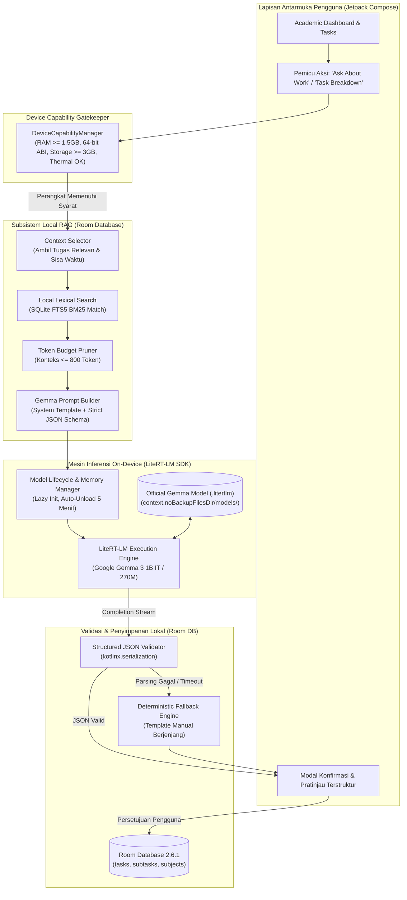
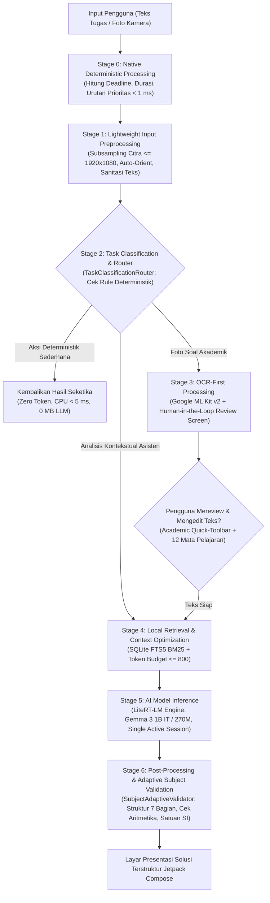
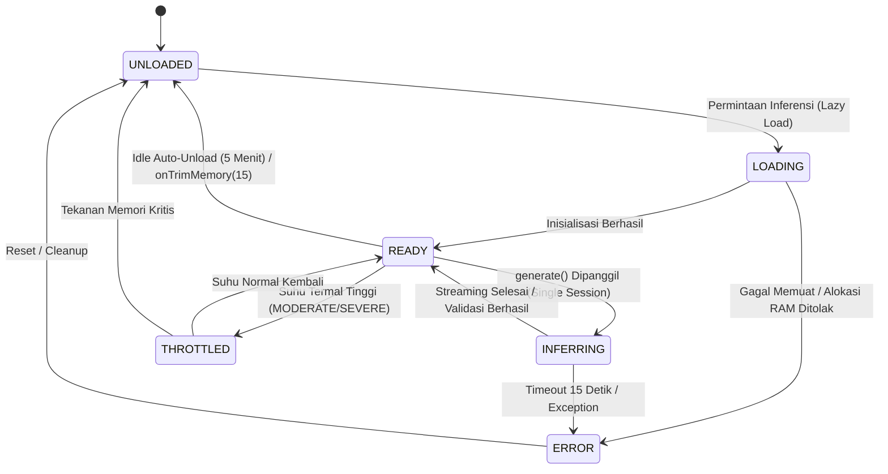

# Arsitektur Kecerdasan Buatan On-Device (On-Device AI Architecture) — KerjaiAja
## Google Gemma via LiteRT-LM · Local RAG FTS5 · Zero External AI API · Task-Contextual Assistant

Dokumen ini mendefinisikan arsitektur teknis kecerdasan buatan (**AI Architecture**) untuk platform **KerjaiAja** berbasis **On-Device AI Inference** menggunakan model **Google Gemma (Gemma 3 1B IT / Gemma 270M)** dan runtime resmi **Google AI Edge LiteRT-LM** di Android Native, diperkuat oleh **Local RAG (SQLite FTS5 BM25)**.

---

## 1. Prinsip Utama & Kebijakan Kedaulatan Data Mutlak

1. **Dual Experience Architecture:**
   - **Mode A (Produktivitas Penuh Tanpa AI):** Menjadi fondasi default. Aplikasi 100% fungsional dan lengkap tanpa model AI.
   - **Mode B (Asisten Kerja On-Device Gemma Opsional):** Berjalan opsional di perangkat yang memenuhi kualifikasi hardware.
2. **100% On-Device Inference:**  
   Seluruh komputasi AI dieksekusi secara lokal pada CPU, GPU, atau NPU perangkat ponsel pengguna. KerjaiAja **DILARANG KERAS** memanggil API eksternal (Gemini API, OpenAI API, Anthropic API, Groq, Hugging Face, atau cloud server pribadi dilarang mutlak).
3. **Bukan Chatbot Generik (Task-Contextual Assistant):**  
   Dilarang menyediakan fitur obrolan terbuka tanpa batas. AI beroperasi secara kontekstual hanya untuk 5 ranah kerja:
   - *Ask About My Work* (Tanya beban dan status tugasku)
   - *Task Breakdown* (Dekomposisi tugas besar menjadi sub-tugas)
   - *Smart Planning* (Saran alokasi blok waktu belajar)
   - *Contextual Recommendations* (Saran tindakan prioritas berikutnya)
   - *Work Review* (Pemeriksaan kelengkapan checklist pra-pengumpulan)
4. **Pemisahan Peran Deterministik vs AI:**  
   Algoritma deterministik 0–100 dan kalkulasi waktu menjadi sumber kebenaran utama. AI bertindak sebagai penganalisis semantik yang memperkaya konteks dengan penjelasan yang dapat dipahami mahasiswa (*explainable rationale*).
5. **Decoupled Model Weights & Zero Supabase Storage:**  
   Bobot model AI dipisahkan dari APK dan **DILARANG** disimpan di Supabase Storage. Model diunduh langsung dari CDN resmi Google AI Edge / Hugging Face.

---

## 2. Diagram Topologi Arsitektur On-Device AI



---

## 3. Rincian Komponen Mesin Inferensi (`com.kerjaiaja.app.ai`)

### 3.1 Abstraksi Engine (`AiEngine.kt`)
Sistem mengisolasi implementasi runtime Google di balik interface bersih agar mudah diuji:
```kotlin
sealed interface ModelStatus {
    object NotDownloaded : ModelStatus
    data class Downloading(val progressPercent: Int) : ModelStatus
    object VerifyingChecksum : ModelStatus
    object Ready : ModelStatus
    data class Incompatible(val reason: String) : ModelStatus
    data class Error(val message: String) : ModelStatus
}

interface AiEngine {
    val status: StateFlow<ModelStatus>
    suspend fun initialize(modelFile: File): Result<Unit>
    suspend fun generate(prompt: String): Result<String>
    fun isReady(): Boolean
    fun close()
}
```

### 3.2 Siklus Hidup Memori Transien & Auto-Unload
1. **Lazy Loading:** Model tidak dimuat ke RAM saat aplikasi dibuka. Model dimuat saat pengguna pertama kali berinteraksi dengan Asisten Kerja.
2. **Auto-Unload:** Jika tidak ada interaksi selama 5 menit berturut-turut, instance model otomatis ditutup (`engine.close()`) untuk mengembalikan alokasi RAM (~600MB–1.2GB) ke sistem operasi.
3. **Proteksi Low Memory Killer (LMK):** Mendaftarkan listener `ComponentCallbacks2.onTrimMemory()`. Jika terdeteksi tekanan memori sistem kritis, runtime AI segera ditutup.

---

## 4. Evaluasi Model: Gemma 3 1B IT vs Gemma 270M

| Kriteria Evaluasi | **Gemma 3 1B IT** *(Kandidat Utama)* | **Gemma 270M** *(Kandidat Ultra-Ringan)* |
| :--- | :---: | :---: |
| **Target Perangkat** | Ponsel RAM $\ge 6\text{ GB}$ (Snapdragon 7/8 / Tensor) | Ponsel RAM 4 GB (Entry-Level / Low Memory) |
| **Ukuran Berkas (.litertlm)** | **~750 – 950 MB** (INT4 Quantized) | **~250 – 350 MB** (INT4 Quantized) |
| **Alokasi RAM Runtime** | **~850 MB – 1.15 GB** | **~350 MB – 500 MB** |
| **Kepatuhan JSON Schema** | Sangat Tinggi ($\ge 97\%$) | Cukup Baik ($\ge 88\%$, perlu sanitizer) |
| **Kecepatan Inferensi** | 8–16 token/detik (GPU/NPU) | 15–25 token/detik (CPU) |
| **Lisensi Distribusi** | Google Gemma Terms of Use | Google Gemma Terms of Use |

---

## 5. Tata Kelola Unduhan Bobot Model (`ModelDownloadManager`)

1. **Persetujuan Sadar Pengguna:** Model hanya diunduh jika pengguna secara eksplisit mengaktifkannya di menu Pengaturan.
2. **Pra-Syarat Unduhan:**
   - Evaluasi hardware `DeviceCapabilityManager` berstatus `RECOMMENDED` atau `LIMITED`.
   - Ruang penyimpanan internal bebas $\ge 3.0\text{ GB}$.
   - Opsi default unduh hanya via Wi-Fi.
   - Status baterai $\ge 30\%$ atau terhubung ke pengisi daya.
3. **Verifikasi Checksum SHA-256:** Setelah unduhan selesai, sistem mencocokkan hash SHA-256 berkas biner terhadap nilai resmi sebelum mengubah status model menjadi `READY`.
4. **Opsi Hapus Seketika:** Pengguna dapat menghapus berkas model kapan saja untuk membebaskan ruang disk tanpa memengaruhi data tugas pribadi.

---

## 6. Progressive AI Processing Pipeline (Arsitektur 7 Tahap)

Sesuai dengan prinsip utama **ADR-033: Progressive AI Processing Pipeline**, sistem menganut doktrin: *"Lakukan sebanyak mungkin dengan pemrosesan deterministik ringan sebelum memanggil model AI."*



### Rincian 7 Tahap Pemrosesan:
1. **Stage 0: Native Deterministic Processing**
   - Menghitung tenggat waktu, estimasi durasi, sorting prioritas tugas (skor 0–100), dan validasi form lokal.
   - Selesai dalam $< 1\text{ ms}$ tanpa alokasi memori AI.
2. **Stage 1: Lightweight Input Preprocessing**
   - Teks: Normalisasi spasi, strip karakter tak terlihat, validasi batas panjang.
   - Citra: Downsampling adaptif ke resolusi target maksimal $1920 \times 1080$ piksel, auto-orientasi EXIF, deteksi blur (varian Laplacian), dan pembersihan memori transien.
3. **Stage 2: Task Classification and Intelligent Routing (`TaskClassificationRouter`)**
   - Router aturan murni deterministik berbasis kata kunci, pola kalimat, dan konteks aktif.
   - Memutuskan apakah suatu input memerlukan LLM atau dapat diselesaikan deterministik 100% tanpa komputasi saraf.
4. **Stage 3: OCR-First Processing (Photo Question Solver Pipeline)**
   - Ekstraksi teks citra menggunakan Google ML Kit Text Recognition v2.
   - Menyajikan Layar Human-in-the-Loop Review sebelum inferensi LLM dijalankan, dilengkapi *Academic Quick-Toolbar* (simbol $\sqrt{}, \int, \pi, \alpha, \pm, \approx, \le, \ge$) dan pemilih 12 rumpun mata pelajaran.
5. **Stage 4: Local Retrieval and Context Optimization (Local RAG)**
   - Mengambil materi pendukung, catatan tugas, dan rumus relevan dari database Room lokal via SQLite FTS5 BM25.
   - Melakukan *token pruning* dengan batasan ketat konteks $\le 800$ token untuk menghemat latensi dan memori.
6. **Stage 5: AI Model Inference (`LiteRT-LM`)**
   - Menjalankan inferensi model on-device (Gemma 3 1B IT atau Gemma 270M) dalam isolasi *single active session* dengan batas waktu (timeout) 15 detik.
7. **Stage 6: Post-Processing and Adaptive Subject Validation (`SubjectAdaptiveValidator`)**
   - Memvalidasi solusi agar mematuhi struktur 7 bagian adaptif: Judul, Rumpun Mata Pelajaran, Konsep Inti, Diketahui/Ditanya, Langkah Penyelesaian Terinci, Verifikasi & Cek Akal Sehat, serta Jawaban Akhir.
   - Menjalankan verifikasi deterministik aritmetika (evaluasi persamaan angka dasar) dan konsistensi satuan SI (misal: $\text{kg}, \text{m/s}^2, \text{Joule}$) untuk rumpun Eksakta.

---

## 7. State Machine Siklus Hidup Model & Manajemen Memori (`ModelLifecycleManager`)

Sesuai **ADR-034: On-Device Model Lifecycle and Memory Management**:



### Safeguards Memori & Eksekusi:
- **Single Active Session Guard:** Menggunakan `Mutex` Kotlin untuk mencegah eksekusi ganda bersamaan. Permintaan inferensi baru ditolak atau diantrekan secara tegas jika inferensi sedang berlangsung.
- **Inference Timeout (15 Detik):** Menghentikan paksa inferensi yang melampaui 15 detik untuk melindungi CPU/GPU dari *infinite loop* atau degradasi performa perangkat.
- **Idle Auto-Unload (5 Menit):** Timer otomatis melepaskan bobot model dari memori RAM setelah 5 menit tidak ada interaksi, mengembalikan footprint RAM aplikasi ke $\le 80\text{ MB}$.
- **Low Memory Killer (LMK) Callback:** Mengintegrasikan `ComponentCallbacks2.onTrimMemory(level)`. Jika `level >= TRIM_MEMORY_RUNNING_CRITICAL` (15), sistem segera memicu `unload()` darurat.

---

## 8. Kepatuhan Standar & Referensi Putusan Arsitektur

Arsitektur AI KerjaiAja berakar langsung pada Architectural Decision Records (ADR):
- [ADR-013: Mode A vs Mode B Dual Experience Architecture](file:///home/ahmadbadawi/Documents/CodinganKu/Android/KerjaiAja/docs/decisions/adr/ADR-013-DUAL-EXPERIENCE-MODE-A-MODE-B.md)
- [ADR-014: On-Device AI via LiteRT-LM & Google Gemma](file:///home/ahmadbadawi/Documents/CodinganKu/Android/KerjaiAja/docs/decisions/adr/ADR-014-ON-DEVICE-AI-LITERTLM-GEMMA.md)
- [ADR-015: SQLite FTS5 BM25 untuk Local RAG](file:///home/ahmadbadawi/Documents/CodinganKu/Android/KerjaiAja/docs/decisions/adr/ADR-015-SQLITE-FTS5-LOCAL-RAG.md)
- [ADR-016: Zero External AI API & Absolute Privacy](file:///home/ahmadbadawi/Documents/CodinganKu/Android/KerjaiAja/docs/decisions/adr/ADR-016-ZERO-EXTERNAL-AI-API.md)
- [ADR-017: Multi-Factor Device Capability Evaluation](file:///home/ahmadbadawi/Documents/CodinganKu/Android/KerjaiAja/docs/decisions/adr/ADR-017-DEVICE-CAPABILITY-MANAGEMENT.md)
- [ADR-022: Photo Question Solver Architecture with Dual Pipeline](file:///home/ahmadbadawi/Documents/CodinganKu/Android/KerjaiAja/docs/decisions/adr/ADR-022-PHOTO-QUESTION-SOLVER-ARCHITECTURE.md)
- [ADR-033: Progressive AI Processing Pipeline](file:///home/ahmadbadawi/Documents/CodinganKu/Android/KerjaiAja/docs/decisions/adr/ADR-033-PROGRESSIVE-AI-PROCESSING-PIPELINE.md)
- [ADR-034: On-Device Model Lifecycle & Memory Management](file:///home/ahmadbadawi/Documents/CodinganKu/Android/KerjaiAja/docs/decisions/adr/ADR-034-ON-DEVICE-MODEL-LIFECYCLE-AND-MEMORY-MANAGEMENT.md)
- [ADR-035: Per-Model Device Capability Evaluation](file:///home/ahmadbadawi/Documents/CodinganKu/Android/KerjaiAja/docs/decisions/adr/ADR-035-PER-MODEL-DEVICE-CAPABILITY-EVALUATION.md)

