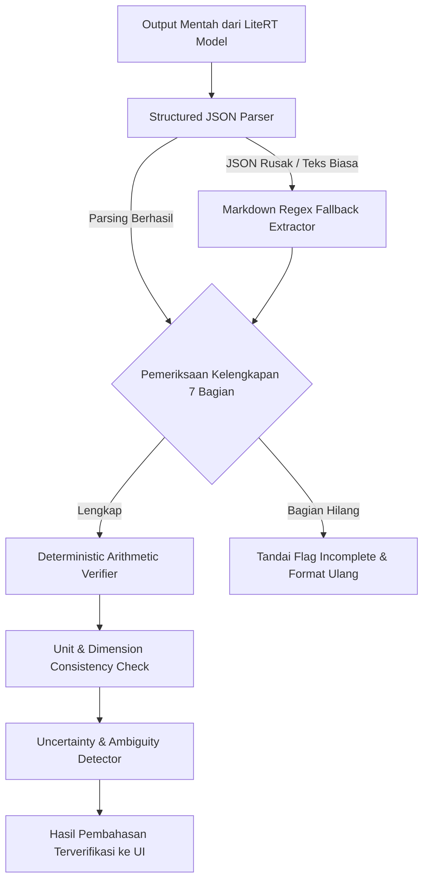

# Validasi Output AI & Quality Control Akademik
## KerjaiAja — Academic Solution Validation Layer

Dokumen ini mendefinisikan arsitektur validasi dan kendali mutu keluaran model AI (*Answer Validation Layer*) untuk fitur **Foto Soal & Pembahasan** pada KerjaiAja. Validasi ini memastikan setiap pembahasan yang diterima pelajar bersifat runtut, akurat, terverifikasi secara deterministik, dan bebas dari halusinasi aritmetika.

---

## 1. Filosofi Validasi: AI Menjelaskan, Kode Deterministik Memverifikasi

Model bahasa kecil (*Small Language Models* seperti Gemma 3 1B IT atau 270M) memiliki keunggulan luar biasa dalam memahami bahasa alami dan menjelaskan konsep akademik. Namun, LLM secara inheren **bukanlah kalkulator aritmetika** dan rentan mengalami halusinasi pada perhitungan numerik bertingkat.

Oleh karena itu, KerjaiAja memisahkan peran:
- **Model AI (Generatif)**: Bertugas memetakan konsep, memilih rumus yang relevan, menyusun narasi langkah demi langkah, dan menyajikan argumen logis.
- **Answer Validation Layer (Deterministik - Kode Kotlin)**: Bertugas memvalidasi kelengkapan 7 bagian struktur, mengecek sintaks matematika, memverifikasi konsistensi aritmetika, serta mendeteksi ambiguitas atau ketidakpastian.

---

## 2. Struktur Mandatori 7 Bagian Pembahasan

Setiap solusi yang dihasilkan wajib mematuhi skema terstruktur 7 bagian:

```json
{
  "questionIdentification": "Menentukan besar gaya normal pada balok di bidang miring licin.",
  "givenInformation": [
    "Massa balok (m) = 5 kg",
    "Sudut kemiringan (θ) = 30°",
    "Percepatan gravitasi (g) = 10 m/s²",
    "Kondisi bidang = Licin (koefisien gesek μ = 0)"
  ],
  "questionTarget": "Besar gaya normal (N) yang bekerja pada balok.",
  "conceptsAndFormulas": [
    "Hukum I Newton pada sumbu tegak lurus bidang miring: ΣFy = 0",
    "Rumus gaya normal bidang miring: N = m * g * cos(θ)"
  ],
  "stepByStepSolution": [
    "Uraikan komponen gaya gravitasi yang bekerja tegak lurus terhadap bidang miring, yaitu W_y = m * g * cos(θ).",
    "Substitusikan nilai yang diketahui ke dalam persamaan: N = 5 kg * 10 m/s² * cos(30°).",
    "Hitung nilai berat: W = 50 N.",
    "Nilai cos(30°) adalah 0.5 * √3 ≈ 0.866.",
    "Kalikan kedua nilai: N = 50 * 0.866 = 43.3 N (atau 25√3 N)."
  ],
  "finalAnswer": "N = 25√3 N atau 43,3 Newton",
  "verificationAndCheck": "Karena bidang miring membentuk sudut 30° dengan bidang horizontal, gaya normal harus lebih kecil dari gaya berat penuh (W = 50 N). Nilai 43.3 N konsisten secara fisika (N < W).",
  "uncertaintyFlag": false,
  "confidenceScore": 0.95
}
```

---

## 3. Komponen Answer Validation Layer



### 1. Structured JSON Parser & Fallback
- Model diinstruksikan menghasilkan keluaran JSON terstruktur.
- Parser Kotlin mencoba melakukan *deserialization* ke dalam data class `StructuredSolution`.
- **Graceful Fallback**: Jika model menghasilkan teks narasi bebas (akibat token limit atau prompt formatting error), modul `MarkdownRegexExtractor` menggunakan ekspresi reguler untuk mengelompokkan teks ke dalam 7 bagian berdasarkan header (misalnya `# 1. Identifikasi Soal`, dsb.), sehingga antarmuka pengguna tidak pernah mengalami *crash* atau menampilkan layar kosong.

### 2. Deterministic Arithmetic Verifier
- Memindai setiap langkah pada `stepByStepSolution` yang memuat relasi persamaan aritmetika sederhana dalam format `A [operator] B = C`.
- Kode Kotlin mengevaluasi kebenaran matematika ekspresi tersebut secara independen:
  ```kotlin
  fun verifyBasicArithmetic(expression: String): Boolean {
      // Mengekstrak pola angka operator angka = hasil
      // Memvalidasi apakah evaluasi kode sesuai dengan hasil yang ditulis LLM
  }
  ```
- Jika terdeteksi perbedaan kalkulasi (misal LLM menulis $7 \times 8 = 54$), validator menyuntikkan catatan perbaikan otomatis: *"[Koreksi Otomatis: 7 × 8 = 56]"* dan menurunkan skor keyakinan (*confidence*).

### 3. Unit & Dimension Consistency Check
- Memastikan satuan pada `givenInformation` kompatibel dengan satuan pada `finalAnswer`.
- Contoh: Jika informasi yang diketahui menggunakan satuan sentimeter ($cm$) dan detik ($s$), sedangkan jawaban akhir dalam meter per detik ($m/s$), validator memeriksa apakah terdapat langkah konversi satuan ($\div 100$) di dalam `stepByStepSolution`.

### 4. Uncertainty & Ambiguity Detector (Penanda Ketidakpastian)
- Memindai frasa yang mengindikasikan informasi soal tidak lengkap atau teks OCR cacat, seperti:
  - *"Informasi nilai x tidak disertakan dalam soal"*
  - *"Asumsi nilai g tidak diketahui, menggunakan g = 9.8 m/s²"*
  - *"Teks terpotong pada baris ketiga"*
- Jika frasa ini terdeteksi, atribut `uncertaintyFlag` disetel ke `true`, dan UI menampilkan banner edukasi berwarna biru:
  *"Perhatian: Model mendeteksi terdapat asumsi tambahan karena sebagian data soal mungkin belum lengkap. Silakan teliti kembali langkah penyelesaian."*

---

## 4. Spesifikasi Kontrak Data Class Kotlin

```kotlin
package com.kerjaiaja.app.core.solver

data class StructuredSolution(
    val questionIdentification: String,
    val givenInformation: List<String>,
    val questionTarget: String,
    val conceptsAndFormulas: List<String>,
    val stepByStepSolution: List<String>,
    val finalAnswer: String,
    val verificationAndCheck: String,
    val uncertaintyFlag: Boolean = false,
    val uncertaintyReason: String? = null,
    val confidenceScore: Float = 1.0f
) {
    fun isValid(): Boolean {
        return questionIdentification.isNotBlank() &&
               givenInformation.isNotEmpty() &&
               questionTarget.isNotBlank() &&
               conceptsAndFormulas.isNotEmpty() &&
               stepByStepSolution.isNotEmpty() &&
               finalAnswer.isNotBlank() &&
               verificationAndCheck.isNotBlank()
    }
}
```

---

## 5. Ringkasan Kriteria Keberhasilan Validasi

1. **Kelengkapan Skema**: 100% dari 7 bagian wajib terisi konten bermakna ($> 3$ karakter).
2. **Ketahanan UI**: 0% kejadian crash antarmuka akibat kesalahan format keluaran AI.
3. **Peringatan Halusinasi**: Notifikasi jelas kepada pengguna apabila ditemukan ketidakkonsistenan aritmetika atau teks yang tidak lengkap.
