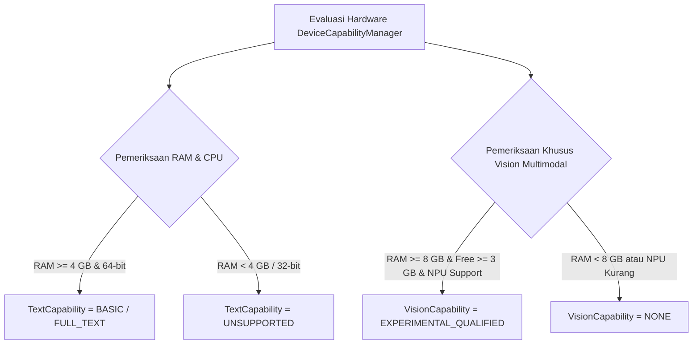

# STRATEGI MANAJEMEN KAPABILITAS PERANGKAT (DEVICE CAPABILITY) — KERJAIAJA
## Kualifikasi Hardware Multi-Faktor untuk Inferensi AI On-Device yang Aman

**Dokumen:** `docs/ai/DEVICE_CAPABILITY_STRATEGY.md`  
**Status:** Baseline Disetujui  
**Target:** Android Native (API 26+)  
**Komponen Inti:** `DeviceCapabilityManager.kt`

---

## 1. Filosofi & Tujuan

Inferensi model bahasa besar (LLM) di perangkat bergerak menuntut alokasi RAM yang besar, kapasitas komputasi CPU/GPU/NPU yang tinggi, dan memicu pelepasan panas termal. KerjaiAja menerapkan kebijakan **Safety & Stability First**:
- Pengalaman pengguna aplikasi produktivitas tidak boleh terganggu oleh lag atau freeze.
- Perangkat tidak boleh mengalami kehabisan memori ekstrem (*Out-of-Memory / OOM crash*).
- Baterai ponsel tidak boleh terkuras secara tidak wajar.
- Pengguna berhak mengetahui secara transparan kapasitas perangkat mereka sebelum mengunduh model.

---

## 2. Parameter Evaluasi Multi-Faktor

Modul `DeviceCapabilityManager` memeriksa 5 parameter penting secara dinamis:

| Parameter | Ambang Batas Minimum | Metode Pemeriksaan Android |
| :--- | :--- | :--- |
| **Total RAM** | $\ge 4.0\text{ GB}$ (Ideal $\ge 6.0\text{ GB}$) | `ActivityManager.MemoryInfo.totalMem` |
| **Available RAM** | $\ge 1.5\text{ GB}$ (Free mem saat idle) | `ActivityManager.MemoryInfo.availMem` & `lowMemory` flag |
| **CPU Architecture** | Wajib 64-bit ABI (`arm64-v8a`, `x86_64`) | `Build.SUPPORTED_ABIS` |
| **Available Storage**| $\ge 3.0\text{ GB}$ (Internal memory) | `StatFs(context.filesDir.path).availableBytes` |
| **Thermal Status** | Bukan `SEVERE` atau `CRITICAL` | `PowerManager.getThermalStatus()` (API 29+) |
| **Battery Status** | Daya $\ge 30\%$ atau sedang diisi | `BatteryManager.EXTRA_LEVEL` / `EXTRA_STATUS` |

---

## 3. Klasifikasi Tingkatan Perangkat (Device Tiers)

Berdasarkan evaluasi di atas, perangkat dikelompokkan ke dalam salah satu dari empat tingkatan:

### 1. `RECOMMENDED` (Sangat Direkomendasikan)
- **Spesifikasi:** Total RAM $\ge 6\text{ GB}$, RAM Bebas $\ge 2.5\text{ GB}$, Storage Bebas $\ge 5\text{ GB}$, 64-bit CPU.
- **Konfigurasi AI:**
  - Model: Google Gemma 3 1B IT (Quantized INT4 / LiteRT-LM).
  - Akselerasi: GPU / NPU didukung via OpenCL / Vulkan delegate.
  - Context Window: 1,024 – 2,048 token.
  - Performa Estimasi: 8–18 token/detik.
  - Status UI: Tombol unduh model tersedia dengan label *"Perangkat Sangat Optimal"*.

### 2. `LIMITED` (Terbatas / Mode Ringan)
- **Spesifikasi:** Total RAM $4\text{ GB} - 6\text{ GB}$, RAM Bebas $1.2\text{ GB} - 2.5\text{ GB}$, Storage Bebas $\ge 3\text{ GB}$.
- **Konfigurasi AI:**
  - Model: Google Gemma 270M (Ultra-ringan) atau Gemma 1B CPU-only.
  - Akselerasi: CPU Threading (2–4 core).
  - Context Window: Terbatas pada 512 token.
  - Performa Estimasi: 3–7 token/detik.
  - Status UI: Tombol unduh tersedia dengan peringatan performa sedang.

### 3. `NOT_RECOMMENDED` (Kurang Disarankan)
- **Spesifikasi:** Total RAM $< 4\text{ GB}$ atau RAM Bebas $< 1.0\text{ GB}$.
- **Perlakuan:**
  - Opsi unduh model dinonaktifkan secara default.
  - Pengguna melihat penjelasan: *"Perangkat Anda memiliki memori terbatas. Mengaktifkan AI dapat menyebabkan aplikasi lambat atau baterai cepat habis."*
  - Pengguna diarahkan untuk menikmati **Mode A (Produktivitas Penuh Tanpa AI)** yang 100% cepat dan hemat baterai.

### 4. `UNSUPPORTED` (Tidak Didukung)
- **Spesifikasi:** Perangkat 32-bit (`armeabi-v7a`), storage bebas $< 2\text{ GB}$, atau OS Android di bawah Android 10.
- **Perlakuan:**
  - Opsi unduh model diblokir permanen dengan alasan teknis yang transparan.

---

## 4. Pemisahan Kapabilitas: TextCapability vs VisionCapability

Dengan hadirnya fitur **Foto Soal & Pembahasan**, KerjaiAja memisahkan evaluasi kapabilitas menjadi dua dimensi independen:

### 1. `TextCapability` (Jalur A - OCR & Model Teks)
- Menggerakkan fitur Asisten Kerja umum dan **Foto Soal & Pembahasan Jalur A** (ML Kit OCR + Gemma 3 1B IT / 270M).
- Tingkatan: `BASIC_TEXT` (270M untuk RAM 4–5 GB), `FULL_TEXT` (1B IT untuk RAM $\ge 6\text{ GB}$), atau `UNSUPPORTED`.
- Kompatibilitas luas: dapat dinikmati oleh $>70\%$ pengguna smartphone modern.

### 2. `VisionCapability` (Jalur B - Multimodal Vision Lab)
- Menggerakkan model multimodal **Gemma 3n E2B** untuk membaca langsung diagram geometri atau grafik kurva tanpa OCR terpisah.
- Tingkatan: `EXPERIMENTAL_QUALIFIED` atau `NONE`.
- Persyaratan Wajib: RAM total $\ge 8.0\text{ GB}$, RAM bebas saat inisialisasi $\ge 3.0\text{ GB}$, penyimpanan internal kosong $\ge 5.0\text{ GB}$, dan akselerasi GPU/NPU aktif.
- Jika tidak memenuhi kualifikasi visual, pengguna tetap dapat menikmati Jalur A secara penuh tanpa batasan fungsionalitas soal teks.

---

## 5. Perlindungan Runtime (Runtime Throttling & Safeguards)

Saat model AI sedang aktif di memori:
1. **Thermal Guard:** Jika listener termal melaporkan status meningkat ke `THERMAL_STATUS_MODERATE` atau lebih tinggi, inferensi yang sedang berjalan dibatasi (*throttled*), dan permintaan inferensi baru ditunda.
2. **Low Memory Trim:** Saat sistem Android memicu `onTrimMemory(TRIM_MEMORY_RUNNING_CRITICAL)`, engine LiteRT-LM segera membebaskan context cache atau melepaskan instance model dari RAM untuk menghindari crash.
3. **Model Auto-Unload:** Jika tidak ada interaksi Asisten Kerja selama 5 menit berturut-turut, model weights otomatis di-unload dari RAM untuk mengembalikan konsumsi memori ke level normal (~60–80 MB).

---

## 6. Evaluasi Per-Model & Dialog Transparansi (ADR-035)

Sesuai **ADR-035: Per-Model Device Capability Evaluation**, aplikasi tidak menggunakan satu status kelayakan global tunggal, melainkan mengevaluasi kelayakan perangkat secara granular per-kemampuan dan per-model:

| Model / Kemampuan | RAM Fisik Min. | RAM Bebas Min. | Storage Min. | SoC / Arsitektur | Keterangan Ketersediaan |
| :--- | :---: | :---: | :---: | :---: | :--- |
| **ML Kit OCR v2** | 2.0 GB | 150 MB | 100 MB | Any 32/64-bit | Tersedia di semua perangkat Android 8.0+ |
| **Gemma 270M INT4** | 4.0 GB | 1.2 GB | 2.0 GB | 64-bit CPU (4 cores) | Tersedia untuk perangkat `LIMITED` |
| **Gemma 3 1B IT INT4** | 6.0 GB | 2.5 GB | 3.5 GB | 64-bit GPU/NPU OpenCL | Sangat direkomendasikan (`RECOMMENDED`) |
| **Gemma 3n E2B (Lab)** | 8.0 GB | 3.0 GB | 5.0 GB | NPU Hardware Delegated | Khusus `EXPERIMENTAL_QUALIFIED` |

### Dialog Transparansi Spesifikasi Pengguna:
Pengguna dapat membuka dialog *Status Kapabilitas Perangkat* di halaman Pengaturan AI untuk melihat:
- Total RAM dan RAM bebas aktual yang terdeteksi.
- Sisa ruang penyimpanan internal.
- Status arsitektur prosesor (64-bit vs 32-bit).
- Model-model yang memenuhi syarat untuk diunduh beserta rekomendasi tier.
- Tombol aksi: Unduh (hanya jika eligible), Verifikasi Checksum SHA-256, atau Hapus Bobot Model.

---

## 7. Referensi Dokumen & ADR Terkait

- [Dokumentasi Lengkap: Device Capability Manager](file:///home/ahmadbadawi/Documents/CodinganKu/Android/KerjaiAja/docs/architecture/DEVICE_CAPABILITY_MANAGER.md)
- [ADR-017: Multi-Factor Device Capability Management](file:///home/ahmadbadawi/Documents/CodinganKu/Android/KerjaiAja/docs/decisions/adr/ADR-017-DEVICE-CAPABILITY-MANAGEMENT.md)
- [ADR-034: On-Device Model Lifecycle & Memory Management](file:///home/ahmadbadawi/Documents/CodinganKu/Android/KerjaiAja/docs/decisions/adr/ADR-034-ON-DEVICE-MODEL-LIFECYCLE-AND-MEMORY-MANAGEMENT.md)
- [ADR-035: Per-Model Device Capability Evaluation](file:///home/ahmadbadawi/Documents/CodinganKu/Android/KerjaiAja/docs/decisions/adr/ADR-035-PER-MODEL-DEVICE-CAPABILITY-EVALUATION.md)

