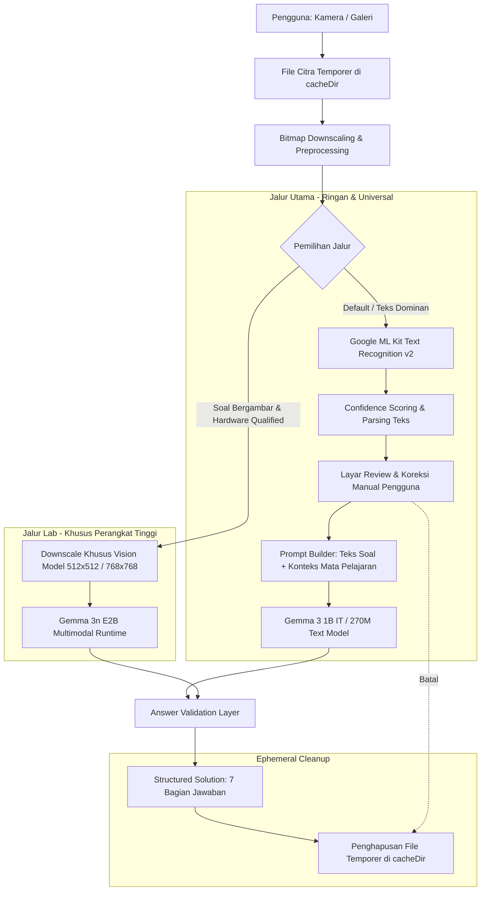

# Arsitektur Pemrosesan Citra (Image Processing Architecture)
## KerjaiAja — On-Device Ephemeral Processing Pipeline

Dokumen ini mendefinisikan arsitektur dan alur kerja pemrosesan citra untuk fitur **Foto Soal & Pembahasan** pada aplikasi KerjaiAja. Seluruh pemrosesan dilakukan secara lokal di perangkat Android (*on-device*), bersifat efemeral (*ephemeral*), dan mengutamakan efisiensi memori serta privasi pengguna.

---

## 1. Prinsip Fundamental Pemrosesan Citra

1. **100% On-Device & Ephemeral**: Citra foto soal tidak pernah diunggah ke server cloud (termasuk Supabase Storage), tidak dikirim ke API pihak ketiga, dan tidak disimpan permanen di perangkat pengguna kecuali diekspor secara eksplisit oleh pengguna.
2. **Efisiensi Alokasi Memori (Anti-OOM)**: Citra beresolusi tinggi dari sensor kamera modern (12 MP – 108 MP) tidak boleh dimuat secara mentah ke dalam RAM Android. Citra harus di-*downsample* secara proporsional ke resolusi optimal OCR (maksimal 1920x1080) sebelum diproses.
3. **Pemisahan Pipeline Jalur A (OCR-First) dan Jalur B (Vision Multimodal)**:
   - **Jalur A (Default - Universal)**: Ekstraksi teks melalui Google ML Kit Text Recognition v2 $\rightarrow$ Peninjauan pengguna (*Human-in-the-loop*) $\rightarrow$ Model Teks Gemma 3 (1B IT / 270M).
   - **Jalur B (Laboratorium - Khusus Perangkat Tinggi)**: Inferensi citra langsung via model multimodal on-device (`Gemma 3n E2B`) untuk soal dengan diagram, grafik, atau geometri yang tidak dapat dibaca teks saja.
4. **Human-in-the-loop Editing**: Pengguna memiliki kontrol penuh untuk memotong (*crop*), merotasi (*rotate*), mengambil ulang (*retake*), dan mengoreksi teks hasil OCR sebelum dikirim ke inferensi AI.

---

## 2. Diagram Pipeline Pemrosesan Citra



---

## 3. Tahapan Rinci Pemrosesan Citra

### Tahap 1: Pengambilan Citra (Capture & Ingestion)
- **Kamera**: Menggunakan Jetpack CameraX untuk stabilitas, *lifecycle-awareness*, dan konsistensi pada berbagai variasi vendor Android. Mengaktifkan *tap-to-focus* dan indikator grid panduan bingkai dokumen.
- **Galeri**: Menggunakan *Photo Picker* modern Android (`ActivityResultContracts.PickVisualMedia`) tanpa memerlukan izin penyimpanan berlebih (`READ_EXTERNAL_STORAGE` tidak diperlukan pada Android 13+).
- **Lokasi File Sementara**: File disimpan di direktori internal cache:
  ```
  context.cacheDir/temp_solver/<uuid>.jpg
  ```
  Direktori ini diproteksi oleh *Android sandbox isolation* sehingga tidak dapat diakses aplikasi lain.

### Tahap 2: Preprocessing & Alokasi Memori
1. **Subsampling Bitmap (Mencegah OOM)**:
   - Gunakan `BitmapFactory.Options.inJustDecodeBounds = true` untuk membaca dimensi asli gambar tanpa mengalokasikan memori piksel.
   - Hitung rasio `inSampleSize` agar resolusi terpanjang tidak melebihi 1920 piksel.
   - Konfigurasi `inPreferredConfig = Bitmap.Config.ARGB_8888` atau `Bitmap.Config.RGB_565` (menghemat 50% memori untuk grayscale/OCR).
2. **Auto-Orientation & EXIF Correction**:
   - Membaca metadata EXIF (`ExifInterface.TAG_ORIENTATION`) dan menerapkan transformasi matriks agar orientasi gambar selalu tegak lurus sesuai perspektif membaca manusia.
3. **Contrast & Binarization Optimization**:
   - Menerapkan penajaman kontras adaptif (*local adaptive thresholding*) pada tingkat ringan untuk mempertegas tulisan hitam di atas kertas putih serta mereduksi bayangan jari atau pencahayaan ruangan yang tidak merata.

### Tahap 3: Interaksi UI (Crop, Rotate, Retake)
- **Crop**: Pengguna dapat menyesuaikan kotak batas (*bounding box*) untuk mengisolasi hanya nomor soal yang ingin diselesaikan, membuang soal di atas/bawahnya serta margin buku yang tidak relevan.
- **Rotate**: Tombol rotasi 90 derajat searah jarum jam untuk membetulkan orientasi buku miring.
- **Retake**: Membuang citra saat ini dan membuka kembali jendela CameraX jika hasil foto buram.

### Tahap 4: Eksekusi OCR (Jalur A)
- Citra hasil *crop* dikirim ke `com.google.mlkit:text-recognition` (Latin Script).
- ML Kit berjalan secara asinkron pada background thread (`Dispatchers.Default`).
- Menghasilkan daftar blok teks, baris kalimat, dan kata dengan nilai probabilitas keyakinan (*confidence score*).
- Jika *confidence score* rata-rata $< 0.70$ atau teks terdeteksi $< 5$ kata, sistem menampilkan saran (*hint*) ke pengguna: *"Teks tampak buram atau kurang jelas. Silakan periksa kembali atau ambil ulang foto."*

### Tahap 5: Human-in-the-Loop Review & Subject Selection
- Teks hasil OCR ditampilkan di dalam komponen `OutlinedTextField` yang dapat diedit langsung oleh siswa.
- Siswa dapat memperbaiki typo karakter, menambahkan tanda pangkat matematika ($x^2$), pecahan ($a/b$), atau simbol satuan ($m/s^2$) yang salah dikenali OCR.
- Siswa memilih rumpun mata pelajaran (12 Rumpun Mata Pelajaran KerjaiAja) melalui filter chips interaktif guna menyuntikkan *system prompt context* yang spesifik.

### Tahap 6: Inferensi AI & Pembersihan Efemeral
- Teks terkurasi diformat ke dalam template instruksi terstruktur dan dikirim ke mesin inferensi on-device (LiteRT-LM).
- Segera setelah inferensi selesai atau ketika pengguna meninggalkan layar pembahasan:
  ```kotlin
  fun cleanupEphemeralImage(tempFile: File) {
      if (tempFile.exists()) {
          tempFile.delete()
      }
  }
  ```
- File temporer dipastikan bersih dari `cacheDir` tanpa meninggalkan jejak byte citra di media penyimpanan internal.

---

## 4. Parameter Batasan Sumber Daya (Resource Budget)

| Parameter | Batas Maksimum | Keterangan |
| :--- | :--- | :--- |
| **Resolusi Input Mentah** | Tidak terbatas | Ditampung di stream kamera |
| **Resolusi Bitmap di Memori** | $1920 \times 1080$ piksel | Dibatasi via `inSampleSize` |
| **Alokasi RAM Bitmap** | Maksimal 8.3 MB | Pada format ARGB_8888 |
| **Latensi Preprocessing** | $< 150\text{ ms}$ | Diukur pada prosesor ARMv8 mid-range |
| **Latensi ML Kit OCR** | $< 350\text{ ms}$ | Berjalan di CPU/NNAPI on-device |
| **Masa Hidup File Citra** | Efemeral | Dihapus seketika saat sesi selesai |

---

## 5. Strategi Penanganan Error (Failure Modes & Fallback)

1. **Citra Terlalu Buram (Motion Blur)**:
   - Sistem mendeteksi varians Laplacian citra. Jika di bawah ambang batas ketajaman, beri peringatan: *"Foto tampak buram. Pegang ponsel lebih stabil untuk hasil terbaik."*
2. **Kamera Tidak Memiliki Izin (`CAMERA_PERMISSION_DENIED`)**:
   - Tampilkan dialog edukasi izin dengan opsi alternatif: *"Gunakan unggah dari Galeri"* atau *"Buka Pengaturan Sistem"*.
3. **Memori Perangkat Menipis (`LowMemory / OOM Warning`)**:
   - Turunkan resolusi pemrosesan ke $1280 \times 720$ dan paksa *garbage collection* terhadap bitmap lama dengan memanggil `bitmap.recycle()`.
