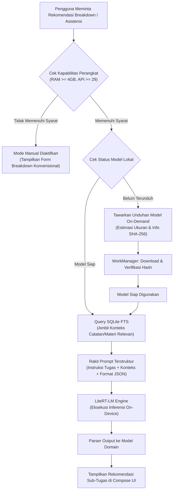

# Arsitektur Local AI (Local AI Architecture) — KerjaiAja

Dokumen ini menguraikan arsitektur subsistem **Adaptive Local AI Engine** untuk **KerjaiAja**. 

> [!NOTE]
> Seluruh isi dokumen ini mencerminkan arah arsitektur yang direncanakan (*intended architectural direction*), bukan sistem yang sudah terimplementasi di kode sumber.

---

## 1. Prinsip Utama Desain Local AI

1. **Adaptive Capability Detection:**  
   Aplikasi mendeteksi kapasitas perangkat pengguna (versi Android SDK, RAM total, arsitektur CPU/NPU) secara dinamis saat runtime sebelum menawarkan kemampuan AI lokal.
2. **Graceful Fallback & Zero Blocking:**  
   Aplikasi inti (manajemen tugas, mata kuliah, checklist) tetap 100% fungsional tanpa AI. Fitur berbasis AI tidak pernah menjadi prasyarat untuk memakai aplikasi.
3. **Decoupled Abstraction:**  
   Lapisan domain berinteraksi hanya melalui antarmuka `AiEngine`. Implementasi konkrit (`LiteRtLmEngine` atau mock untuk testing) diinjeksi melalui Dependency Injection (Hilt).
4. **Zero Mandatory Cloud Dependency:**  
   Tidak ada keharusan langganan API berbayar (seperti OpenAI/Claude API) dan tidak ada VPS khusus untuk menjalankan inferensi model. Pemrosesan dilakukan murni di perangkat pengguna.

---

## 2. Diagram Alur Kerja Subsistem AI

---

## 3. Komponen Subsistem

### 3.1 Device Capability Inspector
Komponen yang bertugas membaca profil perangkat:
- Memeriksa `ActivityManager.MemoryInfo` untuk memastikan ketersediaan RAM minimal (target 4–6 GB, dengan batas bebas minimal sebelum memuat model).
- Memverifikasi dukungan akselerasi hardware (OpenCL / Vulkan / GPU delegate untuk LiteRT jika tersedia).

### 3.2 Model Lifecycle & Integrity Manager
- Mengatur proses pengunduhan on-demand via `WorkManager`.
- Melakukan verifikasi integritas berkas menggunakan kalkulasi hash **SHA-256** sebelum berkas diizinkan untuk di-load oleh runtime.
- Menyimpan model di direktori privat aplikasi (`context.filesDir/models/`) agar terlindung dari manipulasi aplikasi lain.

### 3.3 Prompt Engine & Local RAG Integrator
- Menggunakan pola prompt terstruktur (*structured prompting*) dengan pembatas instruksi yang tegas.
- Mengintegrasikan hasil pencarian lokal via **SQLite FTS** dari catatan pengguna, sehingga jawaban model kontekstual terhadap materi mata kuliah yang bersangkutan tanpa perlu melatih ulang model.

### 3.4 LiteRT-LM Runtime Wrapper
- Mengelola inisialisasi sesi inferensi, pembatasan alokasi token (`max_tokens`), parameter temperatur, serta pelepasan memori (*cleanup/close*) segera setelah aliran token (*token stream*) selesai diproses.
