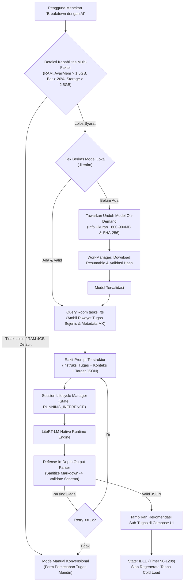
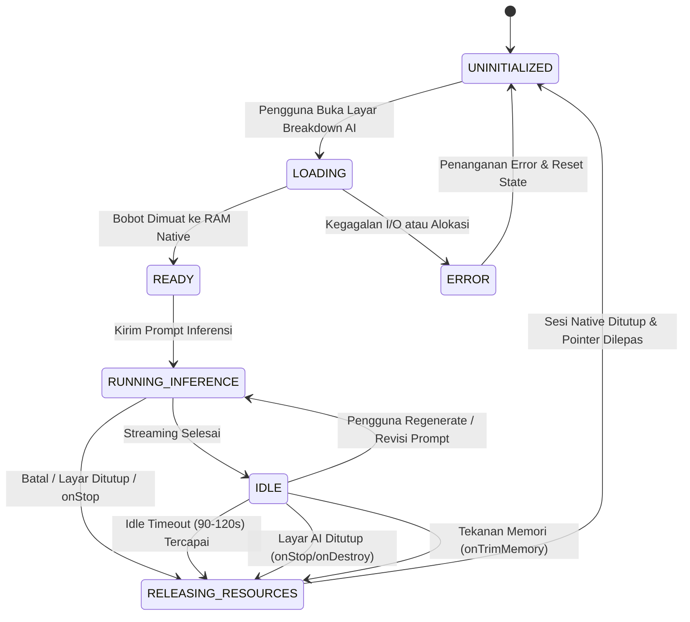

# Arsitektur Local AI (Local AI Architecture) — KerjaiAja [SUPERSEDED]
**Adaptive On-Device Intelligence Subsystem (Historical Blueprint)**

> [!WARNING]
> **STATUS ARSITEKTUR: SUPERSEDED (DIGANTIKAN)**  
> Sesuai keputusan rebaseline arsitektur penuh pada [ADR-004: Backend AI Inference Architecture](file:///home/ahmadbadawi/Documents/CodinganKu/Android/KerjaiAja/docs/decisions/adr/ADR-004-BACKEND-AI-INFERENCE.md), arsitektur model on-device (Gemma 3 1B IT + LiteRT-LM) telah secara resmi digantikan oleh **Backend AI Inference Architecture**. Silakan rujuk dokumen standar terbaru di [`docs/ai/AI_ARCHITECTURE.md`](file:///home/ahmadbadawi/Documents/CodinganKu/Android/KerjaiAja/docs/ai/AI_ARCHITECTURE.md). Dokumen ini dipertahankan utuh semata-mata sebagai catatan audit historis.

---

## 1. Prinsip Utama Desain Local AI

1. **Adaptive Multi-Factor Capability Detection ([ADR-001](file:///home/ahmadbadawi/Documents/CodinganKu/Android/KerjaiAja/docs/decisions/adr/ADR-001-LOCAL-AI-CAPABILITY-DETECTION.md)):**  
   Kelayakan eksekusi model lokal tidak ditentukan semata-mata oleh total RAM fisik, melainkan melalui inspeksi multi-faktor dinamis:
   - **RAM 4 GB:** Menggunakan mode fallback manual sebagai default untuk mencegah crash oleh Android Low Memory Killer (LMKD).
   - **RAM 6 GB:** Berstatus kandidat pengujian (*test candidate*), aktif jika memori bebas mencukupi.
   - **RAM >= 8 GB:** Berstatus kandidat prioritas pengujian (*primary target*).
   - **Parameter Runtime:** Memeriksa ketersediaan memori bebas aktual (`available RAM > 1.5 GB`), ruang penyimpanan (> 2.5 GB), status baterai (> 20%), dan suhu perangkat (*thermal headroom*).
2. **Task-Based Local RAG ([ADR-002](file:///home/ahmadbadawi/Documents/CodinganKu/Android/KerjaiAja/docs/decisions/adr/ADR-002-TASK-BASED-LOCAL-RAG-MVP.md)):**  
   Penyusunan konteks RAG pada MVP (v1.0) difokuskan murni pada data tugas (`tasks`: judul, deskripsi instruksi, kode mata kuliah, dan riwayat tugas sejenis via `tasks_fts`). Modul catatan kuliah independen (`academic_notes`) ditunda ke rilis pasca-MVP. Model AI dibatasi pada akses *read-only* minimal tanpa akses query bebas ke database Room.
3. **Structured Output Defense-in-Depth ([ADR-003](file:///home/ahmadbadawi/Documents/CodinganKu/Android/KerjaiAja/docs/decisions/adr/ADR-003-STRUCTURED-AI-OUTPUT.md)):**  
   Sebelum mewajibkan *constrained grammar decoding*, sistem memverifikasi stabilitas API runtime LiteRT-LM dan menerapkan pipeline pertahanan 5 lapis: Strict Prompt -> Sanitizer Pre-Parser -> Schema Validation -> Bounded Retry (1x) -> Deterministic Fallback.
4. **Adaptive AI Session Lifecycle ([ADR-004](file:///home/ahmadbadawi/Documents/CodinganKu/Android/KerjaiAja/docs/decisions/adr/ADR-004-ADAPTIVE-AI-SESSION-LIFECYCLE.md)):**  
   Pengelolaan siklus hidup model berbasis State Machine adaptif dengan *configurable idle timeout* (default 90–120 detik) untuk mengeliminasi friksi cold-load berulang, didukung pembersihan proaktif via `ComponentCallbacks2.onTrimMemory()`.
5. **Graceful Fallback & Zero Blocking:**  
   Fungsionalitas inti aplikasi (manajemen tugas, mata kuliah, checklist) tetap 100% beroperasi normal tanpa dependensi wajib pada ketersediaan mesin AI.
6. **Decoupled Abstraction:**  
   Domain layer hanya berkomunikasi melalui kontrak antarmuka `AiEngine`. Implementasi konkret (`LiteRtLmEngine` atau `FakeAiEngine` untuk testing) diinjeksi via Hilt.

---

## 2. Diagram Alur Kerja Subsistem AI



---

## 3. State Machine Siklus Hidup Sesi AI (Session Lifecycle)

Mengacu pada [ADR-004](file:///home/ahmadbadawi/Documents/CodinganKu/Android/KerjaiAja/docs/decisions/adr/ADR-004-ADAPTIVE-AI-SESSION-LIFECYCLE.md):



---

## 4. Komponen Subsistem

### 4.1 Device Capability Inspector
Bertugas mengevaluasi kelaikan perangkat sebelum menawarkan fitur AI:
- **RAM Profiler:** Membaca total RAM dan memverifikasi `ActivityManager.MemoryInfo.availMem`.
- **Storage Checker:** Memverifikasi ketersediaan ruang penyimpanan internal minimal 2.5 GB pada `context.filesDir`.
- **Battery & Thermal Monitor:** Memeriksa `BatteryManager` (baterai >= 20% atau sedang charging) dan `PowerManager` (status suhu tidak throttling).
- **ABI Validator:** Memastikan CPU berjalan pada arsitektur 64-bit (`arm64-v8a`).

### 4.2 Model Lifecycle & Integrity Manager
- Mengatur unduhan on-demand via Android `WorkManager` (mendukung jeda/lanjut jaringan dan filter Wi-Fi).
- Melakukan verifikasi integritas berkas menggunakan kalkulasi hash **SHA-256** sebelum berkas dipindahkan ke lokasi eksekusi.
- Berkas model biner disimpan dalam direktori privat terisolasi: `context.filesDir.resolve("models/gemma3-1b-it.litertlm")`.

### 4.3 Task-Based Prompt Engine & Local RAG Integrator
- Menyusun prompt sistem dengan peran strictly bounded: *"Asisten dekonstruksi tugas akademik"*.
- Mengambil riwayat tugas sejenis yang tersimpan di Room database menggunakan tabel virtual `tasks_fts` untuk menyuntikkan contoh pemecahan tugas (*few-shot context*).
- Menolak injeksi data di luar lingkup tugas yang sedang dikerjakan (mematuhi prinsip *data minimization*).

### 4.4 Defense-in-Depth Structured Output Parser
- **Sanitizer:** Membersihkan pembungkus markdown code block (` ```json `), memotong teks obrolan pembuka, dan menormalisasi koma gantung.
- **Validator:** Memvalidasi struktur data JSON ke kelas data Kotlin menggunakan `kotlinx.serialization`.
- **Fail-Safe Mechanism:** Jika 1x bounded retry gagal, sistem secara elegan beralih ke form breakdown manual tanpa memicu crash antarmuka.

### 4.5 LiteRT-LM Runtime Wrapper
- Membungkus pustaka resmi `com.google.ai.edge.litertlm:litertlm-android`.
- Mengelola alokasi context window (dibatasi 1.024–2.048 token untuk efisiensi memori) dan pembatasan `max_output_tokens`.
- Mengintegrasikan mekanisme pembatalan (*cancellation token*) berbasis Kotlin Coroutines `Job.cancel()`.
