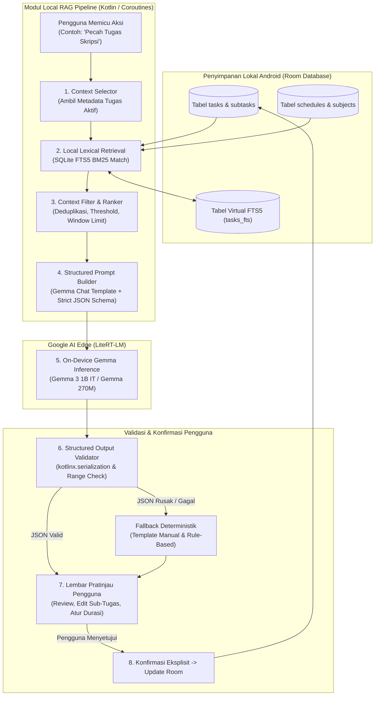

# Arsitektur Local RAG (Retrieval-Augmented Generation) — KerjaiAja
## KerjaiAja Knowledge Intelligence Layer

- **Tanggal Dokumen:** 2026-11-20
- **Status:** APPROVED & LOCKED (Terkunci via [ADR-015](file:///home/ahmadbadawi/Documents/CodinganKu/Android/KerjaiAja/docs/decisions/adr/ADR-015-LOCAL-RAG-SQLITE-FTS5.md) & [ADR-039](file:///home/ahmadbadawi/Documents/CodinganKu/Android/KerjaiAja/docs/decisions/adr/ADR-039-TWO-TIER-KNOWLEDGE-INTELLIGENCE-LAYER.md))
- **Paradigma:** 100% On-Device, Zero External Transmission, Local-First
- **Engine Baseline:** SQLite FTS5 (BM25) terintegrasi Room Database (`tasks_fts` & `academic_fts`)
- **Spesifikasi Lengkap:** Lihat [`KNOWLEDGE_INTELLIGENCE_LAYER.md`](file:///home/ahmadbadawi/Documents/CodinganKu/Android/KerjaiAja/docs/architecture/KNOWLEDGE_INTELLIGENCE_LAYER.md) & [`LOCAL_RETRIEVAL_ENGINE.md`](file:///home/ahmadbadawi/Documents/CodinganKu/Android/KerjaiAja/docs/architecture/LOCAL_RETRIEVAL_ENGINE.md)

---

## 1. Prinsip Utama Local RAG

Arsitektur RAG di KerjaiAja beroperasi di bawah prinsip **"Retrieve the right knowledge, not the most knowledge"**:
1. **Pemisahan Dua Domain (Two Knowledge Domains):** Mengisolasi secara ketat domain **Productivity Knowledge** (tugas pribadi via `tasks_fts`) dari **Academic Knowledge** (referensi 12 mata pelajaran via `academic_fts`).
2. **Zero External Data Leakage:** Tidak ada satu pun teks tugas, nama mata kuliah, jadwal kuliah, foto soal, atau catatan mahasiswa yang dikirim keluar dari perangkat fisik ponsel.
3. **Selective Context Retrieval & Budget Ketat:** Alokasi konteks dibatasi maksimal 800 tokens untuk tugas dan 1200 tokens untuk materi akademik agar alokasi KV-Cache LiteRT-LM tetap berada di bawah ambang batas aman RAM mobile.
4. **Data Freshness & Real-Time Invalidation:** Indeks pencarian disinkronkan secara real-time via SQLite trigger saat entitas dibuat, diubah, atau dihapus oleh pengguna.
5. **Source Traceability & Anti-Hallucination:** Setiap klaim jawaban didukung oleh rujukan terverifikasi (nama buku, bab, halaman jika tersedia); model wajib membedakan fakta sumber dengan langkah penalaran logika.

---

## 2. Alur Kerja Lengkap Local RAG (End-to-End Flow)



---

## 3. Tahap 1: Mesin Pencarian Leksikal (SQLite FTS5 BM25)

SQLite FTS5 merupakan modul bawaan Android SQLite yang memungkinkan pencarian teks berkecepatan tinggi dengan algoritma pembobotan relevansi BM25 (*Best Matching 25*).

### 3.1 Skema Tabel Virtual FTS5 di Room
Tabel virtual `tasks_fts` dikonfigurasi sebagai tabel bayangan (*external content table*) dari tabel `tasks`:

```sql
CREATE VIRTUAL TABLE IF NOT EXISTS tasks_fts USING fts5(
    title,
    description,
    subject_name,
    content='tasks',
    content_rowid='id'
);

-- Trigger untuk menjaga integritas data secara otomatis
CREATE TRIGGER tasks_ai AFTER INSERT ON tasks BEGIN
    INSERT INTO tasks_fts(rowid, title, description, subject_name)
    VALUES (new.id, new.title, new.description, new.subject_name);
END;

CREATE TRIGGER tasks_ad AFTER DELETE ON tasks BEGIN
    INSERT INTO tasks_fts(tasks_fts, rowid, title, description, subject_name)
    VALUES('delete', old.id, old.title, old.description, old.subject_name);
END;

CREATE TRIGGER tasks_au AFTER UPDATE ON tasks BEGIN
    INSERT INTO tasks_fts(tasks_fts, rowid, title, description, subject_name)
    VALUES('delete', old.id, old.title, old.description, old.subject_name);
    INSERT INTO tasks_fts(rowid, title, description, subject_name)
    VALUES (new.id, new.title, new.description, new.subject_name);
END;
```

### 3.2 Strategi Query & BM25 Ranking
Saat pengguna meminta analisis pada suatu tugas, sistem membuat kueri leksikal dari judul tugas, kata kunci mata pelajaran, dan sub-tugas yang telah ada:

```sql
SELECT t.id, t.title, t.description, t.deadline, t.deterministic_priority, bm25(tasks_fts) AS rank
FROM tasks t
JOIN tasks_fts ON t.id = tasks_fts.rowid
WHERE tasks_fts MATCH :searchQuery AND t.deleted_at IS NULL
ORDER BY rank
LIMIT 5;
```

---

## 4. Mekanisme Pemangkasan & Filter Konteks (Context Pruning & Filtering)

Untuk mencegah pembengkakan context window model yang dapat memicu keterlambatan inferensi dan risiko OOM, `ContextRanker` menerapkan aturan berjenjang:

1. **Deduplikasi Entitas:** Jika tugas yang sama muncul dari relasi sub-tugas dan riwayat, entitas digabungkan menjadi satu catatan tunggal.
2. **Metadata Filtering:** Tugas yang sudah selesai lebih dari 30 hari yang lalu secara otomatis diabaikan dari konteks kecuali menjadi prasyarat eksplisit (*dependency*).
3. **Batas Token Maksimum (Budget: 800 Tokens):**
   - Ringkasan Profil Akademik (Semester, SKS aktif): ~100 tokens.
   - Tugas Aktif yang Sedang Diproses: ~250 tokens.
   - Konteks Riwayat Tugas Relevan (Top-3 BM25 Match): ~350 tokens.
   - Jadwal & Beban Waktu Tersedia (3 Hari ke Depan): ~100 tokens.
4. **Sanitasi Data Sensitif (PII Filter):** Sebelum teks disuntikkan ke prompt builder, filter lokal menghapus nomor telepon, alamat email, atau kata sandi jika tidak sengaja tertulis pada catatan tugas.

---

## 5. Structured Prompt Construction (Format Gemma Chat)

Konteks yang telah disaring digabungkan dengan format template instruksi resmi Google Gemma:

```text
<start_of_turn>user
Kamu adalah mesin asisten produktivitas akademik mahasiswa Indonesia.
Tugas kamu adalah menganalisis dan memecahkan tugas berikut menjadi sub-tugas terstruktur.

[KONTEKS AKADEMIK PENGGUNA]
- Mata Kuliah: Praktikum Jaringan Komputer (3 SKS)
- Sisa Waktu Deadline: 3 Hari (Tenggat: 23 Nov 2026, 23:59)
- Riwayat Terkait: Laporan Modul 1 selesai tepat waktu (nilai 85).
- Ketersediaan Waktu Belajar: 2 jam malam ini, 3 jam besok sore.

[TUGAS AKTIF]
Judul: Laporan Akhir Praktikum Routing OSPF & VLAN
Deskripsi: Konfigurasi topologi 3 router, analisis packet capture Wireshark, dan kesimpulan pengujian throughput.

[INSTRUKSI OUTPUT]
Keluarkan HANYA dokumen JSON valid yang mematuhi skema berikut tanpa pengantar atau penjelasan tambahan:
{
  "subtasks": [
    {
      "title": "String (ringkas, aksi spesifik)",
      "estimated_minutes": Integer (15 - 90),
      "priority_tier": "HIGH" | "MEDIUM" | "LOW",
      "order_index": Integer
    }
  ],
  "reasoning_summary": "String (1-2 kalimat, alasan logis)"
}
<end_of_turn>
<start_of_turn>model
```

---

## 6. Validasi Output Terstruktur & Fallback Deterministik

1. **Schema Validation (`kotlinx.serialization`):**
   Model output diparsing ke data class Kotlin `TaskBreakdownResponse`. Jika format JSON rusak atau melanggar skema:
   - Sistem melakukan **1x bounded auto-repair** dengan regex pembersih kurung kurawal.
   - Jika tetap tidak valid, sistem **TIDAK MENYIMPAN DATA RUSAK**.
2. **Fallback Deterministik:**
   Aplikasi secara instan mengembalikan dekomposisi berbasis template akademik standar (Persiapan -> Pengerjaan Inti -> Verifikasi & Review -> Pengumpulan) sehingga alur kerja mahasiswa tidak pernah terhenti akibat kegagalan model AI.
3. **Kendali Eksplisit Pengguna (Anti-Autonomous Action):**
   Hasil dekomposisi atau rekomendasi prioritas ditampilkan dalam modal lembar bawah (*BottomSheet*). Pengguna dapat mencentang, mengedit teks sub-tugas, mengubah durasi menit, atau membatalkan rekomendasi sebelum data ditulis secara permanen ke Room Database.
