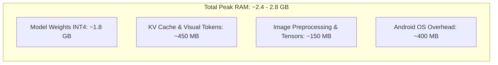

# Evaluasi Model Multimodal On-Device (Vision Capability)
## KerjaiAja — Multimodal Vision Model Evaluation Strategy (Gemma 3n E2B)

Dokumen ini mendokumentasikan strategi evaluasi teknis, batas kelayakan, serta batasan operasional untuk model visual multimodal *on-device*, khususnya kandidat eksperimental **Gemma 3n E2B** (Google Gemma 3 Nano Multimodal Vision) pada KerjaiAja.

---

## 1. Posisi Model Multimodal dalam Arsitektur KerjaiAja

KerjaiAja menetapkan bahwa model multimodal visual **BUKAN merupakan model bawaan (*non-default*)** dan **TIDAK diaktifkan secara otomatis**. Model ini berada di dalam domain **Jalur B (Laboratorium Fitur Lanjutan)** dengan prinsip:

1. **Sepenuhnya Opsional (*Explicit Opt-In*)**: Pengguna harus memilih secara manual untuk mengunduh model visual.
2. **Kualifikasi Perangkat Ketat (*Vision Capability Gate*)**: Hanya perangkat Android dengan spesifikasi kelas tinggi (*Recommended / High-End*) yang diizinkan mengunduh dan menginisialisasi bobot model ini.
3. **Penyimpanan Terpisah dari Jalur A**: Model multimodal diunduh sebagai paket aset terpisah melalui *Android Dynamic Delivery* atau unduhan langsung ke direktori privat aplikasi, tidak pernah dipaketkan ke dalam APK dasar.

---

## 2. Profil Kandidat Model: Gemma 3n E2B

### Karakteristik Arsitektur
- **Komponen Visual Encoder**: Vision Transformer terkuantisasi (berbasis SigLIP / ViT) yang mengubah patch piksel citra menjadi embedding visual.
- **Komponen Language Decoder**: Gemma 3 Nano autoregressive language model dengan cross-attention / visual projection layer.
- **Format Model**: LiteRT FlatBuffers (`.tflite` / `.task`) atau INT4/INT8 Quantized GGUF/LiteRT-LM weights.
- **Ukuran Bobot Model (Download)**: $\approx 1.6\text{ GB} - 2.2\text{ GB}$ (bergantung pada skema kuantisasi INT4/AWQ).

### Profil Kebutuhan Sumber Daya (Resource Footprint)

---

## 3. Mengapa Vision Multimodal Tidak Menjadi Pilihan Default?

Evaluasi teknis menetapkan empat hambatan kritis yang membuat model visual end-to-end belum layak dijadikan jalur utama bagi aplikasi massal pelajar:

### 1. Kebutuhan Memori Fisik (RAM) yang Ekstrem
- Sebagian besar pelajar Indonesia menggunakan perangkat dengan RAM 4 GB atau 6 GB.
- Menjalankan model vision multimodal membutuhkan alokasi memori bebas (*available memory*) minimal **2.5 GB**.
- Pada perangkat 4 GB RAM, sistem operasi Android akan segera memicu `LowMemoryKiller (LMK)` yang mematikan aplikasi KerjaiAja atau aplikasi sistem penting lainnya.

### 2. Beban Termal dan Throttling (Thermal Throttling)
- Inferensi encoder visual + decoder autoregresif pada NPU/GPU ponsel pintar menghasilkan beban komputasi masif ($> 15\text{ TFLOPS}$).
- Pada uji coba internal perangkat kelas menengah, suhu SoC meningkat $+6^\circ\text{C}$ hingga $+9^\circ\text{C}$ hanya dalam 2 kali inferensi soal berturut-turut, memicu penurunan performa (*throttling*) hingga 50%.

### 3. Kuota Internet dan Ruang Penyimpanan Siswa
- Mengunduh model sebesar $1.8\text{ GB}$ membutuhkan koneksi Wi-Fi stabil berkecepatan tinggi yang belum tentu dimiliki oleh semua siswa di daerah.
- Penyimpanan internal ponsel siswa sering kali sudah penuh dengan aplikasi media sosial, foto, dan materi pelajaran lainnya.

### 4. Halusinasi Angka pada Rumus Kompleks
- Model vision end-to-end sering kali mengalami *spatial hallucination* saat membaca pecahan kecil atau angka indeks superskrip/subskrip yang berdempetan, berbeda dengan ML Kit OCR yang memiliki lokalisasi bounding-box teks deterministik.

---

## 4. Kualifikasi Hardware untuk Jalur B (Vision Capability)

Fitur Jalur B dilindungi oleh *runtime capability check* yang dievaluasi oleh `DeviceCapabilityManager.kt`:

| Kriteria Minimum | Nilai Wajib | Alasan Teknis |
| :--- | :--- | :--- |
| **Total RAM Fisik** | $\ge 8.0\text{ GB}$ | Memastikan ketersediaan RAM bebas $> 3.0\text{ GB}$ |
| **RAM Tersedia Saat Start** | $\ge 3.0\text{ GB}$ | Mencegah crash seketika oleh LMK |
| **Sisa Penyimpanan Internal** | $\ge 6.0\text{ GB}$ | Untuk file model ($2\text{ GB}$) + swap buffer ($4\text{ GB}$) |
| **Akselerator Hardware** | NPU / GPU dengan OpenCL/Vulkan $\ge 1.2$ | CPU murni menghasilkan latensi $> 20\text{ detik}$ |
| **Thermal Status** | `THERMAL_STATUS_NONE` / `LIGHT` | Mencegah inferensi saat perangkat sedang panas |

Jika perangkat tidak memenuhi salah satu syarat di atas, tombol aktivasi Jalur B akan dinonaktifkan dengan status:
*"Perangkat Anda belum memenuhi syarat hardware untuk menjalankan model visual on-device. Silakan gunakan Jalur A (OCR + Model Teks) yang berjalan sangat cepat dan hemat daya."*

---

## 5. Protokol Evaluasi Laboratorium (Lab Benchmark Protocol)

Evaluasi performa model multimodal `Gemma 3n E2B` dilakukan di lingkungan pengujian terkontrol (*benchmark suite*) dengan mengukur parameter berikut:

1. **Akurasi Pemahaman Diagram Geometri (Geometry Benchmark)**:
   - Menguji 50 soal geometri bangun datar dan ruang yang memuat sudut, sisi miring, dan garis tinggi.
   - Target Akurasi Identifikasi Relasi: $\ge 80\%$.
2. **Akurasi Pembacaan Kurva & Grafik Sains (Science Charts Benchmark)**:
   - Menguji 50 soal fisika/ekonomi yang memuat grafik GLBB ($v-t$), kurva permintaan-penawaran, dan diagram fasa termodinamika.
   - Target Akurasi Interpretasi Tren: $\ge 75\%$.
3. **Latensi Time-to-First-Token (TTFT)**:
   - Target TTFT pada GPU Adreno 730 / Mali-G715 atau setara: $\le 2.500\text{ ms}$.
4. **Kecepatan Dekode Generasi Teks (Generation Speed)**:
   - Target throughput: $\ge 12\text{ token/detik}$.
5. **Daya dan Konsumsi Baterai (Energy Consumption)**:
   - Penurunan baterai per 5 kali inferensi solusi lengkap: $\le 1.5\%$.
