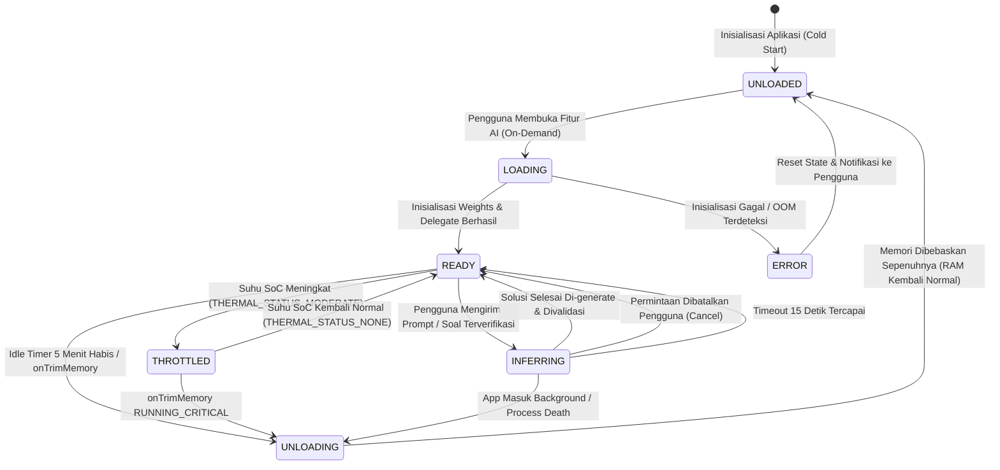

# Manajemen Siklus Hidup & Memori Model AI On-Device
## KerjaiAja — AI Model Lifecycle & Memory Pressure Management

Dokumen ini mendefinisikan arsitektur pengelolaan siklus hidup (*lifecycle*), alokasi memori, pencegahan *OutOfMemoryError*, mitigasi termal, dan penanganan status Android untuk runtime inferensi AI *on-device* di KerjaiAja.

---

## 1. Prinsip Utama Manajemen Siklus Hidup

1. **Lazy Loading Mutlak (Zero Startup Overhead):**  
   Model bobot AI **TIDAK PERNAH** dimuat ke dalam memori RAM saat aplikasi pertama kali dibuka (*Cold Start*). Aplikasi harus selalu terbuka secara instan ($< 800\text{ ms}$) dengan konsumsi memori dasar $\le 80\text{ MB}$. Model hanya diinisialisasi saat pengguna secara eksplisit mengakses antarmuka Asisten Kerja atau Foto Soal.
2. **Sesi Inferensi Tunggal (*Single Active Inference Session*):**  
   Sistem secara tegas melarang eksekusi inferensi AI secara paralel. Dilarang menjalankan OCR, pencarian teks, dan inferensi LLM secara bersamaan. Seluruh tahapan berjalan sekuensial untuk mencegah akumulasi puncak alokasi memori (*RAM spikes*).
3. **Pelepasan Memori Proaktif (Eager Cleanup & Auto-Unload):**  
   Jika tidak ada aktivitas pengguna selama 5 menit (*idle timer*), bobot model otomatis di-unload dari memori RAM.
4. **Respon Adaptif terhadap Tekanan Sistem (Memory & Thermal Awareness):**  
   Sistem merespons secara reaktif sinyal tekanan memori sistem Android (*LowMemoryKiller*) dan sensor suhu SoC (*Thermal Throttling*) untuk menjaga stabilitas OS secara keseluruhan.

---

## 2. State Machine Siklus Hidup Model

Siklus hidup runtime model dikelola oleh komponen `ModelLifecycleManager` yang beroperasi sebagai mesin status (*Finite State Machine*):



### Penjelasan Status (States):
- **`UNLOADED`**: Bobot model berada di penyimpanan internal disk (`context.noBackupFilesDir/models/`). Konsumsi RAM AI adalah 0 MB.
- **`LOADING`**: Runtime LiteRT-LM sedang memetakan FlatBuffers model ke memori virtual (`mmap`) dan menginisialisasi akselerator GPU/NPU.
- **`READY`**: Model siap menerima token masukan. Alokasi RAM stabil (~1.25 GB untuk Gemma 1B, ~480 MB untuk Gemma 270M). Timer *auto-unload* 5 menit mulai berjalan.
- **`INFERRING`**: Model sedang melakukan decoding token autoregresif. Timer *auto-unload* dijeda. Timeout maksimal 15 detik aktif.
- **`THROTTLED`**: Perangkat mengalami panas berlebih. Inferensi baru ditunda atau dialihkan ke mode hemat daya.
- **`UNLOADING`**: Instance runtime LiteRT-LM ditutup (`close()`), konteks KV-cache dihapus, dan referensi memori dilepaskan.
- **`ERROR`**: Terjadi kegagalan inisialisasi atau inferensi. Sistem kembali ke mode aman tanpa menyebabkan crash.

---

## 3. Integrasi Siklus Hidup Android (Android Lifecycle Integration)

### A. Transisi Foreground ke Background (App Minimization)
Ketika pengguna menekan tombol Home atau beralih ke aplikasi lain:
- Activity memicu `onStop()`.
- Jika sesi inferensi sedang tidak berjalan, `ModelLifecycleManager` segera melepaskan bobot model (`unloadModel()`).
- Hal ini memastikan sistem operasi Android tidak menandai aplikasi KerjaiAja sebagai target utama pembunuhan oleh *LowMemoryKiller (LMK)* saat berada di latar belakang.

### B. Pembatalan Pengguna & Navigasi (User Cancellation)
Jika siswa menekan tombol "Batal" atau melakukan gestur kembali (*back navigation*) saat model sedang menghasilkan jawaban:
```kotlin
fun cancelInference() {
    inferenceJob?.cancel() // Membatalkan coroutine context
    aiEngine.interruptGeneration() // Menghentikan decoding loop LiteRT
    _modelState.value = ModelState.READY
}
```
Pembatalan ini seketika menghentikan beban komputasi CPU/NPU dan membersihkan token buffer yang belum selesai.

### C. Batas Waktu Inferensi (Timeout Guardrail)
Untuk mencegah loop tak terhingga atau freeze akibat token decoding yang macet, setiap permintaan inferensi dilindungi oleh batas waktu ketat:
```kotlin
withTimeout(15_000L) { // Maksimal 15 detik
    aiEngine.generateStructuredResponse(prompt)
}
```
Jika batas 15 detik terlampaui, sistem membatalkan inferensi secara anggun dan menampilkan pesan edukatif: *"Pemrosesan memerlukan waktu lebih lama dari biasanya. Silakan coba kembali atau gunakan ringkasan deterministik."*

---

## 4. Penanganan Tekanan Memori (Memory Pressure & LMK Safeguards)

KerjaiAja mendaftarkan pemantauan memori global melalui antarmuka `ComponentCallbacks2`:

```kotlin
class MemoryPressureCallback(
    private val lifecycleManager: ModelLifecycleManager
) : ComponentCallbacks2 {

    override fun onTrimMemory(level: Int) {
        when (level) {
            ComponentCallbacks2.TRIM_MEMORY_RUNNING_CRITICAL,
            ComponentCallbacks2.TRIM_MEMORY_COMPLETE -> {
                Log.w("MemoryGuard", "Tekanan memori kritis (level=$level). Melepaskan model AI segera.")
                lifecycleManager.forceUnloadModel()
                System.gc() // Menyarankan garbage collection terhadap sisa bitmap
            }
            ComponentCallbacks2.TRIM_MEMORY_RUNNING_LOW -> {
                Log.i("MemoryGuard", "Tekanan memori sedang. Membersihkan cache FTS & token context.")
                lifecycleManager.trimContextCache()
            }
        }
    }

    override fun onConfigurationChanged(newConfig: Configuration) {}
    override fun onLowMemory() {
        lifecycleManager.forceUnloadModel()
    }
}
```

---

## 5. Kesadaran Termal & Baterai (Thermal & Battery Awareness)

### A. Sensor Termal Hardware (API 29+)
- Menggunakan `PowerManager.addThermalStatusListener`:
  - `THERMAL_STATUS_NONE` & `LIGHT`: Operasi normal dengan akselerasi penuh (NPU/GPU/Multithreaded CPU).
  - `THERMAL_STATUS_MODERATE`: Peringatan kenaikan suhu. Kurangi jumlah thread CPU dari 4 menjadi 2 thread.
  - `THERMAL_STATUS_SEVERE` & `CRITICAL`: Hentikan inferensi baru. Tampilkan pesan: *"Ponsel Anda sedang mengalami peningkatan suhu. Fitur AI diistirahatkan sejenak untuk menjaga keamanan perangkat."*

### B. Proteksi Daya Baterai Lemah (Low Battery Guard)
- Mengamati `Intent.ACTION_BATTERY_CHANGED`:
  - Jika level baterai $\le 15\%$ dan ponsel **tidak sedang diisi daya (*not charging*)**:
    - Opsi inferensi model dinonaktifkan sementara.
    - Pengguna diarahkan untuk tetap menggunakan **Mode A (Produktivitas Penuh)** yang hemat daya.

---

## 6. Ringkasan Parameter Operasional Lifecycle

| Parameter | Nilai Kebijakan | Tindakan Rekayasa |
| :--- | :--- | :--- |
| **Model Ingestion Policy** | On-Demand Lazy Load | Dimuat hanya saat layar fitur AI dibuka |
| **Idle Auto-Unload Timeout** | 5 Menit (300 detik) | Otomatis unload dari RAM jika tidak ada aksi |
| **Maksimal Durasi Inferensi** | 15 Detik | Timeout dan fallback otomatis |
| **Konkurensi Inferensi** | Maksimal 1 Sesi Aktif | Menolak kueri paralel secara deterministik |
| **Batas Baterai Minimum** | $\ge 15\%$ (saat baterai lepas) | Peringatan hemat baterai |
| **Ambang Termal Kritis** | `THERMAL_STATUS_SEVERE` | Blokir inferensi sementara |
| **Respon Trim Memory** | `RUNNING_CRITICAL` | Force unload model seketika |
