# Arsitektur Data Terpadu Android & Web CMS (Shared Data Architecture) — KerjaiAja
## Single Shared Supabase PostgreSQL · Multi-Tenant RLS · Delta Sync Compatibility

- **Dokumen:** `docs/architecture/CMS_DATA_ARCHITECTURE.md`
- **Status:** BASELINE APPROVED
- **Basis Data Utama:** Supabase Managed PostgreSQL (Shared Database)
- **Klien Konsumen:**
  1. **KerjaiAja Android App** (Kotlin Room Offline-First via `supabase-kt`)
  2. **KerjaiAja Web Admin CMS** (Next.js 15 Server Components via `@supabase/ssr`)

---

## 1. Prinsip Penataan Data Terpadu

Arsitektur data KerjaiAja menyatukan kebutuhan aplikasi produktivitas mobile dan dashboard operasional web ke dalam satu database relasional PostgreSQL:

1. **Satu Basis Data, Dua Sudut Pandang Akses:**  
   Android dan Web CMS berbagi database yang sama. Perbedaan hak akses diatur sepenuhnya oleh **PostgreSQL Row Level Security (RLS)** dan pemisahan peran (`auth.uid()` vs `is_admin()`).
2. **Kepatuhan Terhadap Sinkronisasi Offline Android:**  
   Setiap perubahan data yang dilakukan oleh CMS (misalnya penambahan materi referensi atau pembaruan status keluhan) wajib memperbarui timestamp `updated_at`. Hal ini memungkinkan Android menarik data baru secara efisien (*Delta Sync*) tanpa kehilangan integritas lokal.
3. **Pemberian Hak Terbatas Tanpa Mengorbankan Privasi:**  
   Tabel tugas pribadi (`public.tasks`, `public.subtasks`) diproteksi ketat sehingga hanya pemilik tugas yang dapat membacanya (`auth.uid() = user_id`). Administrator web tidak memiliki kebijakan SELECT untuk membaca konten tugas personal.
4. **Disiplin Retensi Data (Free Tier Guardrails $\le 500\text{ MB}$):**  
   Log audit dan tiket feedback lama diarsipkan atau dibersihkan secara berkala untuk menjaga ukuran database tetap aman di bawah kuota gratis Supabase ($0).

---

## 2. Diagram Entitas Relasional Bersama (Entity Relationship Diagram)

```mermaid
erDiagram
    AUTH_USERS ||--o| USER_PROFILES : "extends"
    AUTH_USERS ||--o| ADMIN_ROLES : "assigned"
    AUTH_USERS ||--o{ TASKS : "owns"
    AUTH_USERS ||--o{ USER_FEEDBACKS : "submits"
    AUTH_USERS ||--o{ TEAM_MEMBERS : "participates"
    
    SUBJECTS ||--o{ TASKS : "categorizes"
    ACADEMIC_REFERENCES ||--o{ CURRICULUM_TOPICS : "contains"
    
    TEAMS ||--o{ TEAM_MEMBERS : "has"
    TEAMS ||--o{ TEAM_TASKS : "manages"
    
    AUTH_USERS ||--o{ ADMIN_AUDIT_LOGS : "performed_by"
    
    USER_PROFILES {
        uuid id PK
        string full_name
        string education_level
        string avatar_url
        timestamptz created_at
        timestamptz updated_at
        timestamptz deleted_at
    }

    ADMIN_ROLES {
        uuid id PK
        uuid user_id FK
        admin_role_type role
        boolean is_active
        timestamptz created_at
    }

    ACADEMIC_REFERENCES {
        uuid id PK
        string subject_code
        string subject_name
        string curriculum_standard
        boolean is_published
        timestamptz updated_at
    }

    CURRICULUM_TOPICS {
        uuid id PK
        uuid reference_id FK
        string topic_title
        text summary
        jsonb key_formulas
        int order_index
    }

    USER_FEEDBACKS {
        uuid id PK
        uuid user_id FK
        string category
        text description
        string status
        text admin_notes
        timestamptz created_at
        timestamptz resolved_at
    }

    ADMIN_AUDIT_LOGS {
        uuid id PK
        uuid admin_id FK
        string action
        string target_table
        string target_id
        jsonb payload
        timestamptz created_at
    }
```



---

## 3. Rincian Skema Tabel Bersama

### 3.1 Tabel Referensi Akademik Kurikulum (`public.academic_references`)
Dikelola penuh oleh Admin di Web CMS, dibaca oleh pengguna Android untuk sinkronisasi kurikulum 12 mata pelajaran:

```sql
CREATE TABLE public.academic_references (
    id UUID PRIMARY KEY DEFAULT gen_random_uuid(),
    subject_code VARCHAR(32) NOT NULL UNIQUE,  -- e.g. 'MATH_ADV', 'PHYS_MECH'
    subject_name VARCHAR(128) NOT NULL,        -- e.g. 'Matematika Tingkat Lanjut'
    category VARCHAR(64) NOT NULL,             -- e.g. 'EKSAKTA', 'SOSIAL_HUMANIORA'
    curriculum_standard VARCHAR(64) NOT NULL,  -- e.g. 'Kurikulum Merdeka SMA / Universitas'
    icon_name VARCHAR(64),
    is_published BOOLEAN NOT NULL DEFAULT false,
    created_at TIMESTAMPTZ NOT NULL DEFAULT timezone('utc', now()),
    updated_at TIMESTAMPTZ NOT NULL DEFAULT timezone('utc', now())
);

CREATE INDEX idx_academic_ref_published ON public.academic_references (is_published, category);

-- RLS: Publik & Siswa Android bisa membaca data yang dipublikasikan
ALTER TABLE public.academic_references ENABLE ROW LEVEL SECURITY;

CREATE POLICY "public_read_published_references"
ON public.academic_references
FOR SELECT
TO authenticated, anon
USING (is_published = true);

-- RLS: Admin & Super Admin dapat membaca semua dan memodifikasi
CREATE POLICY "admins_manage_references"
ON public.academic_references
FOR ALL
TO authenticated
USING (public.has_admin_role('ADMIN'))
WITH CHECK (public.has_admin_role('ADMIN'));
```

### 3.2 Tabel Topik Kurikulum & Formula Kunci (`public.curriculum_topics`)
Menyimpan ringkasan konsep dan rumus standar yang digunakan oleh `SubjectAdaptiveValidator` dan Local RAG di Android:

```sql
CREATE TABLE public.curriculum_topics (
    id UUID PRIMARY KEY DEFAULT gen_random_uuid(),
    reference_id UUID NOT NULL REFERENCES public.academic_references(id) ON DELETE CASCADE,
    topic_title VARCHAR(128) NOT NULL,
    summary TEXT NOT NULL,
    key_formulas JSONB DEFAULT '[]'::jsonb,   -- Array rumus & simbol: [{"symbol": "F=m.a", "unit": "N"}]
    order_index INT NOT NULL DEFAULT 0,
    created_at TIMESTAMPTZ NOT NULL DEFAULT timezone('utc', now()),
    updated_at TIMESTAMPTZ NOT NULL DEFAULT timezone('utc', now())
);

CREATE INDEX idx_curriculum_topics_ref ON public.curriculum_topics (reference_id, order_index);

ALTER TABLE public.curriculum_topics ENABLE ROW LEVEL SECURITY;

CREATE POLICY "read_topics_for_published_ref"
ON public.curriculum_topics
FOR SELECT
TO authenticated, anon
USING (
    EXISTS (
        SELECT 1 FROM public.academic_references r 
        WHERE r.id = reference_id AND r.is_published = true
    )
);

CREATE POLICY "admins_manage_topics"
ON public.curriculum_topics
FOR ALL
TO authenticated
USING (public.has_admin_role('ADMIN'))
WITH CHECK (public.has_admin_role('ADMIN'));
```

### 3.3 Tabel Umpan Balik Pengguna & Laporan Bug (`public.user_feedbacks`)
Dibuat oleh pengguna Android dari aplikasi mobile, dikelola dan direspon oleh staf Admin/Support di Web CMS:

```sql
CREATE TABLE public.user_feedbacks (
    id UUID PRIMARY KEY DEFAULT gen_random_uuid(),
    user_id UUID REFERENCES auth.users(id) ON DELETE SET NULL,
    category VARCHAR(64) NOT NULL,             -- 'OCR_ERROR', 'AI_SOLUTION', 'BUG', 'FEATURE_REQUEST'
    subject_code VARCHAR(32),                  -- Referensi mata pelajaran terkait (jika ada)
    description TEXT NOT NULL,
    app_version VARCHAR(32) NOT NULL,          -- e.g. '1.0.0 (Build 12)'
    device_model VARCHAR(64),                  -- e.g. 'Samsung Galaxy A54'
    status VARCHAR(32) NOT NULL DEFAULT 'NEW', -- 'NEW', 'IN_REVIEW', 'RESOLVED', 'DISMISSED'
    admin_notes TEXT,                          -- Catatan internal admin
    resolved_by UUID REFERENCES auth.users(id),
    created_at TIMESTAMPTZ NOT NULL DEFAULT timezone('utc', now()),
    updated_at TIMESTAMPTZ NOT NULL DEFAULT timezone('utc', now()),
    resolved_at TIMESTAMPTZ
);

CREATE INDEX idx_feedbacks_status ON public.user_feedbacks (status, created_at DESC);

ALTER TABLE public.user_feedbacks ENABLE ROW LEVEL SECURITY;

-- Pengguna Android hanya bisa membaca feedback miliknya sendiri
CREATE POLICY "users_read_own_feedback"
ON public.user_feedbacks
FOR SELECT
TO authenticated
USING (auth.uid() = user_id);

-- Pengguna Android bisa membuat feedback baru
CREATE POLICY "users_insert_own_feedback"
ON public.user_feedbacks
FOR INSERT
TO authenticated
WITH CHECK (auth.uid() = user_id);

-- Staf Admin & Support dapat membaca seluruh feedback
CREATE POLICY "admins_read_all_feedback"
ON public.user_feedbacks
FOR SELECT
TO authenticated
USING (public.is_admin());

-- Staf Admin & Support dapat memperbarui status & catatan resolusi
CREATE POLICY "admins_update_feedback"
ON public.user_feedbacks
FOR UPDATE
TO authenticated
USING (public.is_admin())
WITH CHECK (public.is_admin());
```

---

## 4. Mekanisme Sinkronisasi & Isolasi Terhadap Data Lokal Android

1. **Non-Direct Room Mutation:**  
   Admin Web CMS tidak memiliki saluran komunikasi langsung ke database SQLite Room di ponsel pengguna. Seluruh pertukaran data melalui Supabase PostgreSQL.
2. **Pola Delta Sync Android:**  
   Klien Android `SyncWorker` melakukan kueri periodik dengan filter:
   ```sql
   SELECT * FROM public.academic_references 
   WHERE updated_at > :lastSyncTimestamp;
   ```
   Hal ini menjamin penggunaan kuota egress Supabase tetap minimal (<10 KB per request).
3. **Soft-Deletion Tombstone:**  
   Jika admin menghapus atau membatalkan publikasi materi referensi, kolom `is_published` diset ke `false` atau `deleted_at` diisi timestamp UTC, sehingga klien Android mengetahui bahwa data tersebut harus dinonaktifkan di penyimpanan lokal.
