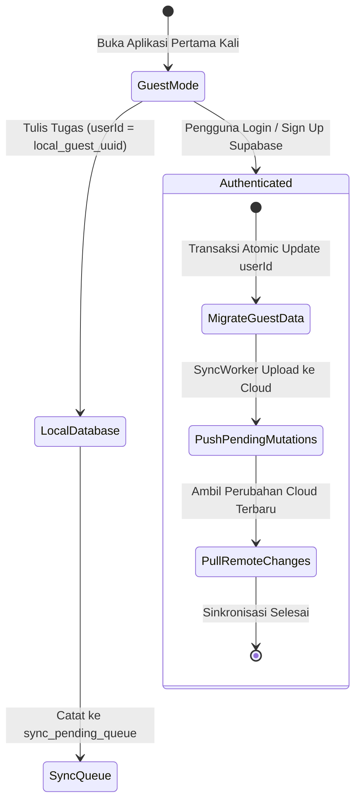

# Arsitektur Data (Data Architecture) — KerjaiAja
## Hybrid Offline-First Persistence · Room Database + Supabase PostgreSQL

Dokumen ini mendefinisikan arsitektur data **KerjaiAja** pasca-rebaseline arsitektur hybrid.

Persistensi data mengadopsi prinsip **Local-Write-First**: Room Database lokal menjadi sumber kebenaran instan (*Immediate Source of Truth*), sedangkan Supabase PostgreSQL berfungsi sebagai backend cloud terpusat untuk sinkronisasi multi-device dan kolaborasi tim.

---

## 1. Paradigma Penyimpanan Data Hybrid

1. **Room Database (Local-First Canonical Storage):**  
   Seluruh data tugas, sub-tugas, mata pelajaran, dan tim disimpan secara lokal di SQLite Room. Operasi baca dan tulis berjalan instan dalam milidetik tanpa menunggu koneksi internet.
2. **UUID Identifiers:**  
   Semua entitas menggunakan UUID string (format v4) sebagai Primary Key, memungkinkan pembuatan record secara offline tanpa risiko tabrakan ID dengan server cloud.
3. **Pending Sync Queue (`sync_pending_queue`):**  
   Setiap mutasi lokal dicatat dalam antrean sinkronisasi untuk dikirim ke Supabase PostgREST saat online.
4. **Soft Deletion (`deleted_at` Tombstone):**  
   Penghapusan data menggunakan timestamp `deleted_at` agar perubahan status hapus dapat disinkronkan secara konsisten ke seluruh perangkat.
5. **Local RAG Index via SQLite FTS5:**  
   Tabel virtual FTS5 (`tasks_fts`) untuk pencarian leksikal cepat BM25 langsung di perangkat lokal.

---

## 2. Skema Basis Data Lokal (Room Database)

### 2.1 Entitas Mata Kuliah (`subjects`)
```kotlin
@Entity(tableName = "subjects")
data class SubjectEntity(
    @PrimaryKey val id: String = UUID.randomUUID().toString(),
    val userId: String,                  // "local_guest_..." atau Supabase Auth UID
    val name: String,                    // Contoh: "Algoritma & Struktur Data"
    val code: String? = null,            // Contoh: "IF2104"
    val colorHex: String = "#1E293B",    // Bauhaus Dark Slate
    val instructorName: String? = null,
    val createdAt: Long = System.currentTimeMillis(),
    val updatedAt: Long = System.currentTimeMillis(),
    val deletedAt: Long? = null,
    val version: Int = 1
)
```

### 2.2 Entitas Tugas Akademik (`tasks`)
```kotlin
@Entity(
    tableName = "tasks",
    foreignKeys = [
        ForeignKey(
            entity = SubjectEntity::class,
            parentColumns = ["id"],
            childColumns = ["subjectId"],
            onDelete = ForeignKey.SET_NULL
        )
    ],
    indices = [Index(value = ["subjectId"]), Index(value = ["deadline"]), Index(value = ["status"])]
)
data class TaskEntity(
    @PrimaryKey val id: String = UUID.randomUUID().toString(),
    val userId: String,
    val subjectId: String? = null,
    val title: String,
    val description: String? = null,
    val deadline: Long,                   // Timestamp epoch milidetik
    val estimatedMinutes: Int = 60,
    val difficulty: Int = 3,              // 1 (Mudah) - 5 (Sangat Sulit)
    val gradeWeight: Double = 10.0,       // Kontribusi nilai (%)
    val isCompleted: Boolean = false,
    val completedAt: Long? = null,
    val deterministicPriority: Int = 50,  // 0 - 100 dari Deterministic Engine
    val userPriorityOverride: String? = null,
    val status: String = "TODO",          // TODO, IN_PROGRESS, COMPLETED, OVERDUE
    val createdAt: Long = System.currentTimeMillis(),
    val updatedAt: Long = System.currentTimeMillis(),
    val deletedAt: Long? = null,
    val version: Int = 1
)
```

### 2.3 Entitas Sub-Tugas (`subtasks`)
```kotlin
@Entity(
    tableName = "subtasks",
    foreignKeys = [
        ForeignKey(
            entity = TaskEntity::class,
            parentColumns = ["id"],
            childColumns = ["taskId"],
            onDelete = ForeignKey.CASCADE
        )
    ],
    indices = [Index(value = ["taskId"])]
)
data class SubtaskEntity(
    @PrimaryKey val id: String = UUID.randomUUID().toString(),
    val taskId: String,
    val title: String,
    val isCompleted: Boolean = false,
    val sortOrder: Int = 0,
    val createdAt: Long = System.currentTimeMillis(),
    val updatedAt: Long = System.currentTimeMillis(),
    val deletedAt: Long? = null
)
```

### 2.4 Antrean Sinkronisasi Mutasi Lokal (`sync_pending_queue`)
```kotlin
@Entity(tableName = "sync_pending_queue")
data class SyncQueueEntity(
    @PrimaryKey(autoGenerate = true) val queueId: Long = 0,
    val entityType: String,              // "TASK", "SUBJECT", "SUBTASK", "TEAM_TASK"
    val entityId: String,                // UUID string
    val operation: String,               // "INSERT", "UPDATE", "DELETE"
    val payloadJson: String,             // JSON snapshot
    val createdAt: Long = System.currentTimeMillis(),
    val retryCount: Int = 0,
    val lastError: String? = null
)
```

### 2.5 Tabel Virtual SQLite FTS5 (`tasks_fts` & `academic_fts`)
```sql
-- Domain A: Productivity Knowledge
CREATE VIRTUAL TABLE IF NOT EXISTS tasks_fts USING fts5(
    title,
    description,
    subject_name,
    content='tasks',
    content_rowid='rowid',
    tokenize='unicode61 remove_diacritics 1'
);

-- Domain B: Academic Knowledge
CREATE TABLE IF NOT EXISTS academic_chunks (
    id INTEGER PRIMARY KEY AUTOINCREMENT,
    chunk_id TEXT UNIQUE NOT NULL,
    document_id TEXT NOT NULL,
    owner_id TEXT NOT NULL,
    domain TEXT NOT NULL CHECK(domain IN ('PRODUCTIVITY', 'ACADEMIC')),
    section_title TEXT NOT NULL,
    page_number INTEGER,
    chunk_index INTEGER NOT NULL,
    content TEXT NOT NULL,
    subject TEXT NOT NULL,
    category TEXT,
    source_reference TEXT NOT NULL,
    content_hash TEXT NOT NULL,
    quality_score REAL DEFAULT 1.0,
    is_published INTEGER DEFAULT 1
);

CREATE VIRTUAL TABLE IF NOT EXISTS academic_fts USING fts5(
    section_title,
    content,
    subject,
    category,
    keywords,
    content='academic_chunks',
    content_rowid='id',
    tokenize='unicode61 remove_diacritics 1'
);
```

---

## 3. Skema Basis Data Cloud (Supabase PostgreSQL)

Skema database cloud di Supabase PostgreSQL memiliki struktur tabel relasional yang menyatukan kebutuhan aplikasi Android dan Web Admin CMS:
- **Tabel Aplikasi Android:** `profiles`, `subjects`, `tasks`, `subtasks`, `teams`, `team_members`, `team_tasks`. Diproteksi menggunakan **Row Level Security (RLS)** dengan klausa `auth.uid() = user_id`.
- **Tabel Kurikulum & Referensi (Dikelola CMS, Dibaca Android):** `academic_references` dan `curriculum_topics`. Memungkinkan pembaruan silabus 12 mata pelajaran secara live via Delta Sync.
- **Tabel Dukungan & Keluhan:** `user_feedbacks` (dibuat di Android, direspon di CMS).
- **Tabel Tata Kelola Admin:** `admin_roles` dan `admin_audit_logs`.

---

## 4. Siklus Hidup Sinkronisasi & Migrasi Akun



---

## 5. Keamanan, Efisiensi & Kedaulatan Data

1. **Efisiensi Database:** Record tugas rata-rata berukuran ~250 byte. Kapasitas 500 MB di Supabase PostgreSQL mampu menampung lebih dari 500,000 record tugas aktif.
2. **Auto-Cleanup Tombstone:** Record yang telah ditandai `deleted_at` selama lebih dari 30 hari dibersihkan dari penyimpanan lokal dan cloud via scheduled vacuum.
3. **Pemisahan Penyimpanan Model AI:** Model bobot Gemma disimpan secara eksklusif di sandbox privat perangkat (`context.noBackupFilesDir/models/`) dan tidak pernah diunggah ke database atau storage cloud.
4. **Isolasi Terhadap Data Lokal Room:** Web Admin CMS tidak memiliki saluran langsung ke database Room Android. Seluruh pembaruan data masuk melalui protokol sinkronisasi resmi Supabase.
5. **Kedaulatan Konten Privat Mahasiswa:** RLS PostgreSQL memblokir seluruh akun admin dari membaca tabel `tasks` dan `subtasks` personal milik mahasiswa (anti-surveillance).

---

## 6. Referensi Putusan Arsitektur Terkait

- [ADR-022: Offline-First Sync & Conflict Resolution](file:///home/ahmadbadawi/Documents/CodinganKu/Android/KerjaiAja/docs/decisions/adr/ADR-022-OFFLINE-FIRST-SYNC-CONFLICT-RESOLUTION.md)
- [ADR-038: Shared Database Schema & Multi-Tenant RLS for CMS](file:///home/ahmadbadawi/Documents/CodinganKu/Android/KerjaiAja/docs/decisions/adr/ADR-038-SHARED-DATABASE-SCHEMA-AND-CMS-RLS.md)

