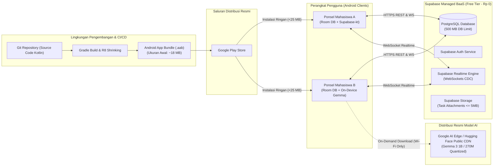

# Arsitektur Penerapan Hybrid (Hybrid Deployment Architecture) — KerjaiAja
## Android Native Client + Supabase Managed BaaS (Free Tier) · Zero Compute Server

Dokumen ini mendefinisikan arsitektur penerapan (*Deployment Architecture*) aplikasi **KerjaiAja** pasca-rebaseline arsitektur hybrid.

Sistem menerapkan paradigma **Zero-Compute Server**: tidak ada server VPS yang disewa, tidak ada container Docker custom yang dijalankan, dan seluruh beban cloud ditangani oleh **Supabase Managed BaaS** dalam batas aman **Free Tier (Rp 0)**.

---

## 1. Topologi Penerapan Sistem (Hybrid Topology)

---

## 2. Saluran & Format Distribusi Binari

1. **Format Distribusi Utama:**  
   **Android App Bundle (`.aab`)** melalui Google Play Store. Ukuran instalasi awal aplikasi berada di kisaran **~18–25 MB**.
2. **Distribusi Model AI Terpisah:**  
   Bobot model Google Gemma (INT4) **TIDAK DIBUNDEL** ke dalam APK aplikasi, melainkan diunduh langsung dari CDN resmi Google AI Edge / Hugging Face secara on-demand dengan izin pengguna.
3. **Konfigurasi Supabase Client:**  
   Kredensial publik `SUPABASE_URL` dan `SUPABASE_ANON_KEY` diinjeksi via `BuildConfig` saat proses kompilasi Gradle dari file lokal `local.properties`.

---

## 3. Kebijakan Biaya Operasional Transparan (Cost Policy: Rp 0)

| Kategori Infrastruktur | Estimasi Biaya Bulanan | Penjelasan & Rationale |
| :--- | :---: | :--- |
| **Server VPS / Compute Hosting** | **Rp 0 / $0** | Tidak ada custom backend server (Go/Node/Python ditiadakan). |
| **Inference Server (llama.cpp/vLLM)** | **Rp 0 / $0** | Tidak ada server inferensi. Model berjalan on-device via LiteRT-LM. |
| **Cloud AI API (Gemini/OpenAI/Groq)**| **Rp 0 / $0** | Dilarang mutlak. Tidak ada biaya token pihak ketiga per permintaan. |
| **Database Cloud Hosting (Supabase)**| **Rp 0 / $0** | Beroperasi penuh dalam kuota Supabase Free Tier (500 MB DB). |
| **Realtime WebSockets (Supabase)** | **Rp 0 / $0** | Beroperasi dalam batas aman Free Tier (200 concurrent connections). |
| **File Storage Attachment (Supabase)**| **Rp 0 / $0** | Kuota 1 GB storage; upload dokumen tugas dibatasi maksimal 5 MB. |
| **Bandwidth Server & Egress** | **Rp 0 / $0** | Terjaga di bawah 2 GB/bulan berkat caching Room & delta sync. |
| **Total Biaya Operasional Berulang** | **Rp 0 / $0** | **100% Gratis & Mandiri** |

---

## 4. Keandalan & Toleransi Gangguan (Fault Tolerance)

1. **Ketiadaan Jaringan (Offline Mode):**  
   Aplikasi 100% fungsional tanpa jaringan internet. Semua perubahan disimpan di Room Database lokal dan antrean `sync_pending_queue`.
2. **Mitigasi Supabase Free Tier Inactivity Pausing:**  
   Aktivitas aplikasi reguler pengguna menjaga database tetap aktif. Skrip keep-alive ringan mingguan via GitHub Actions disiapkan untuk memastikan database tidak di-pause saat periode liburan semester.
3. **Perangkat Tanpa Model AI (Mode A):**  
   Pengguna perangkat dengan spesifikasi terbatas atau yang memilih tidak mengunduh model AI tetap menikmati 100% fitur produktivitas dan sinkronisasi tanpa kendala (*zero blocking UI*).
