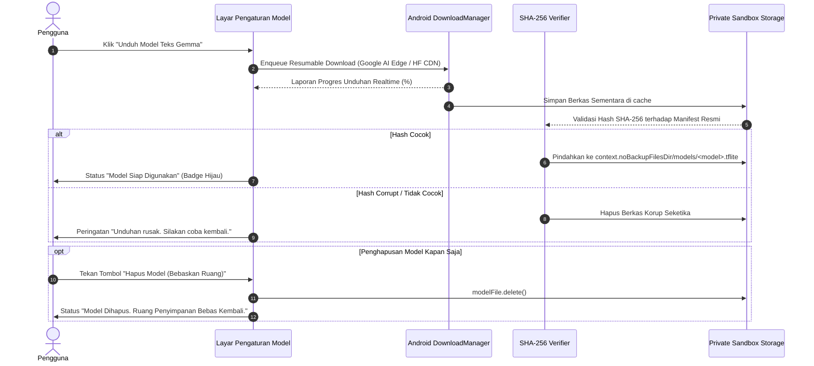

# Manajer Kapabilitas Perangkat Granular (Per-Model Evaluation)
## KerjaiAja — Fine-Grained Device Capability & Model Qualification Gate

Dokumen ini mendefinisikan arsitektur dan spesifikasi teknis komponen **Device Capability Manager** pada KerjaiAja. Komponen ini bertanggung jawab mengevaluasi kelayakan perangkat keras Android secara granular **per-model dan per-fitur**, bukan hanya sekadar memberikan satu label kaku untuk seluruh perangkat.

---

## 1. Filosofi Evaluasi: Kualifikasi Terarah Per-Model

Sebuah ponsel pintar mungkin tidak sanggup menjalankan model vision multimodal berbobot 2 GB, namun sangat mumpuni menjalankan mesin OCR lokal berbobot 30 MB dan model bahasa ultra-ringan 270M.

Oleh karena itu, KerjaiAja menolak pendekatan "satu ukuran untuk semua" (*one-size-fits-all*). Evaluasi dipisahkan menjadi empat gerbang kapabilitas independen:

```mermaid
flowchart TD
    ScanDevice[Audit Metrik Hardware Android: RAM, ABI, Storage, Thermal, Baterai] --> G1
    
    subgraph Gate1 ["Gerbang 1: Kapabilitas OCR Teks Dasar (Google ML Kit)"]
        G1{RAM >= 2 GB & Android >= 8.0?}
        G1 -->|Ya| OcrOK[OCR: QUALIFIED]
        G1 -->|Tidak| OcrFail[OCR: UNSUPPORTED]
    end
    
    subgraph Gate2 ["Gerbang 2: Model Teks Ringan (Google Gemma 3 270M)"]
        G2{RAM >= 4 GB & Bebas >= 1.2 GB & 64-bit?}
        G2 -->|Ya| Text270OK[Gemma 270M: QUALIFIED (LIMITED TIER)]
        G2 -->|Tidak| Text270Fail[Gemma 270M: NOT_RECOMMENDED]
    end
    
    subgraph Gate3 ["Gerbang 3: Model Teks Lengkap (Google Gemma 3 1B IT)"]
        G3{RAM >= 6 GB & Bebas >= 2.5 GB & Storage >= 4 GB?}
        G3 -->|Ya| Text1BOK[Gemma 1B IT: QUALIFIED (RECOMMENDED TIER)]
        G3 -->|Tidak| Text1BFail[Gemma 1B IT: NOT_RECOMMENDED]
    end
    
    subgraph Gate4 ["Gerbang 4: Model Multimodal Visual (Gemma 3n E2B Lab)"]
        G4{RAM >= 8 GB & Bebas >= 3.0 GB & NPU/GPU >= 15 TOPS?}
        G4 -->|Ya| VisionOK[Vision E2B: EXPERIMENTAL_QUALIFIED]
        G4 -->|Tidak| VisionFail[Vision E2B: NONE / BLOCKED]
    end

    ScanDevice --> G2
    ScanDevice --> G3
    ScanDevice --> G4
```

---

## 2. Matriks Persyaratan Hardware Granular Per-Model

| Fitur / Model AI | Batas RAM Total | RAM Bebas Minimal | Storage Kosong | Persyaratan Khusus | Ukuran Download | Footprint RAM |
| :--- | :--- | :--- | :--- | :--- | :--- | :--- |
| **Google ML Kit OCR v2** | $\ge 2.0\text{ GB}$ | $\ge 300\text{ MB}$ | $\ge 200\text{ MB}$ | Android 8.0+ (API 26+) | $\sim 7\text{ MB}$ | $\approx 28\text{ MB}$ |
| **Gemma 3 270M (INT4)** | $\ge 3.8\text{ GB}$ | $\ge 1.2\text{ GB}$ | $\ge 2.5\text{ GB}$ | ABI 64-bit (`arm64-v8a`) | $\sim 280\text{ MB}$ | $\approx 480\text{ MB}$ |
| **Gemma 3 1B IT (INT4)** | $\ge 6.0\text{ GB}$ | $\ge 2.5\text{ GB}$ | $\ge 4.0\text{ GB}$ | 64-bit, OpenCL/Vulkan | $\sim 850\text{ MB}$ | $\approx 1.250\text{ MB}$ |
| **Gemma 3n E2B (Visual)**| $\ge 8.0\text{ GB}$ | $\ge 3.0\text{ GB}$ | $\ge 5.0\text{ GB}$ | NPU $\ge 15\text{ TOPS}$, 64-bit | $\sim 1.800\text{ MB}$| $\approx 2.450\text{ MB}$ |

---

## 3. Desain Antarmuka Transparansi Pengguna (User Transparency UX)

Sebelum pengguna memutuskan untuk mengunduh model AI apa pun, aplikasi menampilkan lembar modal edukatif yang transparan:

### A. Komponen Dialog Evaluasi Perangkat:
1. **Status Kelayakan:** Menampilkan badge fungsional Neo-Bauhaus (misal: `SIAP UNTUK MODEL 1B` atau `DIREKOMENDASIKAN MODEL 270M`).
2. **Spesifikasi Fisik yang Terdeteksi:**
   - Total RAM terpasang vs RAM bebas saat ini.
   - Ruang penyimpanan kosong di memori internal.
   - Status termal dan level baterai.
3. **Detail Paket Model:**
   - Ukuran berkas unduhan (misal: *850 MB via Wi-Fi*).
   - Estimasi penggunaan ruang setelah diekstrak (*~1.1 GB*).
4. **Persetujuan Eksplisit (*Explicit Consent*):** Tombol aksi *"Setuju & Unduh"* dan opsi alternatif *"Tetap di Mode Produktivitas Murni (Tanpa AI)"*.
5. **Larangan Unduh Otomatis:** Sistem **DILARANG KERAS** mengunduh model secara otomatis di latar belakang tanpa persetujuan eksplisit pengguna.

---

## 4. Siklus Pengunduhan, Verifikasi SHA-256 & Penghapusan Model



### A. Fitur Download Resumable:
- Menggunakan Android `DownloadManager` sistem untuk menangani koneksi terputus dan melanjutkan unduhan (*resume*) secara otomatis saat jaringan Wi-Fi kembali terhubung.

### B. Validasi Integritas SHA-256:
- Setiap berkas bobot model memiliki pasangan nilai hash SHA-256 resmi yang di-*hardcode* di dalam manifest konfigurasi.
- Jika terjadi kerusakan paket data selama transmisi, berkas sementara segera dihapus dan pengguna diberi opsi untuk mengulang unduhan.

### C. Satu Ketukan Penghapusan (*One-Tap Deletion*):
- Pengguna dapat menghapus berkas model kapan saja melalui menu Pengaturan Aplikasi.
- Tindakan ini seketika mengembalikan ruang penyimpanan internal ponsel tanpa mengganggu data tugas, catatan belajar, atau akun pengguna.
