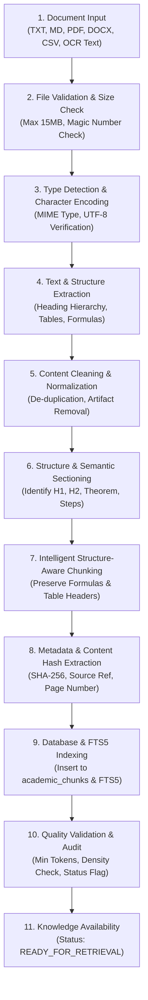

# Document Ingestion Pipeline & Intelligent Chunking
## Pipeline Pemrosesan Dokumen, Ekstraksi Teks, dan Segmentasi Berstruktur

- **Status:** APPROVED & LOCKED
- **Lokasi Dokumen:** `docs/architecture/DOCUMENT_INGESTION_PIPELINE.md`
- **Terkait:** [`KNOWLEDGE_INTELLIGENCE_LAYER.md`](file:///home/ahmadbadawi/Documents/CodinganKu/Android/KerjaiAja/docs/architecture/KNOWLEDGE_INTELLIGENCE_LAYER.md), [`LOCAL_RETRIEVAL_ENGINE.md`](file:///home/ahmadbadawi/Documents/CodinganKu/Android/KerjaiAja/docs/architecture/LOCAL_RETRIEVAL_ENGINE.md)

---

## 1. Alur Kerja Pipa Penyerapan Dokumen (End-to-End Pipeline)

Pipeline penyerapan dokumen (*Document Ingestion Pipeline*) bertugas mengubah berkas dokumen mentah (baik materi kurikulum dari CMS maupun catatan belajar pribadi mahasiswa) menjadi potongan (*chunks*) terindeks yang kaya metadata dan siap diretrieve:



---

## 2. Format Dokumen yang Didukung & Prioritas Teknis

| Format Berkas | Prioritas MVP | Engine Ekstraksi | Penanganan Khusus |
| :--- | :--- | :--- | :--- |
| **Markdown (`.md`)** | **P0 (Kandidat Utama)** | Parser AST Markdown native Kotlin | Struktur heading (`#`, `##`, `###`), tabel, dan blok kode formula langsung diekstrak secara deterministik. |
| **Plain Text (`.txt`)**| **P0 (Kandidat Utama)** | Kotlin String / BufferedReader | Normalisasi whitespace, pemisahan berbasis baris ganda (paragraf). |
| **Teks Hasil OCR** | **P0 (Foto Soal)** | Google ML Kit OCR v2 + Review UI | Diberi penanda `source_type = OCR_EXTRACTED` dan skor keyakinan (*confidence indicator*). Wajib melewati verifikasi pengguna. |
| **PDF Dokumen (`.pdf`)** | **P1 (Should Have)** | PdfRenderer Android Native / Apache PDFBox-Android (lite) | Ekstraksi teks berbasis halaman; deteksi apakah PDF berbasis teks digital atau citra pindaian (*scanned*). |
| **DOCX Dokumen (`.docx`)**| **P2 (Could Have / Post-MVP)** | XML Zip Parser (Docx format) | Membaca struktur XML `word/document.xml`. |
| **CSV / Tabular (`.csv`)** | **P2 (Could Have)** | CSV Parser deterministik | Baris pertama diperlakukan sebagai header kolom yang disertakan di setiap baris chunk. |

---

## 3. Skema Metadata Dokumen (Document-Level Metadata)

Setiap dokumen yang dimasukkan ke dalam basis pengetahuan wajib memiliki metadata lengkap di tabel `knowledge_documents`:

| Nama Kolom | Tipe Data | Deskripsi & Batasan |
| :--- | :--- | :--- |
| `document_id` | `TEXT (UUID)` | Pengenal unik dokumen (Primary Key). |
| `owner_id` | `TEXT (UUID)` | ID pemilik dokumen (User ID untuk catatan privat, `SYSTEM_ADMIN` untuk referensi kurikulum). |
| `domain` | `TEXT` | Nilai wajib: `PRODUCTIVITY` atau `ACADEMIC`. |
| `title` | `TEXT` | Judul dokumen materi atau catatan. |
| `subject` | `TEXT` | Salah satu dari 12 rumpun mata pelajaran (misal: `MATEMATIKA`, `FISIKA`). |
| `category` | `TEXT` | Kategori materi (misal: `RUMUS_STANDAR`, `SILABUS`, `CONTOH_SOAL`). |
| `source_type` | `TEXT` | Tipe sumber: `CMS_CURATED`, `USER_UPLOAD`, `OCR_EXTRACTED`. |
| `source_reference` | `TEXT` | Nama buku, silabus, atau penerbit resmi (misal: *"Kemendikbud Kurikulum Merdeka"*). |
| `document_version` | `INTEGER` | Nomor versi dokumen untuk deteksi pembaruan berkala. |
| `created_at` | `TIMESTAMP` | Waktu dokumen diunggah. |
| `updated_at` | `TIMESTAMP` | Waktu dokumen terakhir diubah (basis delta sync). |
| `processing_status` | `TEXT` | Status: `PENDING`, `PROCESSING`, `COMPLETED`, `FAILED`. |
| `content_hash` | `TEXT` | Hash SHA-256 dari konten mentah untuk mencegah duplikasi dokumen. |
| `privacy_scope` | `TEXT` | Tingkat privasi: `PUBLIC_STUDENT_BASE`, `PRIVATE_USER_ONLY`, `TEAM_SHARED`. |
| `indexing_status` | `TEXT` | Status indeks: `INDEXED`, `OUTDATED`, `CORRUPTED`. |

---

## 4. Strategi Chunking Berstruktur & Cerdas (Intelligent Chunking)

KerjaiAja secara tegas **menolak pendekatan pemotongan ukuran tetap (*fixed-size chunking*)** tanpa memperhatikan konteks, karena dapat memotong rumus matematika di tengah jalan atau memisahkan tabel dari headernya.

### 4.1 Prinsip Pemotongan (Chunking Rules)
1. **Formula-Safe Integrity:** Blok rumus matematika (format LaTeX seperti `$$E = mc^2$$` atau inline `$...$`) **DILARANG DIPOTONG**. Jika batas ukuran chunk tercapai di tengah blok rumus, pemotongan digeser ke akhir blok rumus.
2. **Heading & Section Awareness:** Setiap chunk mempertahankan hierarki judul bab/bagian asalnya (`section_title`). Contoh: *"Bab 3: Termodinamika > Sub-bab 3.2: Hukum Pertama"*.
3. **Table-Header Context Preservation:** Untuk konten tabel, baris *header* tabel wajib disalin dan disertakan di bagian awal setiap chunk tabel yang terpecah, sehingga data angka tidak kehilangan konteks kolomnya.
4. **Ukuran Chunk Proporsional:**
   - **Target Ukuran:** 150 – 300 kata (~200–400 tokens).
   - **Overlap:** 15% – 20% (sekitar 30–50 kata) untuk menjaga kontinuitas semantik antar-paragraf.
   - **Threshold Minimum:** Chunk dengan panjang $<30$ kata dibuang atau digabungkan ke chunk tetangga agar tidak menghasilkan pecahan tanpa makna.

### 4.2 Skema Metadata Chunk (Chunk-Level Metadata)
Setiap potongan teks disimpan di tabel `academic_chunks`:

```sql
CREATE TABLE IF NOT EXISTS academic_chunks (
    id INTEGER PRIMARY KEY AUTOINCREMENT,
    chunk_id TEXT UNIQUE NOT NULL,
    document_id TEXT NOT NULL,
    owner_id TEXT NOT NULL,
    domain TEXT NOT NULL CHECK(domain IN ('PRODUCTIVITY', 'ACADEMIC')),
    section_title TEXT NOT NULL,
    page_number INTEGER,
    chunk_index INTEGER NOT NULL,
    content TEXT NOT NULL,
    subject TEXT NOT NULL,
    category TEXT,
    source_reference TEXT NOT NULL,
    content_hash TEXT NOT NULL,
    quality_score REAL DEFAULT 1.0,
    is_published INTEGER DEFAULT 1,
    FOREIGN KEY(document_id) REFERENCES knowledge_documents(document_id) ON DELETE CASCADE
);
```

---

## 5. Penanganan Kasus Kegagalan & Validasi Kualitas Dokumen

Sistem ingestion dilengkapi deteksi dan penanganan kegagalan komprehensif:

| Kasus Kegagalan | Tindakan Mitigasi Deterministik |
| :--- | :--- |
| **Dokumen Kosong (0 bytes)** | Ditolak seketika pada tahap validasi; tampilkan pesan error yang jelas bagi pengguna. |
| **Berkas Rusak / Corrupted** | Tangani parsing exception secara graceful; tandai `processing_status = FAILED_CORRUPTED`. |
| **Scanned PDF (Tanpa Teks Digital)** | Deteksi jumlah karakter terekstraksi. Jika halaman memiliki $<20$ karakter teks digital, tandai bahwa dokumen berupa pindaian citra dan tawarkan alur OCR. |
| **Berkas Duplikat** | Hitung hash SHA-256 berkas; jika hash sudah ada di database, gunakan kembali indeks yang ada tanpa duplikasi penyimpanan. |
| **Paragraf Berulang / Teks Spam** | Lakukan deduplikasi lokal sederhana menggunakan deteksi Jaccard similarity antar-paragraf $>0.9$. |
| **Encoding Karakter Salah** | Fallback otomatis ke deteksi UTF-8, ISO-8859-1, atau Windows-1252 sebelum parsing. |
| **Dokumen Terlalu Besar (>15 MB)** | Batasi ukuran berkas maksimal 15 MB per dokumen pada perangkat mobile untuk mencegah kehabisan memori. |
| **Teks Hasil OCR Kurang Jelas** | Tandai `quality_score = confidence_ocr` (skala 0.0 – 1.0). Jika skor $<0.7$, tampilkan peringatan pada UI sebelum teks dapat dijadikan referensi. |
