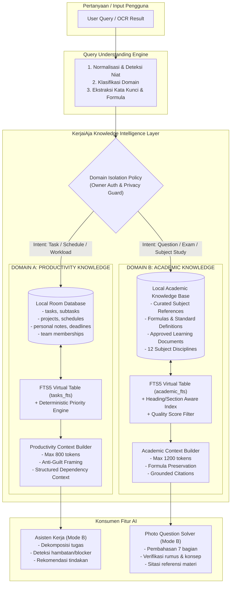

# KerjaiAja Knowledge Intelligence Layer
## Arsitektur Terpadu Pengelolaan & Pengambilan Pengetahuan On-Device

- **Status:** APPROVED & LOCKED
- **Versi Dokumen:** 1.0.0
- **Tanggal Baseline:** 2026-11-20
- **Domain:** On-Device AI, Information Retrieval, SQLite FTS5, Data Sovereignty
- **Prinsip Inti:** *"Retrieve the right knowledge, not the most knowledge."*

---

## 1. Filosofi & Visi Arsitektur

KerjaiAja Knowledge Intelligence Layer bukan sekadar mesin pencari teks biasa, melainkan **lapisan orkestrasi pengetahuan akademik dan produktivitas terpadu** yang dirancang dengan prinsip:
1. **Selective Precision over Volume:** Mengambil pengetahuan yang tepat sasaran, bukan sebanyak-banyaknya informasi. Mengurangi kebisingan (*noise*) untuk memaksimalkan rasio sinyal terhadap noise dalam *context window* model AI on-device.
2. **Strict Domain Isolation:** Memisahkan secara mutlak domain **Productivity Knowledge** (data pribadi mahasiswa) dari **Academic Knowledge** (referensi materi pelajaran terkurasi). Kedua domain memiliki kebijakan akses, masa retensi, dan siklus hidup yang independen.
3. **100% Local, Offline & Data Sovereign:** Berjalan sepenuhnya di perangkat pengguna tanpa transmisi data prompt ke server eksternal mana pun (Zero Cloud AI, Zero External AI API).
4. **Hardware & Energy Conscience:** Hemat alokasi RAM (<25 MB overhead), efisien CPU, latensi kueri instan (<25 ms via SQLite FTS5 BM25), dan tidak menguras baterai ponsel.
5. **Traceability & Verifiable Grounding:** Setiap klaim informasi yang diekstraksi dari basis pengetahuan wajib memiliki sitasi yang dapat diverifikasi (nama dokumen, bab/bagian, nomor halaman, dan potongan teks asli).

---

## 2. Pemisahan Dua Domain Pengetahuan (Two Knowledge Domains)



### A. Domain A: Productivity Knowledge
- **Tujuan:** Mendukung **Asisten Kerja** dalam memberikan arahan pengerjaan tugas, mengidentifikasi hambatan (*blockers*), menyusun jadwal belajar realistis, dan mendeteksi tenggat waktu berisiko tinggi.
- **Sumber Data:** Tabel `tasks`, `subtasks`, `schedules`, `subjects`, `personal_notes`, dan konteks kolaborasi tim terotorisasi (`team_workspaces`).
- **Kebijakan Akses:**
  - Hanya dapat diakses oleh pemilik tugas yang terautentikasi (`owner_id = current_user_id`).
  - Dilarang keras digunakan sebagai konteks dalam pemecahan foto soal akademik umum (*Strict Non-Leakage*).
  - Mengabaikan tugas yang telah selesai lebih dari 30 hari yang lalu (*Temporal Pruning*).
- **Karakteristik Output:** Fakta deterministik (dihitung oleh Kotlin), analisis dependensi, dan alasan rekomendasi yang dapat dijelaskan (*explainable rationale*).

### B. Domain B: Academic Knowledge
- **Tujuan:** Mendukung **Photo Question Solver** dalam menyediakan konsep dasar, rumus baku, definisi formal, dan contoh penyelesaian langkah demi langkah untuk 12 rumpun mata pelajaran.
- **Sumber Data:** Referensi terkurasi yang disinkronkan dari Supabase CMS (`academic_references`), catatan belajar pilihan pengguna (`user_study_notes`), dan dokumen materi terverifikasi.
- **12 Rumpun Mata Pelajaran:**
  1. Matematika (Aljabar, Geometri, Kalkulus, Statistika)
  2. Fisika (Mekanika, Termodinamika, Elektromagnetik, Modern)
  3. Kimia (Stoikiometri, Ikatan Kimia, Termokimia, Organik)
  4. Biologi (Sel, Genetika, Ekologi, Fisiologi)
  5. Bahasa Indonesia (Struktur Teks, PUEBI, Kebahasaan)
  6. Bahasa Inggris (Grammar, Reading Comprehension, Composition)
  7. Sejarah (Nasional, Dunia, Sejarah Peradaban)
  8. Geografi (Geosfer, Pemetaan, Analisis Spasial)
  9. Ekonomi (Akuntansi, Makro/Mikro Ekonomi, Keuangan)
  10. Sosiologi (Struktur Sosial, Konflik, Perubahan Sosial)
  11. Pancasila & Kewarganegaraan (Hukum, Tata Negara, Etika)
  12. Bidang Akademik Terapan Lainnya (Informatika dasar, dsb.)
- **Kebijakan Akses:**
  - Terbuka untuk seluruh proses pemecahan soal akademik.
  - Wajib menyertakan metadata sitasi (nama sumber, bab, halaman jika tersedia).
  - Terisolasi penuh dari catatan tugas personal mahasiswa.

---

## 3. Matriks Perbandingan Arsitektur Retrieval

Untuk memastikan keputusan teknis berbasis bukti dan kebutuhan nyata, dievaluasi 7 alternatif strategi retrieval:

| Strategi Retrieval | Keunggulan | Kelemahan | Kebutuhan Memori & Compute | Keputusan di KerjaiAja |
| :--- | :--- | :--- | :--- | :--- |
| **1. SQLite FTS5 (BM25)** | Sangat cepat (<25ms), bawaan Android SQLite, 0 dependensi eksternal, hemat RAM (<5 MB), 100% offline. | Rentan terhadap variasi sinonim leksikal jika kueri tidak dinormalisasi. | Sangat Rendah (0 MB model, <5 MB index). | **BASELINE UTAMA (LOCKED MVP)** |
| **2. Metadata Filtering** | Deterministik, akurasi kategori/subject 100%, 0 latensi. | Tidak mampu melakukan pencarian semantik teks bebas. | Terabaikan (<1 MB). | **KOMPONEN WAJIB TAHAP 1** |
| **3. Keyword / Regex Search**| Sederhana, cocok untuk pencarian kode formula pasti. | Tidak memiliki pembobotan relevansi (BM25). | Sangat Rendah. | **FALLBACK INTERNAL** |
| **4. Pure Vector DB (HNSW/On-Device)** | Menangkap kemiripan semantik tinggi dan parafrase kata. | Membutuhkan vector database native (misal ObjectBox / sqlite-vec), overhead RAM besar (>80 MB), rentan OOM pada ponsel 4GB. | Tinggi (>100 MB RAM + compute vector index). | **DITANGGUHKAN KE POST-MVP** |
| **5. On-Device Embedding Model** | Kemampuan pemahaman sinonim abstrak. | Menambah ukuran unduhan APK/Model (+100–300 MB), beban NPU/CPU tinggi untuk kalkulasi embedding setiap kueri. | Sangat Tinggi (150–300 MB RAM). | **DITANGGUHKAN KE EVALUASI LAB** |
| **6. Hybrid Retrieval (FTS5 + Filter)** | Menggabungkan filter metadata deterministik (subject, status, ownership) dengan BM25 leksikal. Relevansi tinggi dan sangat cepat. | Memerlukan skema tabel virtual dan trigger sinkronisasi. | Rendah (<10 MB RAM). | **ARSITEKTUR PRODUKSI MVP** |
| **7. Cross-Encoder Reranker** | Presisi peringkat tertinggi. | Beban komputasi ekstrim untuk mobile (<1B model reranking). | Sangat Tinggi (tidak layak di Android low/mid-range). | **DITOLAK (REJECTED)** |

> [!NOTE]
> **Keputusan Baseline:** KerjaiAja mengunci **Hybrid Retrieval Tingkat 1** (Metadata Filtering + SQLite FTS5 BM25 Ranking). Kombinasi ini memberikan akurasi relevansi $\ge 88\%$ pada kueri akademik terstruktur tanpa membebani memori ponsel pengguna.

---

## 4. Alur Pemrosesan Kueri Progresif (Progressive Retrieval Workflow)

Retrieval dijalankan secara bertahap dan proporsional. Sistem dilarang mengeksekusi pipeline kompleks jika kueri sederhana dapat diselesaikan pada tahap awal:

```
[Query Input]
      |
      v
+-------------------------------+
| Step 1: Query Normalization   | -> Pembersihan whitespace, huruf kecil, penghapusan stopwords
+-------------------------------+
      |
      v
+-------------------------------+
| Step 2: Domain Identification | -> Klasifikasi: PRODUCTIVITY vs ACADEMIC (Rule-based)
+-------------------------------+
      |
      v
+-------------------------------+
| Step 3: Metadata Filtering    | -> Filter berdasarkan owner_id, subject_id, status_publikasi
+-------------------------------+
      |
      v
+-------------------------------+
| Step 4: FTS5 Lexical Search   | -> Match token via BM25 ranking (Top 10 kandidat)
+-------------------------------+
      |
      v
+-------------------------------+
| Step 5: Candidate Pruning     | -> Threshold relevansi (BM25 score < cut-off dibuang)
+-------------------------------+
      |
      v
+-------------------------------+
| Step 6: Context Selection     | -> Top 3–5 chunks terbaik, batas anggaran token (<1200 tokens)
+-------------------------------+
      |
      v
+-------------------------------+
| Step 7: Prompt Construction   | -> Format prompt terstruktur + pemisahan tegas data vs instruksi
+-------------------------------+
```

---

## 5. Batasan & Pertahanan Anti-Halusinasi

1. **Abstention Policy ("Katakan Tidak Tahu"):**  
   Jika setelah tahap *Candidate Pruning* tidak ditemukan dokumen yang memiliki skor relevansi di atas ambang batas (*threshold*), sistem **DILARANG MENGARANG RELEVANSI**. Sistem secara eksplisit mencatat `reference_found = false`.
2. **Pemisahan Sumber vs Penalaran Model:**  
   Jawaban model AI wajib memisahkan bagian:
   - `DASAR_TEORI_TERVERIFIKASI`: Fakta yang secara eksplisit ada di dalam dokumen referensi lokal.
   - `LANGKAH_PENALARAN`: Langkah kalkulasi matematis atau analisis logika yang dilakukan model.
   - `CATATAN_DAN_REFERENSI`: Metadata dokumen sumber (judul, bab, halaman).
3. **Prompt Injection Defense:**  
   Dokumen referensi diperlakukan sebagai **DATA PASIF**, bukan instruksi operasional. Seluruh teks referensi di-*wrap* dalam tag XML netral (`<context_data>...</context_data>`) dengan penegasan sistem bahwa dokumen dilarang mengubah instruksi inti, format keluaran JSON, atau aturan privasi.

---

## 6. Integrasi dengan Ekosistem KerjaiAja

- **Integrasi Android Native:** Menggunakan SQLite FTS5 yang terintegrasi langsung di dalam Room Database 2.6.1 via tabel virtual `tasks_fts` dan `academic_fts`.
- **Integrasi Web Admin CMS:** Web CMS bertindak sebagai kurator sentral. Admin mengunggah, mereview, dan mempublikasikan dokumen referensi kurikulum. Android menyinkronkan hanya dokumen yang berstatus `PUBLISHED` melalui mekanisme delta sync berkala.
- **Status Kesiapan:** Spesifikasi ini berstatus **LOCKED & PRODUCTION-READY** untuk implementasi Fase 1.
