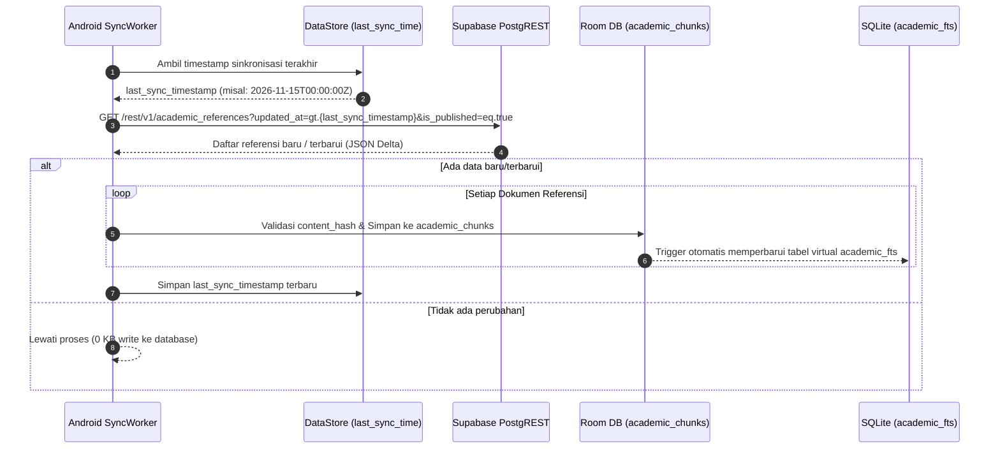

# Offline-First Knowledge Synchronization
## Mekanisme Sinkronisasi Referensi Akademik Antara Supabase CMS dan Android Native

- **Status:** APPROVED & LOCKED
- **Lokasi Dokumen:** `docs/architecture/KNOWLEDGE_SYNC.md`
- **Terkait:** [`KNOWLEDGE_INTELLIGENCE_LAYER.md`](file:///home/ahmadbadawi/Documents/CodinganKu/Android/KerjaiAja/docs/architecture/KNOWLEDGE_INTELLIGENCE_LAYER.md), [`CMS_DATA_ARCHITECTURE.md`](file:///home/ahmadbadawi/Documents/CodinganKu/Android/KerjaiAja/docs/architecture/CMS_DATA_ARCHITECTURE.md), [`SYNC_ARCHITECTURE.md`](file:///home/ahmadbadawi/Documents/CodinganKu/Android/KerjaiAja/docs/architecture/SYNC_ARCHITECTURE.md)

---

## 1. Batasan Arsitektur (Architecture Boundaries)

Sangat penting untuk membedakan antara basis pengetahuan terpusat di cloud dengan basis pengetahuan lokal di ponsel pengguna:

| Aspek | Supabase CMS (Cloud Repository) | Android Local (Room Database & FTS5) |
| :--- | :--- | :--- |
| **Peran** | Sumber utama referensi kurikulum terpusat (*Master Source of Truth*). | Salinan lokal yang dapat diakses seketika secara luring (*Offline Instant Cache*). |
| **Pengelolaan** | Dikelola, direview, dan dipublikasikan oleh kurator/admin CMS. | Disinkronkan secara selektif oleh pengguna Android via background sync. |
| **Penyimpanan** | PostgreSQL table `academic_references` & Supabase Storage (jika ada aset gambar). | SQLite Room table `academic_chunks` & virtual table `academic_fts`. |
| **Konektivitas** | Membutuhkan koneksi internet untuk akses. | **100% Offline-First**; pencarian bekerja penuh tanpa internet. |
| **Hak Modifikasi** | Hanya admin CMS berwenang via RLS `is_admin()`. | Read-Only untuk materi kurikulum; mahasiswa hanya dapat mengelola catatan pribadinya sendiri. |

---

## 2. Alur Kerja Sinkronisasi Delta (Delta Sync Workflow)

Untuk menghemat kuota data seluler mahasiswa dan menjaga kepatuhan batas egress Supabase Free Tier ($<2$ GB/bln), Android menggunakan mekanisme **Delta Synchronization** berbasis penanda waktu (*timestamp*):



---

## 3. Kontrol Pengguna & Manajemen Penyimpanan Lokal (User Consent & Storage Control)

Mahasiswa tidak dipaksa untuk mengunduh seluruh materi akademik dari 12 rumpun mata pelajaran. Aplikasi menyediakan layar pengaturan **Kelola Materi Belajar**:

1. **Pemilihan Mata Pelajaran Selektif:**
   - Mahasiswa jurusan IPA dapat memilih untuk hanya menyinkronkan: *Matematika, Fisika, Kimia, Biologi*.
   - Materi untuk rumpun lain (misal: *Ekonomi, Geografi*) tidak akan diunduh ke ponsel, menghemat ruang penyimpanan.
2. **Batas Anggaran Penyimpanan (Storage Budget):**
   - Total kuota penyimpanan lokal untuk basis pengetahuan akademik dibatasi maksimal **100 MB**.
   - Jika kuota penyimpanan ponsel menipis ($<1$ GB ruang kosong), sistem secara otomatis menghentikan pengunduhan materi baru dan menampilkan notifikasi.
3. **Pembersihan Bersih (Clean Purge):**
   - Pengguna dapat menghapus salinan lokal materi pelajaran tertentu sewaktu-waktu. Penghapusan menghapus baris di `academic_chunks` dan memicu trigger pembersihan di `academic_fts`.

---

## 4. Penanganan Konflik & Dokumen yang Dihapus (Deletion Markers)

Jika sebuah materi kurikulum di CMS ditarik dari publikasi (*revoked*) atau dihapus:

1. **Soft Delete via Deletion Marker:**
   Tabel di Supabase menandai `is_published = false` atau `deleted_at = NOW()`.
2. **Sinkronisasi Penghapusan ke Android:**
   Saat `SyncWorker` mendeteksi dokumen dengan status `is_published = false` atau `deleted_at IS NOT NULL`, aplikasi lokal akan:
   - Menghapus chunk terkait dari `academic_chunks`.
   - SQLite trigger secara otomatis menghapus entri indeks terkait di `academic_fts`.
   - Mengosongkan cache kueri yang relevan.
3. **Penanganan Unduhan Terputus (Interrupted Downloads):**
   Proses sinkronisasi berjalan dalam transaksi atomik Room Database. Jika koneksi terputus di tengah jalan, transaksi dibatalkan (*rollback*) dan tidak ada data setengah jadi yang tersimpan di indeks FTS5.

---

## 5. Pemulihan Indeks Rusak (Index Repair Mechanism)

Jika database lokal mengalami korupsi atau data indeks FTS5 tidak sinkron dengan tabel utama (misal akibat force close saat penulisan OS):

```kotlin
suspend fun rebuildAcademicIndex() {
    roomDatabase.withTransaction {
        // 1. Bersihkan tabel virtual FTS5
        roomDatabase.query("INSERT INTO academic_fts(academic_fts) VALUES('rebuild')", null)
        
        // 2. Jika perintah rebuild gagal, hapus dan sisipkan ulang seluruh data dari tabel utama
        // Room triggers akan secara otomatis mengindeks ulang seluruh baris yang ada
    }
}
```
Langkah ini memastikan integritas pencarian lokal dapat dipulihkan secara instan tanpa perlu mengunduh ulang seluruh data dari cloud.
