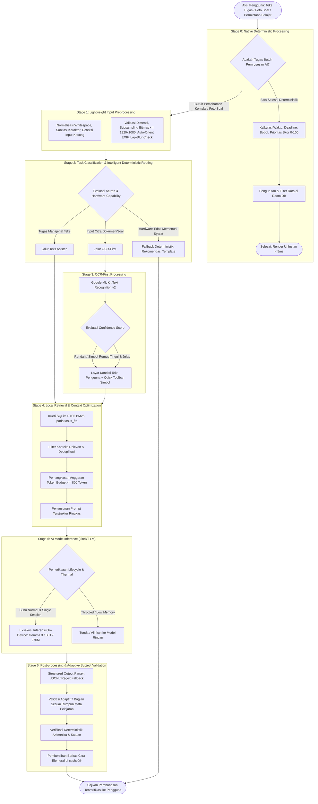

# Arsitektur Pemrosesan AI Progresif (Progressive AI Processing Architecture)
## KerjaiAja — Lightweight, Deterministic-First, On-Device Intelligence Pipeline

Dokumen ini mendefinisikan arsitektur pemrosesan cerdas bertingkat (**Progressive AI Processing Architecture**) untuk aplikasi KerjaiAja. Arsitektur ini dirancang untuk memaksimalkan efisiensi komputasi, menghemat memori RAM, menjaga suhu perangkat dan baterai, serta memastikan keandalan fungsionalitas di ekosistem ponsel pintar pelajar Indonesia.

---

## 1. Prinsip Inti Arsitektur (Core Philosophy)

> **Prinsip Utama:**  
> *"Do as much as possible with lightweight deterministic processing before invoking an AI model."*

Dalam arsitektur komputasi bergerak (*mobile edge computing*), memanggil Large Language Model (LLM) atau Vision Transformer adalah operasi komputasi terberat yang mengonsumsi alokasi memori besar ($> 1\text{ GB}$), memakan siklus CPU/NPU masif, dan menguras daya baterai. 

KerjaiAja menetapkan aturan rekayasa:
1. **LLM Bukan Mesin Serbaguna:** Hindari mendelegasikan tugas-tugas terstruktur, aritmetika, pemilahan tanggal, pencarian kata kunci, atau validasi input ke model AI jika dapat diselesaikan secara deterministik dengan kode Kotlin dalam waktu $< 2\text{ ms}$.
2. **OCR Mengungguli Vision Multimodal untuk Teks Cetak:** Model visual multimodal berukuran gigabyte dilarang digunakan untuk tugas yang dapat diselesaikan oleh mesin OCR ringan ($< 35\text{ MB}$).
3. **Penyaringan Konteks Ketat (Zero Context Bloat):** Konteks yang dikirim ke jendela inferensi LLM harus dipangkas secara leksikal (SQLite FTS5 BM25) dan dibatasi maksimal $\le 800$ token. Dilarang mengirim seluruh isi basis data ke prompt model.
4. **Non-Invasive AI (Produktivitas Tetap Berjalan Tanpa AI):** Seluruh fungsionalitas pencatatan tugas, jadwal kuliah, kalender, dan skor prioritas harus 100% aktif dan mulus tanpa memerlukan pengunduhan model AI (Mode A).

---

## 2. Diagram Pipeline Pemrosesan Progresif (End-to-End Pipeline)

---

## 3. Rincian 7 Tahapan Pemrosesan (The 7 Stages)

### Stage 0 — Native Deterministic Processing (Pemrosesan Deterministik Murni)
- **Tujuan:** Menuntaskan pekerjaan manajemen akademik murni secara instan pada CPU tanpa membangunkan model AI.
- **Operasi yang Dijalankan:**
  - Perhitungan waktu tersisa hingga batas deadline (*hours to deadline*).
  - Penghitungan durasi fokus belajar aktual vs estimasi rencana.
  - Perhitungan skor prioritas tugas 4 faktor (0–100) via `DeterministicPriorityEngine.kt`.
  - Klasifikasi 4 tingkat urgensi: `CRITICAL`, `HIGH`, `MEDIUM`, `LOW`.
  - Validasi kelengkapan berkas tugas sebelum submit (*Pre-Flight Checklist*).
  - Penghitungan persentase progres penyelesaian sub-tugas.
  - Pengurutan dan penyaringan daftar tugas di Room Database SQLite.
- **Keuntungan:** Respons UI instan ($< 5\text{ ms}$), nol konsumsi RAM LLM, nol konsumsi daya baterai tambahan.

### Stage 1 — Lightweight Input Preprocessing (Pembersihan Input Ringan)
- **Input Teks:**
  - Normalisasi whitespace berulang (`\s+` $\rightarrow$ satu spasi).
  - Pemangkasan karakter kontrol yang tidak valid.
  - Deteksi teks kosong atau spam karakter berulang.
  - Segmentasi kalimat dan ekstraksi kata kunci utama.
- **Input Gambar (Foto Soal):**
  - **Validasi Format:** Memastikan MIME type berupa JPEG/PNG yang valid dan file terbaca.
  - **Subsampling Resolusi Proporsional:** Menghitung rasio `inSampleSize` agar resolusi terpanjang tidak melebihi $1920\text{ piksel}$ ($1920\times 1080$), mencegah *OutOfMemoryError* akibat memuat bitmap mentah 12–108 MP.
  - **Koreksi Orientasi EXIF:** Membaca tag `TAG_ORIENTATION` dan menerapkan rotasi matriks agar citra selalu tegak lurus.
  - **Evaluasi Ketajaman & Blur:** Menghitung varians operator Laplacian citra. Jika varians $< 100$, sistem mendeteksi *motion blur* dan memberi saran retake kepada pengguna.
  - **Manajemen Memori:** Memanggil `bitmap.recycle()` pada bitmap perantara yang tidak lagi digunakan.

### Stage 2 — Task Classification & Intelligent Deterministic Routing
- **Tujuan:** Menentukan rute eksekusi optimal secara deterministik menggunakan aturan berbasis logika (*rule-based router*), bukan menggunakan LLM classifier.
- **Aturan Router (`TaskClassificationRouter.kt`):**
  1. *Rule 1 (Zero-AI Path):* Jika permintaan hanya menanyakan daftar tugas, pengurutan deadline, atau pencarian nama tugas $\rightarrow$ Eksekusi query Room Database langsung.
  2. *Rule 2 (Photo-Solver Path):* Jika input berupa gambar $\rightarrow$ Arahkan ke Jalur OCR-First (Stage 3).
  3. *Rule 3 (Text-Assistant Path):* Jika pengguna meminta *Task Breakdown*, analisis beban kerja, atau rekomendasi jadwal $\rightarrow$ Arahkan ke Jalur Teks Asisten (Stage 4 & 5).
  4. *Rule 4 (Hardware Guard):* Jika perangkat berada pada tier `UNSUPPORTED` atau pengguna belum mengunduh model $\rightarrow$ Alihkan ke template heuristik deterministik tanpa memicu error.
  5. *Rule 5 (Vision Lab Guard):* Fitur vision multimodal (Jalur B) hanya dapat dipilih jika soal memuat diagram/grafik visual murni DAN perangkat lolos kualifikasi `VisionCapability = EXPERIMENTAL_QUALIFIED`.

### Stage 3 — OCR-First Processing (Ekstraksi Teks Lokal & Human Review)
- **Tujuan:** Mengubah citra soal menjadi teks latin terstruktur dengan konsumsi RAM sangat rendah ($< 35\text{ MB}$).
- **Engine Terpilih:** Google ML Kit Text Recognition v2 (`com.google.mlkit:text-recognition:16.0.1`).
- **Penanganan Simbol Akademik & Human-in-the-Loop:**
  - OCR umum memiliki keterbatasan inheren dalam membaca pecahan bersusun, akar bertingkat, dan persamaan matriks.
  - Sistem menampilkan hasil OCR pada **Layar Peninjauan Teks (*Review Screen*)** sebelum dikirim ke AI.
  - Pengguna dibekali **Academic Quick-Toolbar** yang berisi tombol pintas simbol:
    - Pecahan `[a/b]`, Akar `√`, Pangkat `²`, `³`, `^`
    - Simbol Eksakta: `±`, `×`, `÷`, `≠`, `≤`, `≥`, `π`, `Δ`, `α`, `β`, `θ`, `λ`, `Ω`, `→`
  - Pengguna memilih rumpun mata pelajaran (12 Rumpun Mata Pelajaran KerjaiAja) untuk mengunci konteks akademik.

### Stage 4 — Local Retrieval & Context Optimization (KerjaiAja Knowledge Intelligence Layer)
- **Tujuan:** Menyaring data relevan dan memadatkan konteks sebelum masuk ke jendela inferensi LLM on-device via [ADR-039](file:///home/ahmadbadawi/Documents/CodinganKu/Android/KerjaiAja/docs/decisions/adr/ADR-039-TWO-TIER-KNOWLEDGE-INTELLIGENCE-LAYER.md) & [ADR-041](file:///home/ahmadbadawi/Documents/CodinganKu/Android/KerjaiAja/docs/decisions/adr/ADR-041-CONTEXT-ENGINEERING-PROMPT-INJECTION-AND-KNOWLEDGE-SYNC.md).
- **Pemisahan Konteks Berdasarkan Dua Domain:**
  - *Untuk Asisten Kerja (Productivity Knowledge):* Ekstraksi 3–5 tugas terdekat dengan tenggat waktu paling mendesak dan dependensi aktif via kueri SQLite FTS5 BM25 (`tasks_fts`). Anggaran token: $\le 800\text{ token}$.
  - *Untuk Photo Question Solver (Academic Knowledge):* Teks soal terkurasi pengguna + ekstraksi 3–5 potongan referensi kurikulum teratas (`academic_fts`) dari materi terkurasi 12 rumpun mata pelajaran. Anggaran token: $\le 1200\text{ token}$.
- **Pengendalian Anggaran Token & Pertahanan Injeksi (Token Budgeting & Prompt Injection Defense):**
  - Pemotongan terstruktur: Dokumen referensi di-wrap sebagai data pasif di `<retrieved_references>` dengan sanitasi karakter XML delimiter.
  - Menghilangkan duplikasi entri materi yang identik via hash SHA-256.
  - Menampilkan sitasi sumber yang terverifikasi (nama buku, bab, halaman jika tersedia) dan melarang sitasi fiktif.

### Stage 5 — On-Device AI Model Inference (Eksekusi Model Terisolasi)
- **Runtime:** Google AI Edge **LiteRT-LM** (Kotlin Android API).
- **Kandidat Model:**
  - *Google Gemma 3 1B IT (Quantized INT4):* Model teks utama untuk perangkat kelas menengah ke atas (RAM bebas $\ge 2.5\text{ GB}$).
  - *Google Gemma 3 270M (Quantized INT4):* Model ultra-ringan untuk perangkat kelas menengah ke bawah (RAM bebas $1.2 - 2.5\text{ GB}$).
  - *Google Gemma 3n E2B (Multimodal Lab):* Model visual khusus perangkat *flagship* (RAM $\ge 8\text{ GB}$, NPU $\ge 15\text{ TOPS}$) untuk membaca diagram geometri/grafik visual secara eksperimental.
- **Isolasi Sesi Tunggal (*Single Active Session*):**
  - Sistem melarang eksekusi inferensi AI paralel. Hanya satu permintaan inferensi yang boleh berjalan pada satu waktu.
  - OCR dan inferensi LLM dijalankan secara sekuensial (bukan paralel) untuk mencegah lonjakan RAM bersamaan (*peak RAM spike*).

### Stage 6 — Post-processing & Adaptive Subject Validation (Kendali Mutu Adaptif)
- **Tujuan:** Menjamin kebenaran numerik, konsistensi satuan, dan format pedagogi sebelum solusi disajikan ke siswa.
- **Struktur Adaptif Sesuai Rumpun Mata Pelajaran:**
  - *Matematika:* Rumus dalil, substitusi aljabar, langkah kalkulasi angka, jawaban akhir, uji pembuktian balik.
  - *Fisika:* Identifikasi variabel diketahui + satuan, yang ditanyakan, hukum gerak/energi, konversi satuan standar SI, perhitungan numerik, verifikasi dimensi.
  - *Kimia:* Persamaan reaksi setara, stoikiometri mol, perhitungan konsentrasi, simpulan reaksi.
  - *Biologi:* Konsep sitologi/ekologi/genetika, hubungan sebab-akibat proses biologis, penalaran ilmiah.
  - *Bahasa (Indonesia/Inggris):* Identifikasi kaidah EYD/Grammar, rujukan kalimat/paragraf pada teks, analisis opsi jawaban benar vs salah.
  - *Sosial & Sejarah (Ekonomi/Sosiologi/Sejarah/Geografi/PPKn):* Konteks kronologis/teori sosial, analisis data kasus, rujukan hukum/pasal konstitusi.
- **Deterministic Arithmetic Verifier:** Memeriksa kesesuaian operasi matematika dasar (`A * B = C`) dan mengoreksi secara otomatis jika LLM mengalami kesalahan kalkulasi aritmetika.
- **Pembersihan Citra Efemeral:** Berkas temporer pada `context.cacheDir/temp_solver/` langsung dihapus dari disk penyimpanan internal (`tempFile.delete()`).

---

## 4. Matriks Perbandingan Efisiensi Sumber Daya

| Parameter Arsitektur | Pendekatan Konvensional (All-to-LLM) | Progressive AI Processing (KerjaiAja) | Penghematan / Manfaat |
| :--- | :--- | :--- | :--- |
| **Kalkulasi Prioritas** | Dikirim ke LLM (Latensi 3–8 detik) | Deterministik Kotlin ($< 2\text{ ms}$) | **$99.9\%$ Lebih Cepat, 0 Byte RAM LLM** |
| **Ekstraksi Soal Teks** | Multimodal Vision ($> 2.4\text{ GB}$ RAM) | ML Kit OCR v2 ($< 35\text{ MB}$ RAM) | **Penghematan RAM $\approx 98.5\%$** |
| **Ukuran Konteks Prompt** | Seluruh data tugas ($> 3.000$ token) | Dipangkas BM25 FTS5 ($\le 800$ token) | **Penghematan Token $\approx 73\%$** |
| **Alokasi Peak RAM** | $2.8\text{ GB} - 3.5\text{ GB}$ (Beresiko OOM) | $1.25\text{ GB}$ (Gemma 1B) / $480\text{ MB}$ (270M) | **Pencegahan Crash LMK 100%** |
| **Konsumsi Baterai** | Menguras 3–5% per 5 kueri | Menguras $< 1.1\%$ per 5 kueri | **Hemat Daya $\approx 65\% - 75\%$** |
| **Integritas Aritmetika** | Halusinasi pada angka kompleks | Terverifikasi deterministik di Stage 6 | **Akurasi Perhitungan Terjamin** |
| **Ketergantungan Model**| Wajib download model untuk pakai app | App 100% berguna tanpa download model | **Inklusif untuk 100% Pengguna** |
