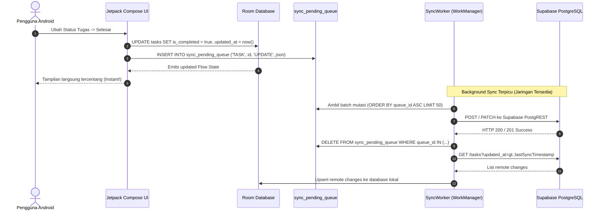

# ARSITEKTUR SINKRONISASI OFFLINE-FIRST & RESOLUSI KONFLIK — KERJAIAJA
## Room Local-First + Supabase Cloud Sync via Android WorkManager

**Dokumen:** `docs/architecture/SYNC_ARCHITECTURE.md`  
**Status:** Baseline Disetujui  
**Target:** Android Native (Kotlin Coroutines, Room 2.6.1, WorkManager, Supabase PostgREST)

---

## 1. Siklus Hidup Data Lokal (Local-Write-First)

KerjaiAja berpegang teguh pada prinsip **Local-Write-First**:
1. Setiap aksi pengguna (buat tugas, edit deadline, centang selesai, hapus) langsung ditulis ke SQLite database lokal (Room) dalam milidetik.
2. UI Jetpack Compose mengamati Flow dari Room DAO dan langsung merender perubahan secara instan tanpa menunggu respons jaringan (zero spinner delay).
3. Bersamaan dengan penulisan entitas, operasi tersebut dicatat ke tabel antrean lokal `sync_pending_queue`.

---

## 2. Struktur Tabel Antrean Sinkronisasi (`sync_pending_queue`)

```sql
CREATE TABLE sync_pending_queue (
    queue_id INTEGER PRIMARY KEY AUTOINCREMENT,
    entity_type TEXT NOT NULL,       -- 'TASK', 'SUBJECT', 'SUBTASK', 'TEAM_TASK'
    entity_id TEXT NOT NULL,         -- UUID string dari entitas
    operation TEXT NOT NULL,         -- 'INSERT', 'UPDATE', 'DELETE'
    payload_json TEXT NOT NULL,      -- Snapshot serialisasi JSON dari data yang diubah
    created_at INTEGER NOT NULL,     -- Unix epoch timestamp mutasi lokal
    retry_count INTEGER NOT NULL DEFAULT 0,
    last_error TEXT
);
```

---

## 3. Alur Kerja `SyncWorker` (WorkManager)

Pustaka Android WorkManager menjadwalkan pekerjaan sinkronisasi latar belakang dengan batasan konektivitas:



---

## 4. Strategi Resolusi Konflik (Conflict Resolution)

Ketika dua perangkat memodifikasi entitas yang sama secara independen dalam status offline, sistem menerapkan aturan resolusi berbasis hierarki:

### A. Last-Write-Wins (LWW) dengan UTC Monotonic Timestamp
- Setiap record memiliki kolom `updated_at` bertipe UTC Timestamp dan integer `version`.
- Jika versi lokal dan versi cloud berbeda:
  - Record dengan `updated_at` paling baru menjadi pemenang dan menimpa perubahan lama.
  - Untuk perubahan atribut independen (misalnya: Perangkat A mengedit judul, Perangkat B mencentang selesai), sistem melakukan **Field-Level Merging** saat memungkinkan.

### B. Soft-Deletion (Tombstone)
- Penghapusan data tidak mengeksekusi `DELETE FROM tasks` secara langsung, melainkan `UPDATE tasks SET deleted_at = CURRENT_TIMESTAMP`.
- Hal ini mencegah anomali di mana data yang dihapus saat offline di Perangkat A dihidupkan kembali (*resurrected*) oleh sync dari Perangkat B.
- Entitas dengan `deleted_at IS NOT NULL` difilter dari tampilan UI utama dan dibersihkan dari penyimpanan setelah masa tenggang 30 hari.

### C. Prompt User Conflict Resolution (Edge Case Tim)
- Jika dua anggota tim mengedit deskripsi tugas kelompok yang sama secara ekstensif pada selang waktu berdekatan:
  - Sistem menyimpan kedua versi di database lokal dengan flag `has_conflict = true`.
  - UI menampilkan banner informatif: *"Terjadi konflik revisi pada tugas ini"*, memberikan opsi bagi pengguna untuk memilih versi lokal, versi tim, atau menggabungkan keduanya.

---

## 5. Migrasi Data Akun Tamu (Guest to Cloud Account Migration)

1. Saat pengguna pertama kali menginstal aplikasi, seluruh data dibuat dengan status akun tamu (`local_guest_...`).
2. Ketika pengguna memutuskan untuk Sign In / Sign Up ke Supabase Auth:
   - Sistem mengambil `auth.uid()` dari sesi Supabase yang valid.
   - Database Room mengeksekusi transaksi atomic:
     ```sql
     UPDATE tasks SET user_id = :supabaseUid WHERE user_id LIKE 'local_guest_%';
     UPDATE subjects SET user_id = :supabaseUid WHERE user_id LIKE 'local_guest_%';
     ```
   - Seluruh data yang diperbarui dimasukkan ke dalam `sync_pending_queue` dengan operasi `INSERT`.
   - `SyncWorker` segera dipicu untuk mengunggah seluruh data historis pengguna ke database Supabase PostgreSQL.
   - Status Guest lokal dihapus dari DataStore Preferences.
