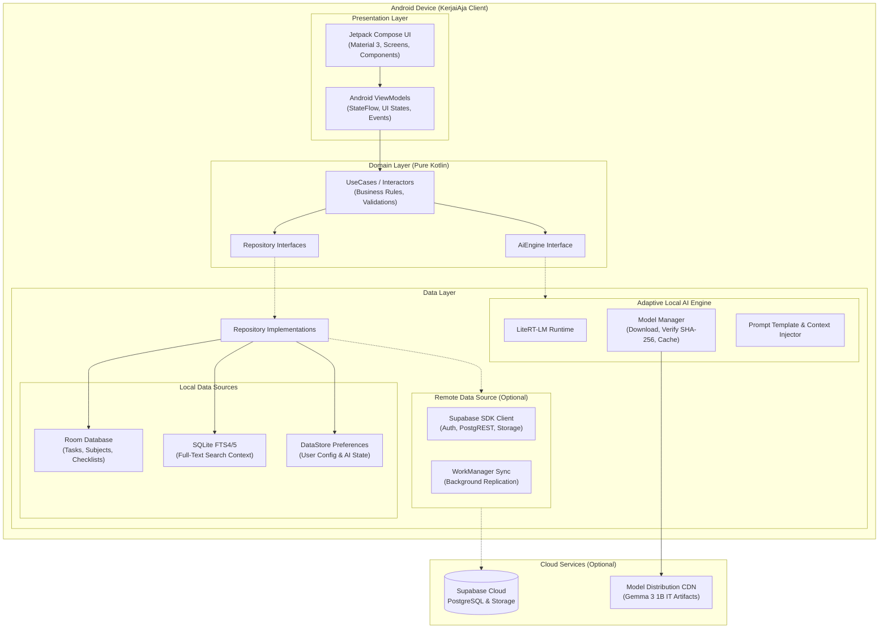

# Arsitektur Sistem (System Architecture) — KerjaiAja

Dokumen ini menjelaskan rancangan arsitektur sistem tingkat tinggi aplikasi **KerjaiAja**.

---

## 1. Prinsip Desain Sistem (System Design Principles)

1. **Local-First & Offline-First:**  
   Perangkat pengguna (*Android client*) bertindak sebagai *single source of truth*. Semua data disimpan dan diproses secara lokal di basis data SQLite melalui Room.
2. **Decoupled AI Engine:**  
   Subsistem inferensi kecerdasan buatan lokal diisolasi di balik abstraksi antarmuka (*interface abstraction*). Fitur aplikasi berinteraksi dengan kontrak AI, bukan dengan pustaka runtime spesifik secara langsung.
3. **Graceful Degradation:**  
   Jika perangkat pengguna mengalami keterbatasan memori atau tidak memiliki model AI lokal, sistem secara elegan menonaktifkan fitur AI tanpa mengganggu alur kerja produktivitas manual.
4. **Cloud-Optional Synchronization:**  
   Integrasi cloud (Supabase) bersifat opsional. Tidak ada logika bisnis lokal yang bergantung pada respon jaringan (*zero blocking network dependencies*).

---

## 2. Diagram Blok Arsitektur Tingkat Tinggi

---

## 3. Komponen & Subsistem Utama

### 3.1 Presentation Layer
- Menggunakan **Jetpack Compose** deklaratif berbasis komponen **Material 3**.
- **State Hoisting:** Semua state antarmuka dimodelkan secara *immutable* di dalam `ViewModel` menggunakan `StateFlow`.
- Satu arah aliran data (*Unidirectional Data Flow / UDF*): UI mengirimkan *User Intent/Event* ke ViewModel, dan menerima pembaruan *UI State*.

### 3.2 Domain Layer
- Modul Kotlin murni tanpa dependensi pada Android SDK (`android.*`).
- Menampung aturan bisnis esensial dalam bentuk `UseCases` (misal: `BreakdownAssignmentUseCase`, `CalculateStudyScheduleUseCase`, `VerifySubmissionChecklistUseCase`).
- Mendefinisikan antarmuka abstraksi `AiEngine` dan `Repository`.

### 3.3 Data Layer
- **Local Data Source (Room):** Mengelola persistensi relasional lokal dengan enkripsi aman jika diperlukan.
- **SQLite FTS:** Menyediakan kemampuan pencarian teks berkecepatan tinggi pada catatan dan silabus lokal untuk injeksi konteks RAG.
- **Adaptive Local AI Subsystem:** Menangani siklus hidup model AI: manajemen pengunduhan, validasi hash SHA-256, inisialisasi runtime `LiteRT-LM`, dan inferensi token.
- **Optional Remote Data Source:** Menggunakan Supabase client untuk sinkronisasi cadangan data pengguna jika fitur cloud diaktifkan.

---

## 4. Keamanan & Batasan Arsitektural

- **Tidak Ada Hardcoded Secrets:** Token dan konfigurasi disimpan dalam `secrets.properties` lokal yang dikecualikan oleh `.gitignore`.
- **Integritas Model AI:** Bobot model yang diunduh wajib diverifikasi hash SHA-256 sebelum dimuat ke memori untuk mencegah eksploitasi berkas biner rusak atau termodifikasi.
- **Manajemen Memori:** Alokasi memori inferensi dibatasi ketat menggunakan pemanggilan terstruktur (*structured concurrency*) dengan pelepasan sumber daya segera setelah inferensi selesai.
