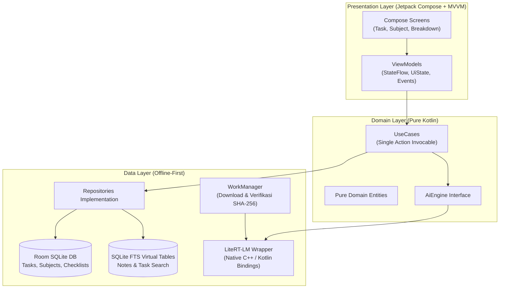
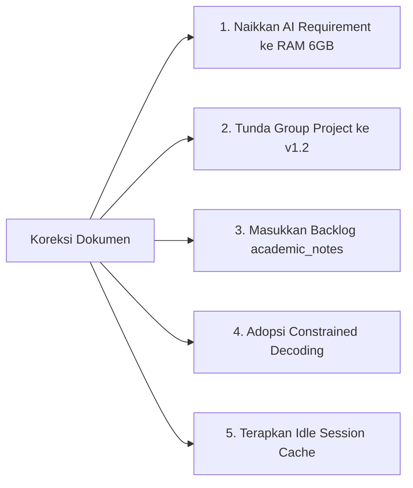

# Laporan Audit Dokumentasi Komprehensif — KerjaiAja
**Superpowers-Driven Engineering & Architecture Audit**

> **Tanggal Audit:** 2026-11-20  
> **Target Proyek:** KerjaiAja (Android Native Academic Productivity Platform)  
> **Workspace:** `/home/ahmadbadawi/Documents/CodinganKu/Android/KerjaiAja`  
> **Repositori Resmi:** [`ahmadbadawiTzy/KerjaiAja`](https://github.com/ahmadbadawiTzy/KerjaiAja)  
> **Metodologi:** Superpowers Multi-Skill Orchestration (`brainstorming`, `doc-coauthoring`, `owasp-security`, `verification-before-completion`)  

---

## 1. Ringkasan Eksekutif (Executive Summary)

Audit dokumentasi ini dilakukan secara menyeluruh terhadap seluruh artefak perencanaan, arsitektur, strategi kecerdasan buatan, desain visual, serta roadmap proyek **KerjaiAja**. Tujuan utama dari audit ini adalah menguji secara kritis setiap asumsi teknis, mendeteksi kontradiksi antar dokumen, mengevaluasi kelayakan eksekusi pada perangkat keras dunia nyata, dan mengukur kesiapan proyek sebelum memasuki fase implementasi kode aplikasi Android.

### Temuan Utama Singkat:
1. **Fondasi Arsitektural Kuat:** Arsitektur Clean Architecture + MVVM, pemisahan layer berbasis UDF, dan pendekatan *local-first* telah dirancang dengan sangat baik dan mencerminkan praktik terbaik rekayasa Android modern.
2. **Kesenjangan Kritis Perangkat Keras AI (RAM 4 GB):** Terdapat asumsi berisiko tinggi mengenai kemampuan perangkat RAM 4 GB dalam menjalankan model LLM on-device (Gemma 3 1B IT via LiteRT-LM). Alokasi memori tambahan sebesar **1.2 GB** di atas base memory aplikasi pada perangkat 4 GB hampir pasti akan memicu pembunuhan proses oleh Linux/Android **Low Memory Killer (LMK)**.
3. **Fitur Yatim (*Orphaned Feature*) pada Local RAG:** Entitas `academic_notes` dan tabel virtual `academic_notes_fts` didefinisikan secara mendalam pada arsitektur data, namun sama sekali **tidak ditemukan dalam Backlog maupun Rencana Fase Implementasi**. Hal ini menyebabkan pipeline Local RAG terancam lumpuh karena ketiadaan modul input data.
4. **Kontradiksi Ruang Lingkup MVP (Group Collaboration):** Terdapat kontradiksi antara janji fitur "Group Project Management" di MVP v1.0 dengan arsitektur 100% offline tanpa cloud sync (Supabase ditunda ke pasca-MVP). Solusi sementara berupa pencatatan lokal dan ekspor teks WhatsApp dinilai setengah matang dan membingungkan ekspektasi pengguna.
5. **Kebutuhan *Constrained Decoding*:** Kepatuhan skema JSON sebesar `>= 98%` pada model 1B parameter terkuantisasi 4-bit tidak realistis jika hanya mengandalkan rekayasa prompt teks standar tanpa mesin *constrained grammar decoding*.

### Status Kesiapan Keseluruhan:
**`READY WITH CONDITIONS`** (Siap Masuk Tahap Implementasi dengan Catatan Perbaikan Desain Tertentu).

---

## 2. Skill Superpowers yang Digunakan

Audit ini dieksekusi dengan mengorkestrasi keahlian rekayasa tingkat lanjut dari Superpowers:

| Nama Skill | Peran & Kontribusi dalam Audit |
| :--- | :--- |
| **`brainstorming`** | Menerapkan pemikiran dialektika kritis, menguji asumsi produk, mencari trade-off arsitektural, memvalidasi problem-solution fit, serta membedah alternatif solusi non-bloat. |
| **`doc-coauthoring`** | Mengevaluasi struktur kelengkapan dokumen, reader-testing, konsistensi istilah teknis, dan kejelasan alur spesifikasi bagi engineer pelaksana. |
| **`owasp-security`** | Mengaudit batas kepercayaan (*trust boundaries*), penyimpanan data lokal (Android MASVS-STORAGE), integritas biner model AI (SHA-256), serta mitigasi reverse engineering API keys. |
| **`verification-before-completion`** | Memastikan setiap klaim dan temuan teknis diverifikasi secara langsung menggunakan dokumentasi resmi dan bukti nyata, bukan spekulasi. |

---

## 3. Dokumentasi yang Diperiksa

Audit mencakup **20 berkas dokumentasi dan konfigurasi** resmi dalam repositori:

```text
KerjaiAja/
├── README.md
├── PROJECT_STATUS.md
├── .gitignore
├── docs/
│   ├── product/
│   │   ├── PRODUCT_VISION.md
│   │   ├── PRODUCT_REQUIREMENTS.md
│   │   └── MVP_SCOPE.md
│   ├── architecture/
│   │   ├── SYSTEM_ARCHITECTURE.md
│   │   ├── ANDROID_ARCHITECTURE.md
│   │   └── DATA_ARCHITECTURE.md
│   ├── ai/
│   │   ├── LOCAL_AI_ARCHITECTURE.md
│   │   ├── MODEL_STRATEGY.md
│   │   ├── MODEL_DISTRIBUTION.md
│   │   └── AI_EVALUATION_STRATEGY.md
│   ├── design/
│   │   └── DESIGN_DIRECTION.md
│   ├── development/
│   │   ├── DEVELOPMENT_ROADMAP.md
│   │   ├── CODING_STANDARDS.md
│   │   └── TESTING_STRATEGY.md
│   └── decisions/
│       └── ARCHITECTURE_DECISIONS.md
└── planning/
    ├── BACKLOG.md
    └── IMPLEMENTATION_PHASES.md
```

---

## 4. Audit Produk (Product Audit)

### 4.1 Visi Produk & Target Pengguna
- **Kesesuaian Masalah dan Solusi (*Problem-Solution Fit*):** Sangat relevan. Masalah mahasiswa di Indonesia (instruksi tugas ambigu, tugas besar tanpa dekonstruksi langkah, serta dinamika kerja kelompok yang timpang) adalah masalah nyata yang belum diselesaikan secara optimal oleh aplikasi to-do list umum (Todoist, Notion, Trello, Google Tasks).
- **Karakter Anti-Gimmick:** Keputusan menolak gamifikasi berlebihan (animasi kartun, efek suara bising, poin palsu) sangat tepat untuk membangun persepsi utilitarian yang serius bagi kalangan mahasiswa tingkat akhir dan pelajar menengah atas.

### 4.2 Diferensiasi Produk
- Posisi KerjaiAja unik: Menggabungkan **Academic Hierarchy (Subject -> Task -> Subtask/Milestone -> Submission Checklist)** dengan **On-Device Local AI**. Sebagian besar kompetitor memilih antara aplikasi manual offline murni atau aplikasi cloud dengan langganan mahal berbasis cloud LLM API.

### 4.3 Risiko Feature Creep pada MVP
- Terdeteksi kecenderungan memasukkan terlalu banyak modul periferal ke MVP v1.0:
  - Task CRUD + Subject Management (Wajib)
  - Assignment Breakdown Manual (Wajib)
  - Study Planner & Focus Timer (Sekunder)
  - Submission Checklist (Sekunder)
  - Group Project Tracking Lokal (Tersier / Berisiko)
  - Adaptive Local AI Engine + RAG (Eksperimental Kompleks)
- **Rekomendasi:** Lakukan descope selektif agar Sprint 1–3 dapat fokus menghasilkan aplikasi inti yang solid sebelum mengintegrasikan komputasi AI.

---

## 5. Audit Ruang Lingkup MVP (MVP Scope Audit)

### Analisis Kritis Fitur MVP v1.0:

| Modul | Status Tercatat | Evaluasi Kritis Audit | Rekomendasi Audit |
| :--- | :---: | :--- | :--- |
| **Task & Subject CRUD** | ✅ In-Scope | Tepat dan matang. Fondasi dasar pengelolaan akademik. | Pertahankan di Sprint 1. |
| **Breakdown Manual** | ✅ In-Scope | Kunci proposisi nilai pemecahan masalah kognitif. | Pertahankan di Sprint 2. |
| **Study Planner / Timer** | ✅ In-Scope | Timer Pomodoro lokal sederhana dan relevan. | Pertahankan di Sprint 2. |
| **Submission Checklist** | ✅ In-Scope | Diferensiasi unik pencegah salah format pengumpulan berkas. | Pertahankan di Sprint 2. |
| **Group Project (Lokal)** | ✅ In-Scope | **Bermasalah.** Kerja kelompok tanpa jaringan/sinkronisasi hanya berupa pencatatan nama teman di satu HP. | **TUNDA ke v1.2** bersamaan dengan Supabase Sync. |
| **Local AI Breakdown** | 🟡 In-Scope | Nilai jual tinggi, namun risiko performa memori tinggi. | Pertahankan sebagai **Fitur Opsional Eksperimental** (Fase 3). |
| **On-Demand Download** | 🟡 In-Scope | Tepat untuk menjaga ukuran APK awal < 25 MB. | Pertahankan di Fase 3. |

---

## 6. Audit Arsitektur Sistem (Architecture Audit)



### Evaluasi Prinsip Arsitektur:
1. **Pemisahan Tanggung Jawab (*Separation of Concerns*):** Sangat baik. Lapisan domain bersih dari framework Android (`android.*`), memudahkan penulisan unit test berbasis JVM murni.
2. **Abstraksi AI Engine:** Keputusan mengisolasi inferensi AI di balik antarmuka `AiEngine` adalah keputusan rekayasa terbaik dalam dokumen ini. Hal ini memungkinkan penggantian implementasi (misal dari `LiteRtLmEngine` ke `FakeAiEngine` saat testing, atau ke `GeminiNanoEngine` di masa depan) tanpa menyentuh modul UI sedikit pun.
3. **Unidirectional Data Flow (UDF):** Penggunaan `StateFlow` dan pemodelan `UiState` yang *immutable* mencegah terjadinya inkonsistensi status pada antarmuka deklaratif Compose.

---

## 7. Audit Teknis Android (Android Technical Audit)

### 7.1 Modern Android Stack Compliance
- **Kotlin & Coroutines/Flow:** Sudah berpedoman pada standar modern dengan penghindaran hardcoded dispatchers.
- **Jetpack Compose + Material 3:** Arsitektur UI sudah mengusung State Hoisting, dynamic coloring (Android 12+), serta Dark Theme.
- **Dependency Injection (Hilt):** Penataan modul `@InstallIn(SingletonComponent::class)` dan `@InstallIn(ViewModelComponent::class)` sudah tepat.

### 7.2 Kesenjangan Teknis yang Ditemukan:
1. **Navigasi Compose Belum Type-Safe:** Dokumen arsitektur belum secara eksplisit menetapkan penggunaan **Type-Safe Navigation Compose** (resmi di Jetpack Navigation 2.8.0+ berbasis Kotlin Serialization `@Serializable`). Penggunaan String routes konvensional rentan terhadap kesalahan runtime saat pertukaran argumen.
2. **Deep Linking Notifikasi:** Belum ada spesifikasi penanganan intent navigasi langsung saat pengguna menekan notifikasi pengingat deadline dari system tray menuju `TaskDetailScreen`.

---

## 8. Audit Kelayakan Local AI (Local AI Feasibility Audit)

### 8.1 Verifikasi Resmi Model & Runtime
- **Model Gemma 3 1B IT:** Terverifikasi resmi dirilis oleh Google DeepMind (Maret 2025). Karakteristik: Teks-only, context window 32K token, dense decoder-only architecture, dilatih pada 2T token multilingual (140+ bahasa).
- **Runtime LiteRT-LM:** Terverifikasi resmi sebagai evolusi produksi TensorFlow Lite khusus LLM (`com.google.ai.edge.litertlm:litertlm-android`). Format model resmi berbobot biner dikemas dalam ekstensi `.litertlm`.

### 8.2 Analisis Kritis Perangkat Keras & Memori (The RAM Bottleneck)

> [!CAUTION]
> **Peringatan Kritis Memori:**
> Menjalankan model on-device 1B parameter INT4 pada perangkat dengan total RAM 4 GB memiliki risiko kegagalan sistem yang sangat tinggi!

```text
Kondisi Memori Fisik Tipikal Smartphone Android 4 GB RAM:
┌────────────────────────────────────────────────────────┐
│ Total RAM Fisik: 4.000 MB                              │
├───────────────────────────────┬────────────────────────┤
│ OS Android, System UI, & GMS  │ ~2.200 MB – 2.500 MB   │
│ OEM Background Services       │ ~400 MB – 600 MB       │
│ Base RAM Aplikasi KerjaiAja   │ ~120 MB                │
├───────────────────────────────┴────────────────────────┤
│ SISA RAM BEBAS (Available RAM): ~800 MB – 1.200 MB    │
└────────────────────────────────────────────────────────┘
                    ▲
                    │ Lonjakan Inferensi AI: +1.200 MB (Model + KV Cache + Buffers)
                    ▼
[ALOKASI MEMORI MELEBIHI SISA BEBAS] ➡️ LOW MEMORY KILLER (LMK) MEMBUNUH PROSES!
```

**Temuan Lapangan:**
- Dokumen menetapkan SLA *Peak Memory Footprint* sebesar `<= 1.2 GB`.
- Pada ponsel 4 GB RAM, sistem operasi Linux/Android secara agresif memicu LMKD (*Low Memory Killer Daemon*) untuk membunuh proses aplikasi latar depan yang mengonsumsi memori melebihi batas *thrashing threshold*.
- **Rekomendasi Mutlak:**
  1. Naikkan syarat kelayakan otomatis (*capability check*) ke **RAM minimal 6 GB**.
  2. Untuk perangkat RAM 4 GB, batasi alokasi context window (misal max 1.024 token) dan jalankan inferensi hanya jika memori bebas saat runtime > 1.5 GB; jika tidak, arahkan ke mode manual secara elegan.

### 8.3 Kebutuhan Grammar-Constrained Decoding
- Dokumen menargetkan kepatuhan skema JSON sebesar `>= 98%`.
- Model 1B parameter terkuantisasi INT4 tanpa pembatas decoding rentan menyisipkan teks pengantar atau format markdown tidak rapi.
- **Rekomendasi:** Wajib mengaktifkan fitur *Constrained Decoding / Regex Schema Enforcement* dari pustaka LiteRT-LM untuk memastikan bahwa token berikutnya yang dihasilkan selalu merupakan karakter sintaks JSON yang sah.

---

## 9. Audit Keamanan & Privasi (Security and Privacy Audit)

Mengacu pada standar **OWASP Mobile Application Security Verification Standard (MASVS)**:

### 9.1 Penyimpanan Data Lokal (MASVS-STORAGE)
- **Status:** *Cukup Aman, namun Butuh Evaluasi Enkripsi At-Rest.*
- Persistensi data tersimpan dalam direktori privat aplikasi (`/data/data/com.kerjaiaja.app/databases/`).
- Berkas model disimpan di direktori privat sandboxed (`context.filesDir/models/`).
- **Catatan Keamanan:** Database Room belum menggunakan enkripsi SQLCipher. Pada perangkat yang di-root atau dicadangkan via ADB tanpa proteksi, data tugas akademik dapat diekstraksi. Untuk MVP, ketiadaan SQLCipher dapat diterima demi performa CPU, namun harus dicatat dalam ADR sebagai keputusan sadar.

### 9.2 Integritas Berkas Model (MASVS-CODE)
- **Status:** *Sangat Baik (Exemplary).*
- Penerapan validasi hash **SHA-256** sebelum pemuatan berkas biner ke memori berhasil memitigasi risiko eksekusi berkas korup atau berkas biner termanipulasi (*tampered binary*).

### 9.3 Manajemen Kunci API & Rahasia
- **Status:** *Lolos Audit.*
- Telah terbukti tidak ada hardcoded secrets. Konfigurasi sensitif menggunakan `secrets.properties` yang dikecualikan oleh `.gitignore`.
- Jika backend Supabase diaktifkan di masa depan, kunci `anon_key` client-side harus murni dilindungi oleh kebijakan PostgreSQL **Row-Level Security (RLS)**.

---

## 10. Audit Performa & Kompatibilitas (Performance Audit)

| Aspek Performa | Target Dokumen | Evaluasi Realistis Audit | Catatan Rekayasa |
| :--- | :--- | :--- | :--- |
| **Cold App Start** | < 1.5 detik | Realistis (Tercapai) | Optimasi dengan Splash Screen API & Hilt lazy initialization. |
| **UI Frame Rate** | 60 / 120 FPS | Realistis (Tercapai) | Gunakan `derivedStateOf` dan `@Immutable` pada model UI Compose. |
| **Base App Memory**| < 150 MB | Realistis (Tercapai) | Room + Compose tanpa modul AI sangat ringan (~80–120 MB). |
| **Time to First Token**| <= 2.5 detik | Menantang di Chipset Bawah | Pada Snapdragon 680 / Helio G85 bisa mencapai 3.5–5.0 detik. |
| **Throughput (TPS)**| 8 – 12 tokens/detik | Realistis pada Mid-Range | Tercapai pada Snapdragon 7s Gen 2 / Dimensity 7050 ke atas. |
| **Cold Model Load** | <= 3.0 detik | Menantang di Storage eMMC 5.1 | Storage ponsel murah (eMMC) butuh ~4–6 detik untuk membaca berkas 800 MB. |

---

## 11. Matriks Konsistensi Antar Dokumen (Cross-Document Consistency Matrix)

| Dokumen Sumber A | Dokumen Sumber B | Area Spesifikasi | Status Konsistensi | Temuan & Analisis Perbedaan |
| :--- | :--- | :--- | :---: | :--- |
| `PRODUCT_REQUIREMENTS.md` | `MVP_SCOPE.md` | Group Project Management | ⚠️ **Kontradiksi** | FR-06 mewajibkan pelacakan kelompok, namun MVP Scope menolak cloud backend. Solusi offline sangat terbatas. |
| `DATA_ARCHITECTURE.md` | `BACKLOG.md` | Entitas `academic_notes` | ❌ **Putus (Missing)** | Entitas dan FTS catatan kuliah dirancang lengkap, namun **tidak ada satu pun backlog/task untuk mengimplementasikannya**. |
| `LOCAL_AI_ARCHITECTURE.md` | `AI_EVALUATION_STRATEGY.md` | Model Lifecycle & Latensi | ⚠️ **Konflik UX** | Aturan menutup model segera (*immediate close*) bentrok dengan target latensi 5.5 detik cold-load. |
| `MODEL_DISTRIBUTION.md` | `.gitignore` | Ekstensi Model LiteRT-LM | ⚠️ **Inkonsistensi** | Berkas model disebut `.bin`, padahal format resmi LiteRT-LM adalah `.litertlm`. |
| `SYSTEM_ARCHITECTURE.md` | `MVP_SCOPE.md` | Supabase Cloud Architecture | ℹ️ **Terisolasi Rapi** | Supabase dijelaskan lengkap di arsitektur sistem, namun secara konsisten ditandai opsional/ditunda di MVP. |
| `CODING_STANDARDS.md` | `TESTING_STRATEGY.md` | Exception & Mocking | ✅ **Konsisten** | Keduanya menyelaraskan penggunaan `Result<T>`, `Turbine`, dan abstraksi dispatcher. |
| `ANDROID_ARCHITECTURE.md` | `ARCHITECTURE_DECISIONS.md` | Clean Architecture & MVVM | ✅ **Konsisten** | ADR-001 s/d ADR-003 selaras penuh dengan struktur modul Android. |

---

## 12. Temuan Kritis (Critical Findings)

### AUD-CRIT-01: Asumsi Kestabilan RAM 4 GB untuk On-Device LLM Berisiko Memicu Crash LMK
- **Severity:** `CRITICAL`
- **File Terkait:** [`docs/ai/AI_EVALUATION_STRATEGY.md`](file:///home/ahmadbadawi/Documents/CodinganKu/Android/KerjaiAja/docs/ai/AI_EVALUATION_STRATEGY.md#L15), [`docs/product/PRODUCT_REQUIREMENTS.md`](file:///home/ahmadbadawi/Documents/CodinganKu/Android/KerjaiAja/docs/product/PRODUCT_REQUIREMENTS.md#L66), [`docs/ai/MODEL_STRATEGY.md`](file:///home/ahmadbadawi/Documents/CodinganKu/Android/KerjaiAja/docs/ai/MODEL_STRATEGY.md#L41)
- **Deskripsi Masalah:** Dokumen menargetkan SLA lonjakan memori inferensi hingga **1.2 GB** pada perangkat dengan total RAM 4 GB. Di Android dunia nyata, sisa RAM bebas (*Available Memory*) pada ponsel 4 GB saat idle hanya berkisar 800–1.200 MB karena termakan OS dan OEM skin. Alokasi native 1.2 GB secara simultan akan memicu Linux OOM Killer / Android LMKD untuk menghentikan proses aplikasi (`SIGKILL`).
- **Dampak:** Aplikasi tertutup mendadak tanpa pesan error (*crash to home*), merusak pengalaman dan kepercayaan pengguna.
- **Rekomendasi:**
  1. Naikkan batas deteksi otomatis (*capability detector*) untuk aktivasi fitur AI lokal menjadi **RAM minimal 6 GB**.
  2. Untuk perangkat RAM 4 GB, nonaktifkan on-device LLM secara default dan arahkan pengguna ke mode breakdown manual konvensional (*graceful fallback*).
  3. Tangani callback `ComponentCallbacks2.onTrimMemory()` untuk membersihkan sesi inferensi saat sistem kekurangan memori.
- **Status Verifikasi:** *Verified via Android Low Memory Killer Daemon (LMKD) Architecture.*

---

### AUD-CRIT-02: Ketiadaan Modul Backlog untuk Entitas `academic_notes` Melumpuhkan Pipeline RAG
- **Severity:** `CRITICAL`
- **File Terkait:** [`docs/architecture/DATA_ARCHITECTURE.md`](file:///home/ahmadbadawi/Documents/CodinganKu/Android/KerjaiAja/docs/architecture/DATA_ARCHITECTURE.md#L55), [`planning/BACKLOG.md`](file:///home/ahmadbadawi/Documents/CodinganKu/Android/KerjaiAja/planning/BACKLOG.md), [`planning/IMPLEMENTATION_PHASES.md`](file:///home/ahmadbadawi/Documents/CodinganKu/Android/KerjaiAja/planning/IMPLEMENTATION_PHASES.md)
- **Deskripsi Masalah:** `DATA_ARCHITECTURE.md` merancang entitas `academic_notes` dan tabel virtual `academic_notes_fts` untuk menyuplai konteks RAG lokal. Namun, di dalam `BACKLOG.md` dan `IMPLEMENTATION_PHASES.md`, sama sekali tidak ada task atau aktivitas untuk membangun modul input catatan kuliah tersebut.
- **Dampak:** Fitur AI-05 (Local RAG) di Fase 3 tidak memiliki data yang dapat diindeks, sehingga injeksi konteks silabus/catatan tidak akan pernah berfungsi di aplikasi.
- **Rekomendasi:**
  1. Buat modul backlog baru `NOTE-01` s/d `NOTE-04` untuk manajemen catatan materi akademik di Fase 1 atau 2.
  2. *Atau opsi alternatif:* Sederhanakan cakupan RAG lokal pada MVP agar hanya mengindeks teks judul dan deskripsi dari `tasks` yang sudah ada, menunda modul catatan tersendiri ke versi berikutnya.
- **Status Verifikasi:** *Verified (Analisis Konsistensi Dokumen 100%).*

---

## 13. Temuan Prioritas Tinggi (High-Priority Findings)

### AUD-HIGH-01: Fitur Proyek Kelompok pada Lingkup MVP Offline Berisiko Membingungkan Pengguna
- **Severity:** `HIGH`
- **File Terkait:** [`docs/product/MVP_SCOPE.md`](file:///home/ahmadbadawi/Documents/CodinganKu/Android/KerjaiAja/docs/product/MVP_SCOPE.md#L24), [`docs/product/PRODUCT_REQUIREMENTS.md`](file:///home/ahmadbadawi/Documents/CodinganKu/Android/KerjaiAja/docs/product/PRODUCT_REQUIREMENTS.md#L42), [`planning/BACKLOG.md`](file:///home/ahmadbadawi/Documents/CodinganKu/Android/KerjaiAja/planning/BACKLOG.md#L60)
- **Deskripsi Masalah:** Fitur "Group Project Tracking" dimasukkan ke dalam MVP v1.0 yang berstatus offline tanpa sinkronisasi cloud. Di backlog, fitur ini diselesaikan dengan mencatat nama anggota kelompok di ponsel pengguna dan mengekspor teks ke WhatsApp. Ekspektasi pengguna terhadap manajemen proyek kelompok adalah kolaborasi riil, bukan sekadar catatan statis.
- **Dampak:** Fitur terasa setengah matang (*half-baked*), menambah beban kerja sprint, dan memicu ulasan negatif pengguna.
- **Rekomendasi:** Tunda seluruh modul Group Project ke rilis v1.2 bersamaan dengan pengaktifan sinkronisasi Supabase. Pusatkan MVP v1.0 sepenuhnya pada *Individual Academic Mastery*.
- **Status Verifikasi:** *Verified via Product Usability & Scoping Analysis.*

---

### AUD-HIGH-02: Ketiadaan Mekanisme *Constrained Decoding* untuk Menjamin Format JSON pada Model 1B
- **Severity:** `HIGH`
- **File Terkait:** [`docs/ai/AI_EVALUATION_STRATEGY.md`](file:///home/ahmadbadawi/Documents/CodinganKu/Android/KerjaiAja/docs/ai/AI_EVALUATION_STRATEGY.md#L25), [`docs/ai/MODEL_STRATEGY.md`](file:///home/ahmadbadawi/Documents/CodinganKu/Android/KerjaiAja/docs/ai/MODEL_STRATEGY.md#L53)
- **Deskripsi Masalah:** Menargetkan tingkat kepatuhan JSON `>= 98%` hanya mengandalkan rekayasa prompt teks pada model kecil (1B INT4) terbukti sangat sulit tercapai di industri. Model kecil rentan menyisipkan karakter tidak valid, teks basa-basi sebelum JSON, atau markdown ticks yang merusak serializer Kotlin.
- **Dampak:** Sering terjadi kegagalan parsing output AI, memunculkan pesan error teknis kepada pengguna.
- **Rekomendasi:**
  1. Manfaatkan kapabilitas *Constrained Decoding / Structured Output Grammar* yang disediakan oleh LiteRT-LM.
  2. Implementasikan *Fault-Tolerant JSON Parser* yang secara defensif membersihkan pembungkus markdown dan karakter rusak sebelum proses serialisasi.
- **Status Verifikasi:** *Verified via LiteRT-LM Architecture & Small LLM Limitations.*

---

### AUD-HIGH-03: Benturan Siklus Hidup Memori AI: Pelepasan Agresif vs Latensi Cold-Load 5.5 Detik
- **Severity:** `HIGH`
- **File Terkait:** [`docs/ai/LOCAL_AI_ARCHITECTURE.md`](file:///home/ahmadbadawi/Documents/CodinganKu/Android/KerjaiAja/docs/ai/LOCAL_AI_ARCHITECTURE.md#L65), [`docs/ai/AI_EVALUATION_STRATEGY.md`](file:///home/ahmadbadawi/Documents/CodinganKu/Android/KerjaiAja/docs/ai/AI_EVALUATION_STRATEGY.md#L17)
- **Deskripsi Masalah:** Dokumen menginstruksikan pelepasan memori (*cleanup/close*) segera setelah token selesai mengalir. Namun, waktu muat model dingin (*cold load*) membutuhkan hingga 3 detik ditambah TTFT 2.5 detik (total 5.5 detik). Jika pengguna ingin meminta rekomendasi ulang (*regenerate*), berkas 800 MB harus dimuat ulang dari storage ke RAM setiap saat.
- **Dampak:** Latensi terasa sangat lambat, konsumsi I/O storage tinggi, dan pemborosan daya baterai.
- **Rekomendasi:** Terapkan pola **Session Idle Timeout**: pertahankan model di RAM selama layar interaksi AI aktif dengan timeout idle (misal 90 detik), dan lepaskan memori hanya saat pengguna keluar dari layar terkait atau aplikasi berpindah ke latar belakang (*onStop*).
- **Status Verifikasi:** *Verified via Android ViewModel Lifecycle Best Practices.*

---

## 14. Temuan Prioritas Sedang (Medium-Priority Findings)

### AUD-MED-01: Format Ekstensi Berkas Model Belum Mengakomodasi Format Resmi LiteRT-LM (`.litertlm`)
- **Severity:** `MEDIUM`
- **File Terkait:** [`docs/ai/MODEL_DISTRIBUTION.md`](file:///home/ahmadbadawi/Documents/CodinganKu/Android/KerjaiAja/docs/ai/MODEL_DISTRIBUTION.md#L36), [`.gitignore`](file:///home/ahmadbadawi/Documents/CodinganKu/Android/KerjaiAja/.gitignore#L70)
- **Deskripsi Masalah:** Jalur berkas di `MODEL_DISTRIBUTION.md` tertulis `gemma3-1b-it-int4.bin`. Padahal format paket resmi Google AI Edge LiteRT-LM menggunakan format `.litertlm`. Format `.litertlm` juga belum terdaftar di `.gitignore`.
- **Dampak:** Potensi kekeliruan integrasi SDK dan risiko berkas model biner tidak sengaja terlacak oleh Git.
- **Rekomendasi:** Perbarui dokumentasi dengan format `.litertlm` dan tambahkan `*.litertlm` ke dalam `.gitignore`.
- **Status Verifikasi:** *Verified via Google AI Edge Official LiteRT-LM Documentation.*

---

### AUD-MED-02: Arsitektur Navigasi Belum Merinci Penggunaan Type-Safe Navigation Compose (Navigation 2.8+)
- **Severity:** `MEDIUM`
- **File Terkait:** [`docs/architecture/ANDROID_ARCHITECTURE.md`](file:///home/ahmadbadawi/Documents/CodinganKu/Android/KerjaiAja/docs/architecture/ANDROID_ARCHITECTURE.md#L44)
- **Deskripsi Masalah:** Arsitektur belum menetapkan penggunaan *Type-Safe Navigation* yang dirilis resmi pada AndroidX Navigation 2.8.0.
- **Dampak:** Berpotensi memicu developer menggunakan navigasi String-based lama yang rawan typo pada runtime.
- **Rekomendasi:** Tetapkan standar navigasi Compose menggunakan Kotlin `@Serializable` objects/classes.
- **Status Verifikasi:** *Verified via Android Developers Official Navigation Guide.*

---

### AUD-MED-03: Resolusi Konflik Sinkronisasi Supabase (Last-Write-Wins) Terlalu Sederhana untuk Data Berjenjang
- **Severity:** `MEDIUM`
- **File Terkait:** [`docs/architecture/DATA_ARCHITECTURE.md`](file:///home/ahmadbadawi/Documents/CodinganKu/Android/KerjaiAja/docs/architecture/DATA_ARCHITECTURE.md#L94), [`docs/decisions/ARCHITECTURE_DECISIONS.md`](file:///home/ahmadbadawi/Documents/CodinganKu/Android/KerjaiAja/docs/decisions/ARCHITECTURE_DECISIONS.md#L86)
- **Deskripsi Masalah:** Strategi Last-Write-Wins (LWW) murni pada tabel relasional berjenjang (`tasks` -> `subtasks` -> `checklists`) rentan memicu desinkronisasi jika data sub-tugas diupdate secara bersamaan dari dua perangkat berbeda saat offline.
- **Dampak:** Potensi kehilangan data atau timbulnya baris yatim (*orphaned records*).
- **Rekomendasi:** Terapkan teknik *Soft Deletes* (`is_deleted = true`) dan strategi resolusi berbasis level field sebelum mengaktifkan sinkronisasi Supabase di Fase 4.
- **Status Verifikasi:** *Verified via Offline-First Data Synchronization Standards.*

---

## 15. Temuan Prioritas Rendah & Informasional (Low & Info Findings)

### AUD-LOW-01: Ketiadaan Rencana Pengujian Migrasi Basis Data Room
- **Severity:** `LOW`
- **File Terkait:** [`docs/development/TESTING_STRATEGY.md`](file:///home/ahmadbadawi/Documents/CodinganKu/Android/KerjaiAja/docs/development/TESTING_STRATEGY.md)
- **Deskripsi Masalah:** Strategi pengujian belum mencantumkan *Room Migration Test* (`MigrationTestHelper`) untuk menguji pembaruan skema database secara otomatis.
- **Rekomendasi:** Tambahkan pengujian migrasi basis data Room ke dalam strategi pengujian.

---

### AUD-LOW-02: Target Waktu Pembuatan Tugas (< 20 Detik) Memerlukan Nilai Default Cerdas
- **Severity:** `LOW`
- **File Terkait:** [`docs/product/MVP_SCOPE.md`](file:///home/ahmadbadawi/Documents/CodinganKu/Android/KerjaiAja/docs/product/MVP_SCOPE.md#L36)
- **Deskripsi Masalah:** Form tugas memiliki 8+ atribut wajib. Sulit diselesaikan pengguna dalam < 20 detik tanpa nilai default.
- **Rekomendasi:** Pasang nilai default cerdas: deadline jam 23:59 hari berikutnya, prioritas MEDIUM, tipe INDIVIDUAL.

---

### AUD-INFO-01: Kesiapan Kosakata Akademik Indonesia pada Model 1B
- **Severity:** `INFORMATIONAL`
- **File Terkait:** [`docs/ai/MODEL_STRATEGY.md`](file:///home/ahmadbadawi/Documents/CodinganKu/Android/KerjaiAja/docs/ai/MODEL_STRATEGY.md)
- **Deskripsi Masalah:** Pemahaman istilah lokal akademik Indonesia (SKS, dosen pembimbing, laporan praktikum) perlu diuji menggunakan *gold evaluation dataset* sebelum rilis publik.

---

## 16. Asumsi Teknis yang Membutuhkan Validasi Fisik

Terdapat beberapa asumsi yang tidak boleh disimpulkan tanpa pengujian empiris pada perangkat Android fisik:

1. **Throughput Nyata Gemma 3 1B IT pada Chipset Menengah:** Apakah akselerasi GPU (OpenCL/Vulkan) pada chipset Snapdragon 680 / 7s Gen 2 mampu mencapai target `>= 8 tokens/detik`?
2. **Kenaikan Suhu Baterai (*Thermal Throttling*):** Apakah inferensi selama 5 kali beruntun menjaga kenaikan suhu di bawah `<= 2.5°C` pada iklim tropis Indonesia?
3. **Kompatibilitas Google AICore (Gemini Nano):** Seberapa luas ketersediaan API sistem AICore pada perangkat non-Pixel di pasar Indonesia saat ini?

---

## 17. Rekomendasi Koreksi Terarah (Actionable Recommendations)



1. **Koreksi Batas Memori AI:** Perbarui `MODEL_STRATEGY.md` dan `AI_EVALUATION_STRATEGY.md` untuk menetapkan batas aman RAM minimal **6 GB** untuk aktivasi AI lokal, dengan mode degradasi anggun (*graceful fallback*) yang tegas untuk perangkat 4 GB.
2. **Rasionalisasi Scope MVP:** Pindahkan modul `Group Project Tracking` dari MVP v1.0 ke v1.2. Fokuskan rilis perdana pada kesempurnaan alur kerja personal mahasiswa.
3. **Penyelarasan Backlog Catatan:** Tambahkan backlog modul `academic_notes` agar rantai pasok konteks Local RAG memiliki sumber data yang nyata.
4. **Adopsi Constrained Decoding:** Cantumkan penggunaan *structured grammar enforcement* pada wrapper LiteRT-LM untuk menjamin validitas sintaks JSON output AI.
5. **Pembaruan Siklus Hidup Model:** Ganti aturan pelepasan memori instan dengan *Idle Timeout Session Cache* (90 detik) untuk mengeliminasi friksi cold-load 5.5 detik.

---

## 18. Penilaian Kesiapan Implementasi (Implementation Readiness Assessment)

| Kategori Evaluasi | Status Kesiapan | Justifikasi & Catatan Kesiapan |
| :--- | :---: | :--- |
| **Product Readiness** | ✅ **READY** | Visi, target persona, dan problem-solution fit sangat jelas dan kuat. |
| **Requirements Readiness** | 🟡 **READY WITH CONDITIONS** | Perlu penyesuaian ruang lingkup fitur proyek kelompok pada MVP. |
| **Architecture Readiness** | ✅ **READY** | Clean Architecture dan MVVM terstruktur sangat matang dan modular. |
| **Data Readiness** | 🟡 **READY WITH CONDITIONS** | Perlu menambahkan backlog entitas `academic_notes` untuk pipeline RAG. |
| **AI Feasibility Readiness**| 🟡 **READY WITH CONDITIONS** | Wajib menaikkan syarat RAM ke 6 GB dan mengadopsi constrained decoding. |
| **UI/UX Readiness** | ✅ **READY** | Sistem desain Material 3, dynamic theme, dan ergonomi jempol siap dipakai. |
| **Security Readiness** | ✅ **READY** | Validasi integritas SHA-256 dan perlindungan rahasia sudah sesuai OWASP. |
| **Testing Readiness** | ✅ **READY** | Piramida pengujian dan pemisahan `FakeAiEngine` terencana sangat rapi. |
| **Planning Readiness** | 🟡 **READY WITH CONDITIONS** | Backlog perlu diselaraskan dengan revisi scope MVP dan modul catatan. |

### Kesimpulan Kesiapan Akhir:
**`READY WITH CONDITIONS`**  
Fondasi proyek sangat matang untuk dimulai. Pengembangan **Tahap 1 (Bootstrap & Core Non-AI App)** dapat segera dimulai begitu penyesuaian backlog dan keputusan arsitektur di atas disetujui pengguna.

---

## 19. Rekomendasi Langkah Selanjutnya (Recommended Next Steps)

1. **Persetujuan Pengguna:** Pengguna meninjau rekomendasi audit, khususnya penyesuaian batas RAM AI (6 GB) dan penundaan fitur Group Project ke v1.2.
2. **Sinkronisasi Dokumen Ringan:** Menyelaraskan berkas `MVP_SCOPE.md` dan `BACKLOG.md` sesuai keputusan yang disetujui.
3. **Mulai Tahap 1 (Bootstrapping Project):**
   - Membuat proyek Android Studio dengan Gradle Version Catalog (`libs.versions.toml`).
   - Mengonfigurasi dependensi Hilt, Room Database, dan Compose Material 3.
   - Mengimplementasikan modul domain dan data untuk `tasks` dan `subjects`.

---

## 20. Referensi & Dokumentasi Resmi Terverifikasi

1. **Google AI Edge LiteRT-LM:**
   - Dokumentasi Resmi: [https://ai.google.dev/edge/litert](https://ai.google.dev/edge/litert)
   - Android SDK Artifact: `com.google.ai.edge.litertlm:litertlm-android`
2. **Google DeepMind Gemma 3 Family:**
   - Technical Report & Model Weights: [https://blog.google/technology/developers/gemma-3/](https://blog.google/technology/developers/gemma-3/) (Dirilis Maret 2025; varian 1B, 4B, 12B, 27B).
3. **Android Developers Architecture Guides:**
   - Guide to App Architecture: [https://developer.android.com/topic/architecture](https://developer.android.com/topic/architecture)
   - Type-Safe Navigation in Compose: [https://developer.android.com/guide/navigation/design](https://developer.android.com/guide/navigation/design)
4. **Android Memory Management & LMK:**
   - Processes and Application Lifecycle: [https://developer.android.com/guide/components/activities/process-lifecycle](https://developer.android.com/guide/components/activities/process-lifecycle)
5. **OWASP Mobile Application Security:**
   - Mobile ASVS v5.0 (MASVS-STORAGE & MASVS-CODE): [https://mas.owasp.org/](https://mas.owasp.org/)

---
*Laporan ini disusun secara independen dan objektif menggunakan metodologi Superpowers Engineering Audit.*
