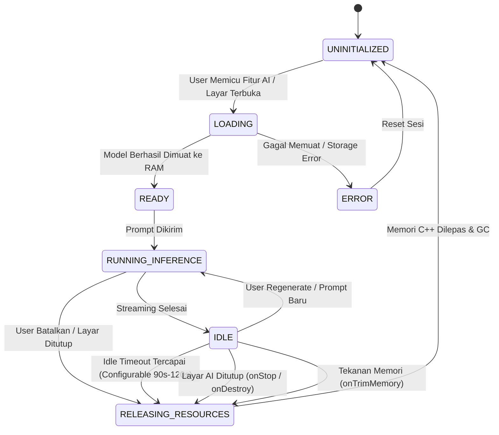

# ADR-004: Siklus Hidup Sesi AI Adaptif dan Manajemen Sumber Daya (Adaptive AI Session Lifecycle & Resource Management)

> [!NOTE]
> **Status:** **CONSOLIDATED INTO ADR-034** (Rancangan Awal Pra-Rebaseline)  
> Dokumen ini merupakan rancangan awal siklus hidup sesi AI lokal. Seluruh keputusan dan implementasinya telah dilebur, diperluas, dan diformalkan secara definitif ke dalam **[ADR-034: On-Device Model Lifecycle & Memory Management](file:///home/ahmadbadawi/Documents/CodinganKu/Android/KerjaiAja/docs/decisions/adr/ADR-034-ON-DEVICE-MODEL-LIFECYCLE-AND-MEMORY-MANAGEMENT.md)**.  
> Nomor kanonikal ADR-004 pada master index dialokasikan untuk **[ADR-004: Backend AI Inference Architecture](file:///home/ahmadbadawi/Documents/CodinganKu/Android/KerjaiAja/docs/decisions/adr/ADR-004-BACKEND-AI-INFERENCE.md)** (Status: SUPERSEDED oleh ADR-014).

- **Status:** CONSOLIDATED INTO ADR-034
- **Tanggal:** 2026-11-20
- **Pengambil Keputusan:** Tim Arsitektur KerjaiAja (Disetujui Pengguna)
- **Terkait Dokumen:** [`docs/ai/LOCAL_AI_ARCHITECTURE.md`](file:///home/ahmadbadawi/Documents/CodinganKu/Android/KerjaiAja/docs/ai/LOCAL_AI_ARCHITECTURE.md), [`docs/architecture/ANDROID_ARCHITECTURE.md`](file:///home/ahmadbadawi/Documents/CodinganKu/Android/KerjaiAja/docs/architecture/ANDROID_ARCHITECTURE.md), [`docs/decisions/adr/ADR-034-ON-DEVICE-MODEL-LIFECYCLE-AND-MEMORY-MANAGEMENT.md`](file:///home/ahmadbadawi/Documents/CodinganKu/Android/KerjaiAja/docs/decisions/adr/ADR-034-ON-DEVICE-MODEL-LIFECYCLE-AND-MEMORY-MANAGEMENT.md)

---

## 1. Konteks (Context)

Model bahasa alami on-device (Gemma 3 1B IT INT4) memiliki ukuran berkas sekitar 600–900 MB. Proses membaca berkas dari internal storage dan memetakannya ke dalam memori native runtime (*cold model load time*) membutuhkan waktu terukur antara 2.0 hingga 4.0 detik tergantung tipe penyimpanan perangkat (UFS vs eMMC).

Dokumen arsitektur awal (`LOCAL_AI_ARCHITECTURE.md`) menetapkan aturan pelepasan memori (*cleanup/close*) segera setelah aliran token inferensi selesai. Audit dokumentasi (`docs/audits/SUPERPOWERS_DOCUMENTATION_AUDIT.md` temuan AUD-HIGH-03) menyoroti bahwa pelepasan instan ini menyebabkan pengguna harus menunggu latensi cold-load 5.5 detik berulang kali setiap kali ingin melakukan revisi prompt, perbaikan sub-tugas, atau regenerasi output.

## 2. Masalah (Problem)

Pelepasan memori instan merusak kenyamanan penggunaan (*user experience*) dan memicu *disk I/O thrashing* serta pemborosan baterai. Sebaliknya, mempertahankan model di RAM terus-menerus tanpa batas waktu (*infinite caching*) akan membebani sistem operasi Android dan rentan memicu pembunuhan proses oleh *Low Memory Killer* (LMKD). Menetapkan satu angka waktu tunggu tunggal (*hardcoded single timeout*) juga tidak adil bagi variasi kapasitas perangkat keras Android yang sangat beragam.

## 3. Keputusan (Decision)

Mengadopsi **State Machine Siklus Hidup AI Adaptif Berbasis Event dan Tekanan Memori (*Event-Driven Adaptive AI Session Lifecycle*)**:

### 1. Definisi Status State Machine:
- **`UNINITIALIZED`:** Berkas model tersimpan di disk, tidak ada alokasi memori RAM native.
- **`LOADING`:** Alokasi memori dan pembacaan berkas model oleh runtime C++ LiteRT-LM.
- **`READY`:** Model telah dimuat di RAM dan siap menerima prompt inferensi.
- **`RUNNING_INFERENCE`:** Proses komputasi dan aliran token (*token stream*) sedang aktif.
- **`IDLE`:** Inferensi selesai, model tetap dipertahankan di RAM untuk mengantisipasi aksi lanjutan pengguna.
- **`RELEASING_RESOURCES`:** Penutupan sesi C++, pelepasan alokasi pointer memori native, dan garbage collection.
- **`ERROR`:** Terjadi kegagalan inisialisasi, berkas rusak, atau kehabisan memori.

### 2. Kebijakan Pelepasan Adaptif Berbasis Event (*Trigger-Based Cleanup*):
Pelepasan memori model dari status `IDLE` atau `RUNNING_INFERENCE` ke `RELEASING_RESOURCES` dipicu secara deterministik oleh kejadian-kejadian berikut:
1. **Perpindahan Layar Antarmuka (*Screen Exit*):** Ketika pengguna menekan tombol kembali (*back*), berpindah tab navigasi, atau Activity memasuki siklus `onStop()` / `onDestroy()`.
2. **Aplikasi Masuk Latar Belakang (*Backgrounding*):** Jika aplikasi diminimalkan atau pengguna beralih ke aplikasi lain, sesi inferensi langsung dihentikan dan memori dilepas agar tidak membebani sistem.
3. **Tekanan Memori Sistem (*System Memory Pressure*):** Mengintegrasikan `ComponentCallbacks2.onTrimMemory()`. Jika sistem mengirimkan sinyal `TRIM_MEMORY_RUNNING_CRITICAL`, `TRIM_MEMORY_BACKGROUND`, atau `TRIM_MEMORY_COMPLETE`, aplikasi secara proaktif melepas model sebelum dibunuh oleh OS.
4. **Configurable Idle Timeout:** Selama pengguna tetap berada di layar AI namun tidak melakukan interaksi apa pun, timer idle (dapat dikonfigurasi, default 90–120 detik) akan melepaskan model secara tenang.
5. **Dukungan Pembatalan Pengguna (*Cancellation Support*):** Pengguna dapat menekan tombol *Batal* saat inferensi berlangsung; Coroutine Job akan dibatalkan secara terstruktur (*structured concurrency*) dan engine kembali ke status `READY` atau `RELEASING_RESOURCES` tanpa *memory leak*.

## 4. Alternatif yang Dipertimbangkan (Alternatives Considered)

- **Alternatif A (Pelepasan Instan Setiap Kali Inferensi Selesai):** Ditolak karena menimbulkan friksi cold-load 5.5 detik pada setiap percobaan revisi prompt.
- **Alternatif B (Menjaga Model Selamanya di Singleton Application Scope):** Ditolak karena sangat berbahaya bagi stabilitas sistem Android dan melanggar prinsip hemat memori.

## 5. Konsekuensi (Consequences)

### Positif:
- Re-inferensi dan penyesuaian instruksi tugas terasa instan (zero cold-load latency saat sesi masih hangat).
- Konsumsi memori tetap terkendali ketat dan ramah terhadap siklus hidup Android (*lifecycle-aware*).
- Aman dari pemutusan paksa LMKD berkat integrasi proaktif `onTrimMemory()`.

### Negatif:
- Memerlukan implementasi `AiSessionLifecycleManager` yang terikat pada Android Lifecycle dan Coroutine Scope.

## 6. Risiko & Mitigasi (Risks & Mitigations)

- **Risiko:** Kebocoran memori jika ViewModel dihancurkan sebelum pointer native C++ dibebaskan.
- **Mitigasi:** Memanggil `engine.close()` di dalam blok `onCleared()` ViewModel dan memastikan penggunaan Coroutine scope yang terikat (`viewModelScope`).

## 7. Persyaratan Validasi (Validation Requirements)

- `REQUIRES TECHNICAL VALIDATION`: Pengujian kebocoran memori (*memory leak test*) menggunakan LeakCanary dan Android Studio Memory Profiler untuk memastikan alokasi RAM native kembali ke baseline saat pengguna meninggalkan layar asistensi AI.
