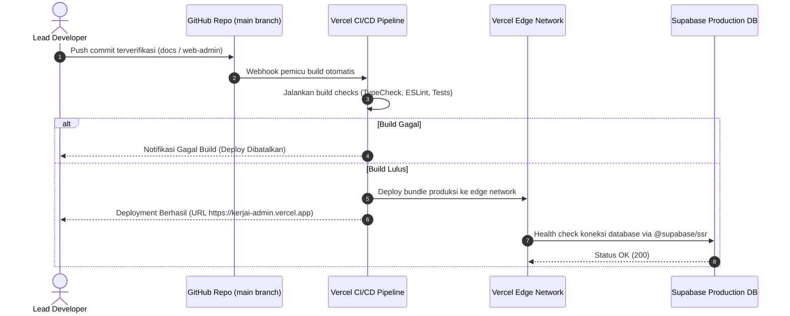

# Strategi Penerapan Vercel & Supabase (Deployment & Cost Strategy) — KerjaiAja
## Vercel Hobby Evaluation · Supabase Free Tier Guardrails · Zero-Cost Operational Roadmap

- **Dokumen:** `docs/deployment/VERCEL_SUPABASE_DEPLOYMENT.md`
- **Status:** BASELINE APPROVED
- **Target Hosting Web:** Vercel (Next.js 15 App Router)
- **Target Managed BaaS:** Supabase Free Tier ($0 / Rp0)
- **Kompatibilitas:** Docker / Coolify / VPS Ready (Anti-Vendor Lock-in)

---

## 1. Evaluasi Ketentuan Lisensi & Kebijakan Vercel Hobby

### 1.1 Analisis Kebijakan Vercel Hobby (Terbaru)
Vercel menyediakan paket **Hobby ($0)** dengan batasan hukum dan teknis yang jelas:
- **Ketentuan Penggunaan:** Paket Hobby diperuntukkan secara eksklusif bagi proyek **personal, hobi, riset, atau non-komersial**.
- **Kategori KerjaiAja:**
  - Pada tahap MVP / Beta / Riset Akademik Mahasiswa: Penggunaan KerjaiAja Web Admin CMS memenuhi syarat non-komersial paket Hobby.
  - Jika di masa mendatang KerjaiAja memungut biaya langganan, menerima sponsor komersial, atau berbadan usaha resmi, Vercel mewajibkan peningkatan ke paket **Vercel Pro ($20/seat/bulan)**.
- **Kebijakan Rekayasa:** Aplikasi Web Admin CMS dibangun murni menggunakan standar web Next.js standar tanpa dependensi eksklusif Vercel (seperti Edge Middleware berbayar atau Vercel KV), sehingga aplikasi **100% siap dipindahkan (*portable*)** ke platform hosting gratis atau murah lainnya jika diperlukan.

### 1.2 Alternatif Hosting Bebas Biaya (Fallback Hosting Options)
Jika batasan Vercel Hobby tercapai atau proyek beralih ke komersial tanpa anggaran bulanan:
1. **Self-Hosted Docker via VPS Gratis (Oracle Cloud Always Free / Fly.io / Render Free):**
   Aplikasi menyertakan `Dockerfile` multi-stage standar untuk build produksi mandiri.
2. **Coolify / Dokploy:** Platform PaaS open-source self-hosted di server pribadi.
3. **Cloudflare Pages / OpenNext:** Menjalankan Next.js di jaringan global Cloudflare dengan kuota gratis melimpah.

---

## 2. Guardrails Kuota Supabase Free Tier ($0 / Rp0)

KerjaiAja menggunakan satu proyek Supabase Free Tier untuk melayani Android dan Web CMS. Batasan kuota wajib dijaga dengan disiplin:

| Sumber Daya Supabase | Batas Paket Gratis | Konsumsi Estimasi KerjaiAja | Strategi Pengendalian & Guardrails |
| :--- | :---: | :---: | :--- |
| **PostgreSQL Database** | **500 MB** | ~15–35 MB (MVP) | Paginasi server, penulisan log efisien, zero model storage. |
| **File Storage** | **1 GB** | ~50–120 MB | Hanya untuk lampiran tugas mahasiswa ($\le 5\text{ MB}$); foto soal diproses efemeral lokal (zero storage upload). |
| **Bandwidth (Egress)** | **2 GB / bulan** | ~200–400 MB / bulan | Delta sync via `updated_at`, seleksi kolom minimal, tanpa streaming data biner besar. |
| **Monthly Active Users (MAU)** | **50,000 MAU** | ~500–2,000 MAU | Onboarding Guest-First mengurangi pembuatan akun auth yang tidak aktif. |
| **Supabase Project Pausing** | **7 Hari Idle** | Terjaga oleh aktivitas pengguna aktif | Peringatan: Dilarang menggunakan skrip cron ping manipulatif yang melanggar ToS Supabase. |

> [!IMPORTANT]
> **Larangan Aktivasi Billing Otomatis:**
> Dilarang keras menambahkan kartu kredit, mengaktifkan opsi *spend cap*, atau melakukan upgrade berbayar tanpa instruksi eksplisit dan persetujuan tertulis dari pengguna.

---

## 3. Konfigurasi Variabel Lingkungan (Environment Variables)

### 3.1 Variabel Publik (Dapat Diakses Browser)
Hanya nilai yang aman untuk publik yang diizinkan memiliki prefix `NEXT_PUBLIC_`:
```bash
# URL Proyek Supabase Publik
NEXT_PUBLIC_SUPABASE_URL=https://your-project-id.supabase.co

# Anon Public Key (Aman di browser, dibatasi oleh RLS)
NEXT_PUBLIC_SUPABASE_ANON_KEY=eyJhbGciOiJIUzI1NiIsInR5cCI6IkpXVCJ9...
```

### 3.2 Variabel Privat Server (Dilarang Masuk Browser)
Hanya terbaca di runtime server (Server Components / Server Actions):
```bash
# Service Role Key (Hanya untuk inisialisasi darurat di lib/supabase/admin.ts)
# PERINGATAN: JANGAN PERNAH MENGGUNAKAN PREFIX NEXT_PUBLIC_
SUPABASE_SERVICE_ROLE_KEY=eyJhbGciOiJIUzI1NiIsInR5cCI6IkpXVCJ9...

# Secret untuk enkripsi sesi admin internal
ADMIN_SESSION_SECRET=super_secret_high_entropy_random_string_32_chars
```

---

## 4. Alur Integrasi Git & Deployment Vercel



### Prosedur Penerapan:
1. Hubungkan repositori GitHub `ahmadbadawiTzy/KerjaiAja` ke dashboard Vercel.
2. Tetapkan **Root Directory** ke direktori `web-admin` (jika menggunakan monorepo) atau konfigurasi Next.js root.
3. Masukkan variabel lingkungan pada menu **Project Settings $\rightarrow$ Environment Variables**.
4. Aktifkan **Preview Deployments** pada pull request untuk verifikasi sebelum penggabungan ke branch `main`.
