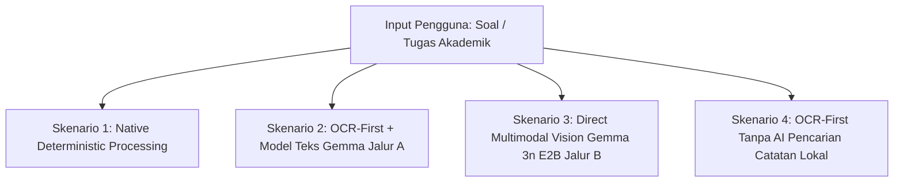

# Protokol & Rencana Benchmark Kinerja AI On-Device
## KerjaiAja — Reproducible Performance & Resource Benchmark Plan

Dokumen ini mendefinisikan metodologi, metrik pengukuran, lingkungan uji, dan protokol benchmark kinerja pemrosesan AI *on-device* yang dapat direproduksi (**reproducible benchmark plan**) untuk aplikasi KerjaiAja.

---

## 1. Prinsip Kejujuran Pengukuran (Benchmark Integrity Principle)

KerjaiAja mematuhi prinsip kejujuran rekayasa mutlak:
1. **Tidak Menetapkan Estimasi Sebagai Fakta:** Seluruh nilai target latensi dan konsumsi daya adalah **hipotesis target rekayasa (*engineering targets*)** yang wajib divalidasi melalui eksekusi pengujian fisik pada perangkat nyata di laboratorium.
2. **Pemisahan Tegas Akurasi OCR vs Kebenaran Jawaban AI:**  
   - *OCR Accuracy:* Mengukur ketepatan ekstraksi karakter dari piksel citra (CER, WER, NRR).
   - *Answer Correctness:* Mengukur ketepatan penalaran ilmiah dan perhitungan matematika dari model generatif.  
   Keduanya adalah metrik independen dan dilarang disamakan.
3. **Reproduksibilitas:** Setiap pengujian harus dapat dijalankan ulang menggunakan dataset publik terstandardisasi dengan kondisi termal awal yang sama ($25^\circ\text{C}$).

---

## 2. Matriks Metrik Pengukuran Standar

| No | Parameter Metrik | Satuan | Alat Ukur / Metode Android | Target Standar Kualitas |
| :--- | :--- | :--- | :--- | :--- |
| 1 | **Peak RAM (Resident Set Size)** | Megabyte (MB) | `android.os.Debug.getPss()` / Android Profiler | $\le 1.400\text{ MB}$ (Gemma 1B), $\le 550\text{ MB}$ (270M) |
| 2 | **Cold Model Load Time** | Milidetik (ms) | `SystemClock.elapsedRealtime()` saat init | $\le 2.500\text{ ms}$ (NPU/GPU), $\le 4.500\text{ ms}$ (CPU) |
| 3 | **Time-to-First-Token (TTFT)** | Milidetik (ms) | Waktu dari prompt siap hingga emisi token pertama | $\le 800\text{ ms}$ (Gemma 1B), $\le 400\text{ ms}$ (270M) |
| 4 | **Throughput Dekode Teks** | Token / detik | Kecepatan generasi token autoregresif | $\ge 15\text{ token/s}$ (Mid-range), $\ge 28\text{ token/s}$ (Flagship)|
| 5 | **Latensi Ekstraksi OCR** | Milidetik (ms) | Durasi eksekusi Google ML Kit Text v2 | $\le 250\text{ ms}$ pada citra $1920\times 1080$ |
| 6 | **End-to-End Pipeline Latency** | Detik (s) | Waktu dari jepret foto hingga 7 bagian solusi muncul | $\le 6.0\text{ detik}$ (Jalur A pada perangkat Mid-Range) |
| 7 | **Ukuran Download & Disk** | Megabyte (MB) | Ukuran berkas `.tflite` terkompresi | $\le 300\text{ MB}$ (270M), $\le 900\text{ MB}$ (1B IT) |
| 8 | **Dampak Baterai & Termal** | $\% \Delta \text{Bat}$ & $^\circ\text{C}$ | Uji 5 kali inferensi beruntun ($25^\circ\text{C}$ ambient) | Baterai turun $\le 1.5\%$, Suhu naik $\le +3.0^\circ\text{C}$ |
| 9 | **Akurasi OCR (CER / WER / NRR)**| Persentase (%) | Pengujian terhadap 100 citra teks cetak & tulis | CER $\le 2.0\%$, WER $\le 4.0\%$, NRR (Angka) $\ge 98.0\%$ |
| 10 | **Akurasi Jawaban Akademik** | Persentase (%) | Evaluasi dataset 240 soal pada 12 rumpun mapel | $\ge 85.0\%$ (Eksakta), $\ge 90.0\%$ (Sosial & Bahasa) |

---

## 3. Matriks Perbandingan 4 Pendekatan Pemrosesan

Protokol benchmark menguji 4 skenario pemrosesan komparatif:

### Tabel Komparasi 4 Skenario Pemrosesan:

| Parameter Evaluasi | Skenario 1: Native Deterministic | Skenario 2: OCR-First + Teks Gemma | Skenario 3: Multimodal Vision Lab | Skenario 4: OCR + Local FTS (No AI) |
| :--- | :--- | :--- | :--- | :--- |
| **Model AI Digunakan** | Tidak Ada (Kode Kotlin) | Google Gemma 3 1B IT / 270M | Gemma 3n E2B Multimodal | Tidak Ada (FTS5 BM25) |
| **Alokasi Peak RAM** | $\mathbf{< 15\text{ MB}}$ | $\approx \mathbf{1.250\text{ MB}}$ | $\approx \mathbf{2.600\text{ MB}}$ | $\mathbf{< 45\text{ MB}}$ |
| **Latensi Respons** | $\mathbf{< 5\text{ ms}}$ | $\mathbf{3.5 - 5.5\text{ detik}}$ | $\mathbf{8.0 - 15.0\text{ detik}}$ | $\mathbf{180 - 350\text{ ms}}$ |
| **Konsumsi Baterai** | Hampir 0% | $\approx 0.2\% - 0.3\%$ per soal | $\approx 0.8\% - 1.2\%$ per soal | $\approx 0.05\%$ per soal |
| **Kasus Penggunaan** | Deadline, Prioritas, Filter | Soal teks, rumus eksakta, tugas | Soal diagram visual murni | Pencarian catatan rumus tersimpan |
| **Kelayakan Hardware** | 100% Smartphone Android | Mid-Range ke atas (RAM $\ge 4\text{ GB}$) | Flagship murni (RAM $\ge 8\text{ GB}$) | 100% Smartphone Android |

---

## 4. Lingkungan Uji Profil Perangkat Nyata (Target Testbed)

Pengujian benchmark fisik ditargetkan pada 3 kategori perangkat yang representatif bagi pasar Indonesia:

1. **Low-End Testbed (Kategori Keterbatasan Memori):**
   - *Profil:* RAM 4 GB, SoC MediaTek Helio G35 / Snapdragon 680, Storage 64 GB, Android 11/12.
   - *Target Pengujian:* Mode A (Produktivitas Murni), evaluasi kelayakan model ultra-ringan Gemma 3 270M CPU-only.
2. **Mid-Range Testbed (Kategori Arus Utama Pelajar):**
   - *Profil:* RAM 6–8 GB, SoC MediaTek Dimensity 7050 / Snapdragon 778G / Snapdragon 7s Gen 2, GPU Mali-G68 / Adreno 642L, Storage 128/256 GB, Android 13/14.
   - *Target Pengujian:* Mode B Jalur A (ML Kit OCR v2 + Gemma 3 1B IT dengan akselerasi GPU/OpenCL delegate).
3. **High-End / Flagship Testbed (Kategori Laboratorium Eksperimental):**
   - *Profil:* RAM 12–16 GB, SoC Qualcomm Snapdragon 8 Gen 2/3 atau Dimensity 9200, NPU Hexagon/APU $\ge 15\text{ TOPS}$, Vapor Chamber Cooling, Android 14/15.
   - *Target Pengujian:* Mode B Jalur B (Evaluasi multimodal Gemma 3n E2B untuk pemahaman diagram geometri dan grafik sains).

---

## 5. Prosedur Eksekusi Benchmark Berulang

1. **Pra-Kondisi:**
   - Perangkat di-*reboot* sebelum pengujian dimulai.
   - Aplikasi latar belakang (*background apps*) ditutup sepenuhnya.
   - Perangkat dihubungkan ke pengukur daya fisik / Monsoon Power Monitor (jika di lab) atau memantau `BatteryManager`.
2. **Siklus 10 Iterasi Berulang:**
   - Menjalankan 10 soal uji berturut-turut untuk setiap rumpun mata pelajaran.
   - Mencatat nilai `min`, `max`, `median`, dan `standard deviation` untuk latensi TTFT, throughput, dan peak RAM.
3. **Penyusunan Laporan:**
   - Hasil disimpan dalam format terstruktur JSON di `docs/performance/results/<tanggal>-benchmark.json`.
