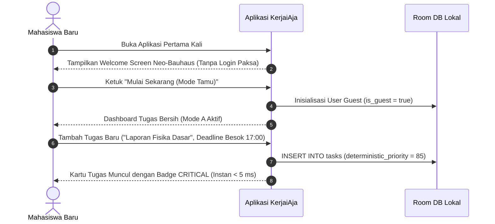
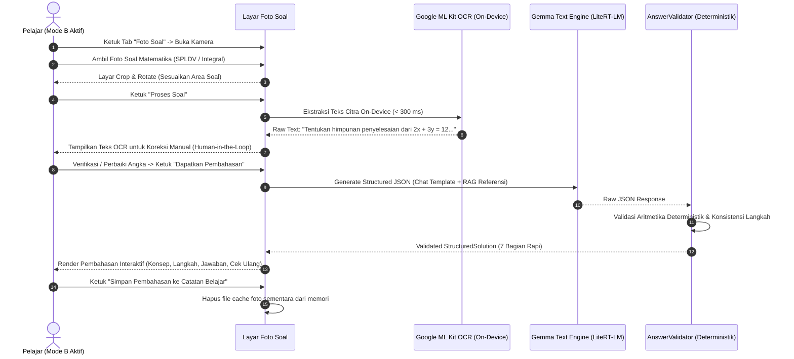
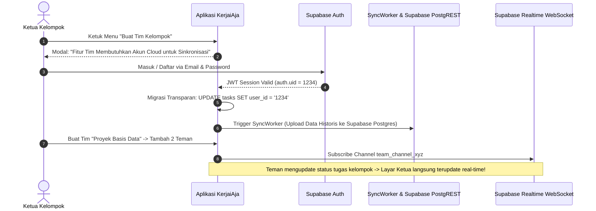

# Alur Pengguna (User Journeys) — KerjaiAja
## Pemetaan Pengalaman Pengguna: Dari Onboarding hingga Penyelesaian Soal

Dokumen ini memetakan alur perjalanan pengguna (*user journeys*) untuk interaksi inti KerjaiAja: Onboarding Guest-First, Manajemen Tugas Mode A, Asisten Kerja Mode B, dan Foto Soal & Pembahasan.

---

## 1. Journey 1: Guest-First Onboarding & Pembuatan Tugas Pertama (Mode A)

---

## 2. Journey 2: Alur Foto Soal & Pembahasan (Mode B — Jalur A OCR-First)

---

## 3. Journey 3: Kolaborasi Tim & Migrasi Akun Cloud

