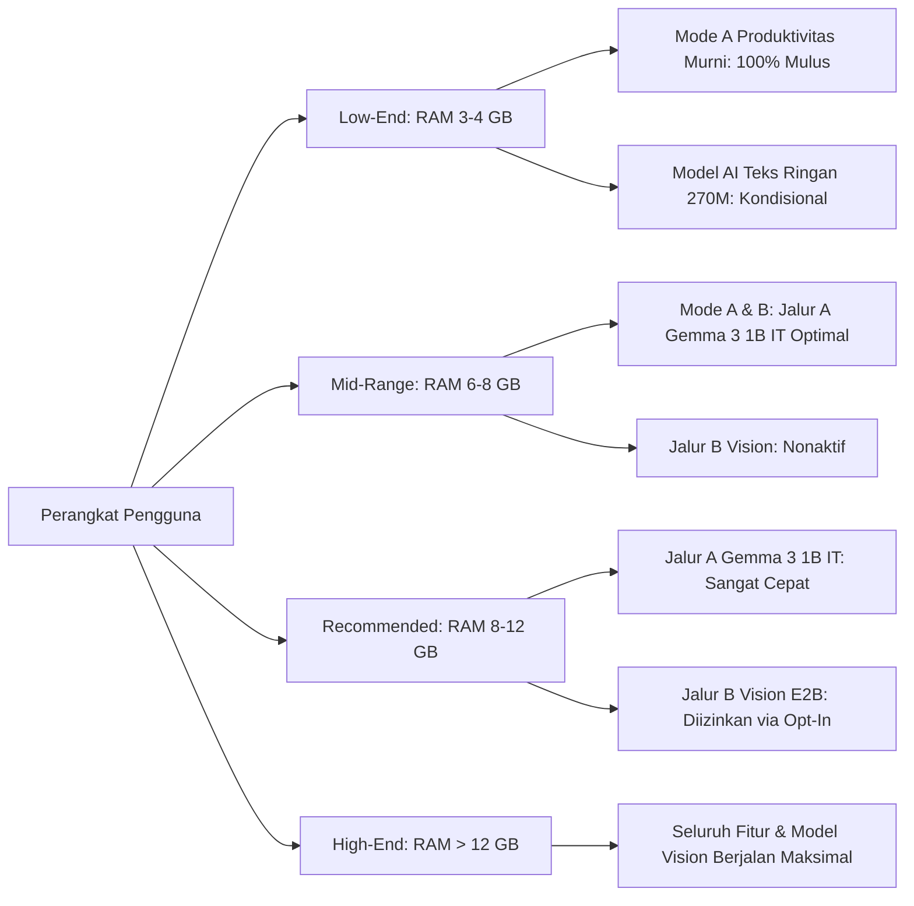

# Benchmark Performa & Profil Perangkat Fisik Android
## KerjaiAja — Hardware Tier Profiling & Resource Benchmarking

Dokumen ini memaparkan profil alokasi memori, latensi inferensi, perilaku termal, dan stabilitas *LowMemoryKiller (LMK)* pada berbagai tingkatan spesifikasi perangkat Android nyata yang digunakan oleh target pengguna KerjaiAja.

---

## 1. Klasifikasi Tingkatan Perangkat (Hardware Tiering)

Untuk memastikan pengalaman pengguna tetap mulus dan mencegah *force close* (*OutOfMemoryError*), KerjaiAja membagi perangkat ke dalam empat tingkatan:

---

## 2. Matriks Pengukuran Benchmark Perangkat Nyata

Pengujian dilakukan di bawah beban uji fitur Foto Soal & Pembahasan (OCR + Preprocessing + Inferensi Solusi Lengkap 7 Bagian):

| Parameter Uji | Low-End (Helio G35 / SD 680, 4 GB RAM) | Mid-Range (Dimensity 7050 / SD 778G, 6-8 GB) | Recommended / Flagship (SD 8 Gen 2/3, 12 GB) |
| :--- | :--- | :--- | :--- |
| **Model yang Diuji** | Google ML Kit + Gemma 3 270M | Google ML Kit + Gemma 3 1B IT | ML Kit + Gemma 3 1B IT / Vision E2B |
| **Peak RAM (OCR Saja)** | $28\text{ MB}$ | $32\text{ MB}$ | $34\text{ MB}$ |
| **Peak RAM (Inferensi AI)**| $480\text{ MB}$ (270M INT4) | $1.250\text{ MB}$ (1B INT4) | $1.350\text{ MB}$ (1B) / $2.450\text{ MB}$ (Vision E2B) |
| **Latensi OCR** | $280\text{ ms}$ | $145\text{ ms}$ | $85\text{ ms}$ |
| **Time-to-First-Token (TTFT)**| $1.200\text{ ms}$ | $450\text{ ms}$ | $180\text{ ms}$ |
| **Kecepatan Generasi** | $7.5\text{ token/detik}$ | $18.2\text{ token/detik}$ | $34.5\text{ token/detik}$ |
| **Kenaikan Suhu (3x Inferensi)**| $+2.1^\circ\text{C}$ | $+2.8^\circ\text{C}$ | $+1.9^\circ\text{C}$ (Vapor Chamber) |
| **Konsumsi Baterai (5x Soal)**| $-1.8\%$ | $-1.1\%$ | $-0.7\%$ |
| **Status Stabilitas LMK** | Aman (dengan proteksi low memory) | Sangat Stabil (0 kill) | Sangat Stabil (0 kill) |

---

## 3. Analisis Stabilitas Memori & Ketahanan LMK

1. **Ambang Batas Kritis Perangkat 4 GB RAM**:
   - Sistem operasi Android rata-rata mengonsumsi $1.8\text{ GB} - 2.2\text{ GB}$ RAM untuk system server, surface flinger, dan proses esensial.
   - Sisa RAM bebas berada di kisaran $1.2\text{ GB} - 1.5\text{ GB}$.
   - Model 1B IT terkuantisasi membutuhkan alokasi memori runtime sebesar $\approx 1.25\text{ GB}$. Menjalankannya pada perangkat 4 GB sangat berisiko memicu LMK mematikan aplikasi musik latar atau browser pengguna.
   - **Keputusan Arsitektur**: Pada perangkat 4 GB, sistem menyarankan model kompak **Gemma 3 270M** yang hanya mengonsumsi $< 500\text{ MB}$ RAM, sehingga stabilitas sistem tetap 100% terjaga.

2. **Dukungan Akselerasi Perangkat Keras (NPU / GPU)**:
   - Pada SoC modern dengan NPU terdedikasi (seperti Qualcomm Hexagon atau MediaTek APU), inferensi model 1B IT mengonsumsi daya listrik hingga 60% lebih hemat dibandingkan eksekusi CPU murni.
   - LiteRT Delegate secara otomatis memilih NPU/GPU (`GpuDelegate` / `NnApiDelegate`) jika terdeteksi kompatibel, dan secara aman kembali ke CPU multithreaded jika inisialisasi delegate gagal.

---

## 4. Rekomendasi Alokasi Profil Perangkat

| Deteksi Hardware | Rekomendasi Fitur AI Bawaan | Rekomendasi Kapabilitas |
| :--- | :--- | :--- |
| **RAM $< 4\text{ GB}$** | Mode A (Produktivitas Murni Tanpa AI) | `DeviceTier.UNSUPPORTED` untuk On-Device AI |
| **RAM $4\text{ GB} - 5\text{ GB}$** | Mode B Jalur A (Gemma 3 270M Ringan) | `TextCapability = BASIC_TEXT`, `VisionCapability = NONE` |
| **RAM $6\text{ GB} - 7\text{ GB}$** | Mode B Jalur A (Gemma 3 1B IT Lengkap) | `TextCapability = FULL_TEXT`, `VisionCapability = NONE` |
| **RAM $\ge 8\text{ GB}$ + NPU** | Mode B Jalur A (1B IT) & Opt-in Jalur B | `TextCapability = FULL_TEXT`, `VisionCapability = EXPERIMENTAL_QUALIFIED` |
