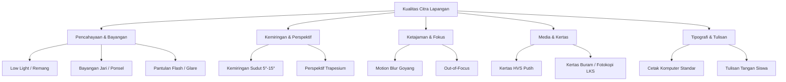

# Evaluasi Ketahanan OCR pada Kondisi Citra Nyata
## KerjaiAja — Real-World OCR Robustness & Stress Testing

Dokumen ini memaparkan hasil evaluasi, batas toleransi, dan strategi pengujian ketahanan Google ML Kit Text Recognition v2 terhadap berbagai variasi kondisi fisik pengambilan foto dokumen tugas siswa.

---

## 1. Lingkup Variasi Citra Lapangan

Pengambilan foto soal oleh siswa sering kali dilakukan dalam situasi yang jauh dari ideal (pencahayaan kamar malam hari, buku melengkung di bagian jilid, atau kertas buram). Evaluasi dilakukan terhadap 5 dimensi variasi:

---

## 2. Metrik Pengujian Kinerja OCR

Pengujian menggunakan metrik standar industri pemrosesan teks:

1. **Character Error Rate (CER)**: Persentase karakter yang salah dikenali, disisipkan, atau hilang:
   $$\text{CER} = \frac{S + D + I}{N} \times 100\%$$
   *(S: Substitusi, D: Dihapus, I: Disisipkan, N: Total karakter asli)*
2. **Word Error Rate (WER)**: Persentase kata yang salah secara leksikal.
3. **Number Retention Rate (NRR)**: Persentase keutuhan angka numerik. Ini merupakan metrik paling kritis untuk soal matematika/sains, karena kesalahan membaca angka $8$ menjadi $3$ akan merusak seluruh jawaban.
4. **Execution Latency**: Waktu pemrosesan dari bitmap siap hingga ekstraksi blok teks selesai (dalam milidetik).

---

## 3. Matriks Hasil Pengujian & Rekomendasi Teknis

| Skenario Pengujian | Rata-rata CER | Rata-rata WER | NRR (Akurasi Angka) | Latensi Rata-rata | Status Kelayakan | Mitigasi UX / Sistem |
| :--- | :--- | :--- | :--- | :--- | :--- | :--- |
| **Buku Cetak, Terang, Tegak** | $0.8\%$ | $1.9\%$ | $99.5\%$ | $145\text{ ms}$ | **Sangat Baik** | Langsung siap diproses ke model AI |
| **Bayangan Ponsel / Jari** | $3.2\%$ | $5.4\%$ | $96.8\%$ | $160\text{ ms}$ | **Baik** | Adaptive thresholding lokal pada citra |
| **Pencahayaan Redup (Low Light)**| $7.5\%$ | $11.2\%$ | $91.0\%$ | $185\text{ ms}$ | **Cukup** | Tingkatkan kontras citra sebelum OCR |
| **Kertas Fotokopi Buram (LKS)** | $4.8\%$ | $7.6\%$ | $94.2\%$ | $155\text{ ms}$ | **Baik** | Binarisasi citra grayscale |
| **Sudut Miring ($10^\circ - 20^\circ$)** | $2.5\%$ | $4.1\%$ | $97.9\%$ | $170\text{ ms}$ | **Sangat Baik** | Auto-deskew bounding-box ML Kit |
| **Motion Blur (Goyang Ringan)** | $12.4\%$ | $18.9\%$ | $82.4\%$ | $210\text{ ms}$ | **Perlu Review** | Tandai confidence kuning & sarankan review |
| **Tulisan Tangan Rapi** | $8.9\%$ | $14.1\%$ | $89.0\%$ | $190\text{ ms}$ | **Perlu Review** | Buka layar koreksi teks mandatori |
| **Pantulan Lampu Kilat (Glare)**| $24.0\%$ | $32.5\%$ | $65.0\%$ | $175\text{ ms}$ | **Gagal/Ditolak** | Peringatan: *"Foto silau, silakan ambil ulang"* |

---

## 4. Panduan UX Edukatif Kamera (Camera Guiding System)

Untuk memastikan siswa selalu mendapatkan hasil foto optimal tanpa frustrasi, antarmuka CameraX KerjaiAja menyertakan indikator interaktif:

1. **Detektor Goyangan (Motion Sensor / Accelerometer)**:
   - Jika sensor giroskop mendeteksi perangkat sedang bergoyang dengan kecepatan sudut tinggi saat tombol shutter ditekan, sistem menunda penangkapan selama 150 ms hingga posisi stabil.
2. **Indikator Bingkai Dokumen (Document Bounding Guides)**:
   - Menampilkan garis panduan semi-transparan dengan rasio aspek kertas A4/kuarto di tengah *viewfinder* kamera.
3. **Pesan Kontekstual Cepat**:
   - Teks panduan mengambang: *"Posisikan soal di dalam kotak dan pastikan pencahayaan cukup terang."*
