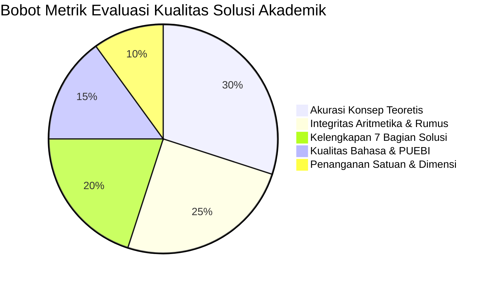

# Benchmark Kualitas 12 Rumpun Mata Pelajaran
## KerjaiAja — Academic Subject Evaluation Protocol

Dokumen ini mendefinisikan standar evaluasi, dataset uji, dan metrik kualitas pembahasan untuk **12 Rumpun Mata Pelajaran** pada fitur Foto Soal & Pembahasan di KerjaiAja.

---

## 1. Daftar 12 Rumpun Mata Pelajaran & Karakteristiknya

KerjaiAja mengklasifikasikan materi akademik ke dalam 12 rumpun utama berbasis Kurikulum Nasional (Kurikulum Merdeka) dan jenjang SMP–SMA/SMK serta Perguruan Tinggi Dasar:

| No | Rumpun Mata Pelajaran | Cakupan Materi Pokok | Tantangan Teknis Utama |
| :--- | :--- | :--- | :--- |
| 1 | **Matematika** | Aljabar, Geometri, Trigonometri, Kalkulus, Statistika, Peluang | Simbol pecahan, akar, integral, validitas aritmetika |
| 2 | **Fisika** | Kinematika, Dinamika, Termodinamika, Listrik & Magnet, Optik | Analisis vektor, konversi satuan, penurunan rumus |
| 3 | **Kimia** | Stoikiometri, Struktur Atom, Termokimia, Asam Basa, Reaksi Redoks | Persamaan reaksi setara, subskrip rumus kimia, mol |
| 4 | **Biologi** | Sitologi/Sel, Genetika, Ekologi, Anatomi & Fisiologi, Evolusi | Istilah taksonomi ilmiah, rantai sebab-akibat proses |
| 5 | **Bahasa Indonesia** | Analisis Teks, Kaidah PUEBI/EYD V, Ide Pokok Paragraf, Sastra | Kutipan teks panjang, interpretasi makna tersirat |
| 6 | **Bahasa Inggris** | *Reading Comprehension, Grammar/Tenses, Syntax, Idioms* | Kejelasan konteks, ketepatan analisis tata bahasa |
| 7 | **Sejarah** | Sejarah Indonesia, Sejarah Dunia, Kronologi Peristiwa, Tokoh | Akurasi tarikh/tahun peristiwa, kausalitas sejarah |
| 8 | **Geografi** | Litosfer, Atmosfer, Hidrosfer, Antroposfer, Analisis Peta/SIG | Hubungan sebab-akibat fenomena geologis & iklim |
| 9 | **Ekonomi** | Teori Permintaan-Penawaran, Neraca Akuntansi Dasar, Kebijakan | Kalkulasi elastisitas harga, jurnal penyesuaian |
| 10 | **Sosiologi** | Interaksi Sosial, Stratifikasi, Lembaga Sosial, Perubahan Sosial | Pemahaman konteks studi kasus kemasyarakatan |
| 11 | **PPKn** | Konstitusi UUD 1945, Hak Asasi Manusia, Tata Hukum, Kebangsaan | Rujukan pasal hukum, hierarki peraturan perundangan |
| 12 | **Materi Lainnya** | Informatika Dasar, Seni Budaya, Kewirausahaan, PJOK | Konsep logika dasar pemrograman, istilah seni & etika |

---

## 2. Metrik Pengukuran Kualitas Akademik

Kualitas jawaban AI dievaluasi menggunakan 5 metrik berbobot:



1. **Akurasi Konsep Teoretis (Bobot 30%)**:
   - Apakah hukum fisika, dalil matematika, atau prinsip teori sosial yang digunakan sudah tepat untuk menyelesaikan soal tersebut?
2. **Integritas Aritmetika & Rumus (Bobot 25%)**:
   - Apakah rumus disubstitusikan dengan benar dan hasil perhitungannya tepat (diverifikasi via layer deterministik)?
3. **Kelengkapan 7 Bagian Solusi (Bobot 20%)**:
   - Apakah seluruh 7 bagian (Identifikasi, Diketahui, Ditanya, Konsep, Langkah, Jawaban Akhir, Verifikasi) terpenuhi dengan runtut?
4. **Kualitas Bahasa & PUEBI (Bobot 15%)**:
   - Apakah penjelasan menggunakan Bahasa Indonesia akademik yang santun, logis, mudah dimengerti siswa, dan mematuhi kaidah EYD V?
5. **Penanganan Satuan & Dimensi (Bobot 10%)**:
   - Apakah satuan besaran (misal $Joule$, $m/s^2$, $mol$, $Rupiah$) konsisten dari tahap diketahui hingga jawaban akhir?

---

## 3. Protokol Benchmark Berulang (Subject Test Suite)

Evaluasi dilakukan pada setiap iterasi pembaruan bobot model atau pembaruan *system prompt*.

### Format Dataset Pengujian
Dataset uji terdiri dari 20 soal standar terkurasi untuk masing-masing rumpun mata pelajaran (total 240 soal benchmark) yang disimpan di `docs/quality/datasets/academic_benchmarks.json`.

Contoh entri data uji:
```json
{
  "subject": "Fisika",
  "topic": "Hukum Gerak Newton",
  "difficulty": "Medium",
  "rawQuestionText": "Sebuah benda bermassa 4 kg ditarik dengan gaya 20 N pada lantai licin. Tentukan percepatan benda tersebut!",
  "expectedFormulas": ["F = m * a", "a = F / m"],
  "expectedFinalAnswer": "5 m/s²",
  "requiredStepsCount": 3
}
```

### Ambang Batas Kelulusan Rilis (Pass Criteria)
Sebuah versi konfigurasi model dinyatakan lulus untuk rilis jika:
- Skor rata-rata Akurasi Konsep $\ge 85\%$ untuk mata pelajaran eksakta (Matematika, Fisika, Kimia).
- Skor rata-rata Akurasi Konsep $\ge 90\%$ untuk mata pelajaran sosial & bahasa.
- Kelengkapan 7 Bagian Solusi $= 100\%$ (dibantu oleh Markdown fallback regex).
- Tingkat kegagalan aritmetika fatal $\le 3\%$ pada tingkat validator deterministik.
