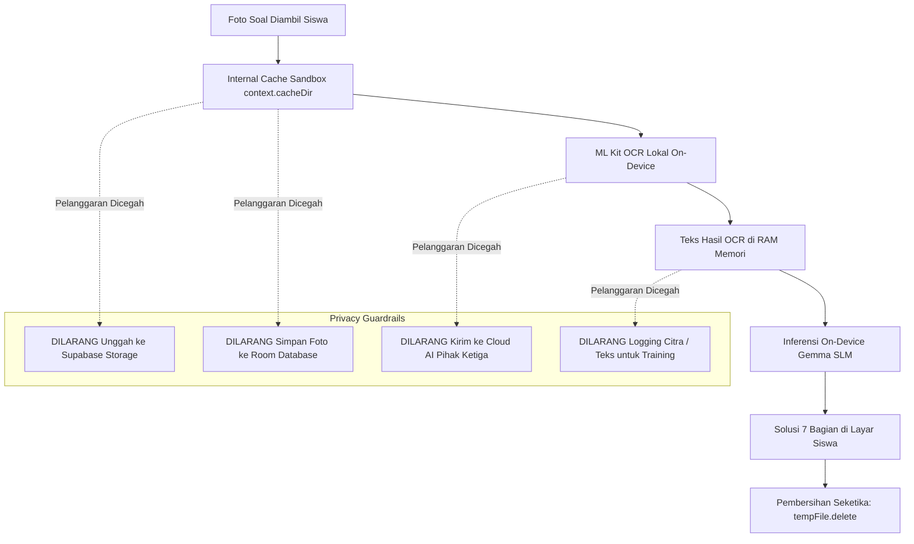

# Tinjauan Privasi & Perlindungan Data Pembelajaran
## KerjaiAja — Privacy Review & Ephemeral Data Processing

Dokumen ini memaparkan audit komprehensif terkait privasi data, perlindungan berkas citra, dan kepatuhan regulasi privasi untuk fitur **Foto Soal & Pembahasan** serta asisten belajar pada aplikasi KerjaiAja.

---

## 1. Prinsip Utama Privasi: Zero Image Cloud & Ephemeral by Design

Aplikasi KerjaiAja dirancang untuk pelajar dan mahasiswa yang sering kali berinteraksi dengan materi pembelajaran privat, lembar tugas sekolah, dan catatan pribadi. Sistem menerapkan lima pilar perlindungan privasi:



1. **Zero Cloud Image Upload**: Berkas foto soal tidak pernah dikirim atau diunggah ke Supabase Storage, server perantara, atau API eksternal mana pun. Seluruh siklus hidup citra berada di perangkat siswa.
2. **Siklus Hidup Efemeral (Ephemeral Lifecycle)**: Berkas citra sementara (*temporary cache*) hanya hidup selama sesi penangkapan dan OCR. Segera setelah ekstraksi teks selesai atau pengguna membatalkan proses, berkas fisik dihapus dari disk penyimpanan internal (`tempFile.delete()`).
3. **Pemisahan Penyimpanan Database**: Room Database hanya menyimpan metadata tugas dan catatan teks yang secara sadar disimpan oleh pengguna. Citra biner (*BLOB*) foto soal tidak pernah disimpan di Room Database.
4. **Zero Model Retraining & Zero Telemetry Harvesting**: Tidak ada pengumpulan data soal atau riwayat belajar siswa untuk keperluan pelatihan ulang model AI (*model training/fine-tuning*).
5. **Human-in-the-Loop Consent**: Pengguna memiliki visibilitas penuh atas teks yang diekstrak dan secara eksplisit menyetujui sebelum teks tersebut diproses oleh model asisten lokal.

---

## 2. Kepatuhan Regulasi & Kebijakan Platform

### Kepatuhan UU PDP (Undang-Undang Pelindungan Data Pribadi No. 27 Tahun 2022)
- **Prinsip Minimasi Data**: KerjaiAja hanya memproses data teks yang mutlak diperlukan untuk menyelesaikan tugas akademik yang diminta pengguna.
- **Batasan Tujuan (*Purpose Limitation*)**: Data pemrosesan citra hanya digunakan untuk fungsi OCR instan dan tidak dialihkan untuk profiling iklan, pelacakan analitik perilaku, atau komersialisasi pihak ketiga.
- **Hak Subjek Data**: Siswa dapat menghapus seluruh riwayat tugas lokal secara instan melalui menu Pengaturan Privasi Aplikasi (*Clear All Local Data*).

### Kepatuhan Google Play Store Families Policy
- Karena sebagian besar pengguna KerjaiAja adalah siswa sekolah (termasuk usia di bawah 18 tahun):
  - Aplikasi **tidak menggunakan SDK pelacak pihak ketiga** yang mengumpulkan Advertising ID (GAID).
  - Kamera hanya diakses saat pengguna secara sadar menekan tombol foto soal (*runtime permission* dengan konteks transparan).
  - Tidak ada transmisi citra ke server mana pun yang berpotensi melanggar ketentuan privasi anak (*Child Safety & Privacy Regulations*).

---

## 3. Prosedur Pembersihan Berkas Temporer (Technical Verification)

Implementasi pembersihan cache pada komponen `ImageCaptureManager.kt`:

```kotlin
fun cleanupTemporaryFiles(context: Context) {
    val tempDir = File(context.cacheDir, "temp_solver")
    if (tempDir.exists() && tempDir.isDirectory) {
        tempDir.listFiles()?.forEach { file ->
            try {
                file.delete()
            } catch (e: Exception) {
                Log.w("PrivacyReview", "Gagal menghapus file temporer: ${file.name}", e)
            }
        }
    }
}
```

Pembersihan ini dipanggil pada tiga titik kritis:
1. Saat pengguna menekan tombol "Selesai" atau "Batal" di antarmuka kamera/review.
2. Saat `ViewModel` menyelesaikan siklus hidupnya (`onCleared()`).
3. Pada saat inisialisasi aplikasi (`Application.onCreate()`) untuk memastikan tidak ada sisa file jika aplikasi sebelumnya ditutup paksa (*force closed*) oleh OS.

---

## 4. Audit Keamanan Data Sync Supabase

Ketika pengguna memilih menggunakan akun cloud (Mode B - Hybrid Sync):
- Data yang disinkronkan ke Supabase PostgreSQL **hanya**:
  - Judul mata pelajaran, judul tugas, tenggat waktu, status penyelesaian, dan skor prioritas deterministik.
- Berkas foto soal **100% dikecualikan** dari sinkronisasi cloud.
- Kuota Supabase Storage Free Tier (1 GB) dialokasikan secara murni untuk lampiran dokumen tugas umum (PDF/dokumen teks) yang secara sadar diunggah pengguna untuk tugas kelompok, bukan untuk penampungan foto soal sementara.
