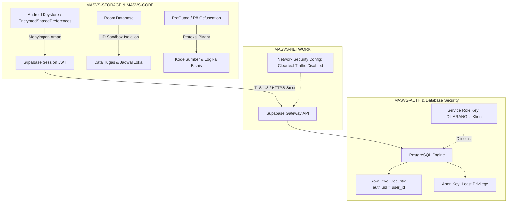

# Tinjauan Keamanan Aplikasi & Arsitektur BaaS
## KerjaiAja — Security Review & OWASP MASVS Compliance

Dokumen ini memaparkan audit komprehensif terkait postur keamanan aplikasi Android KerjaiAja, arsitektur Row Level Security (RLS) Supabase, serta kepatuhan terhadap standar **OWASP Mobile Application Security Verification Standard (MASVS v2.0)**.

---

## 1. Arsitektur Keamanan Bertingkat (Defense in Depth)

KerjaiAja menerapkan pertahanan keamanan berlapis yang mencakup sisi klien (*Android Native Client*), komunikasi jaringan (*Transport Layer*), dan sisi backend (*Supabase Managed Infrastructure*):



---

## 2. Pemenuhan Standar OWASP MASVS

### MASVS-STORAGE (Penyimpanan Data Aman)
1. **Penyimpanan Token Otentikasi**:
   - Token sesi (*JWT Access & Refresh Token*) dikelola oleh `supabase-kt` dengan integrasi aman ke `EncryptedSharedPreferences` yang dienkripsi menggunakan kunci master AES-256-GCM dari **Android Keystore hardware-backed provider**.
2. **Isolasi Database Lokal (Room)**:
   - File database SQLite tersimpan di direktori aplikasi privat (`/data/data/com.kerjaiaja.app/databases/`) dengan hak akses `0600` (hanya UID aplikasi yang memiliki akses baca-tulis).
   - Perangkat yang di-*root* dideteksi melalui modul `RootDetector` ringan untuk memberikan peringatan risiko integritas data kepada pengguna.
3. **Penyimpanan Citra Efemeral**:
   - Foto soal tidak pernah ditulis ke media eksternal publik (`Environment.getExternalStorageDirectory()`) dan langsung dibersihkan setelah inferensi.

### MASVS-NETWORK (Keamanan Jaringan & Transport Layer)
1. **Enkripsi Komunikasi**: Seluruh pertukaran data dengan Supabase dilakukan via HTTPS dengan protokol minimal TLS 1.2 (diutamakan TLS 1.3) menggunakan cipher suite terverifikasi.
2. **Network Security Config**:
   ```xml
   <!-- res/xml/network_security_config.xml -->
   <?xml version="1.0" encoding="utf-8"?>
   <network-security-config>
       <base-config cleartextTrafficPermitted="false">
           <trust-anchors>
               <certificates src="system" />
           </trust-anchors>
       </base-config>
   </network-security-config>
   ```
   Atribut `cleartextTrafficPermitted="false"` mencegah kebocoran data melalui protokol HTTP yang tidak terenkripsi.

### MASVS-AUTH & DATABASE (Otentikasi & Otorisasi Ketat)
1. **Prinsip Least Privilege pada Supabase API**:
   - Binary APK Android **HANYA** memuat `SUPABASE_ANON_KEY` (kunci publik).
   - `SERVICE_ROLE_KEY` (kunci bypass admin) **SECARA MUTLAK DILARANG** berada di dalam kode sumber, aset, maupun konfigurasi Android.
2. **Row Level Security (RLS) Mandatori**:
   - Seluruh tabel publik pada PostgreSQL Supabase memiliki status `ENABLE ROW LEVEL SECURITY`.
   - Tidak ada tabel yang dapat dibaca atau ditulis oleh pengguna tanpa melalui verifikasi identitas `auth.uid() = user_id`:
     ```sql
     CREATE POLICY "User hanya dapat mengelola tugas miliknya"
     ON public.tasks
     FOR ALL
     USING (auth.uid() = user_id)
     WITH CHECK (auth.uid() = user_id);
     ```

### MASVS-CODE (Integritas Kode & Nol Kebocoran Rahasia)
1. **Obfuscation & Shrinking**:
   - Build tipe *Release* mengaktifkan R8/ProGuard untuk mengacak nama kelas, fungsi, dan variabel sehingga mencegah analisis biner secara mudah.
2. **Zero External AI Token Exposure**:
   - Karena KerjaiAja menggunakan model *On-Device AI* (Google Gemma) yang berjalan lokal melalui LiteRT, **TIDAK ADA token API eksternal** (seperti OpenAI API Key, Anthropic Key, atau Google AI Studio Key) di dalam kode aplikasi. Hal ini mengeliminasi 100% risiko pencurian token API komersial.

---

## 3. Kebijakan Integritas Infrastruktur Supabase

KerjaiAja memegang prinsip integritas tinggi dalam memanfaatkan layanan BaaS Supabase:
- **Penghapusan Skrip Manipulatif**: Menolak penggunaan skrip GitHub Actions otomatis yang melakukan *ping* atau *dummy query* berkala untuk mengelabui mekanisme *project pause* pada akun gratis Supabase.
- **Transparansi Kuota Free Tier**: Aplikasi memonitor ukuran data secara mandiri dan memberi tahu pengguna apabila kuota penyimpanan gratis mendekati ambang batas, dengan rekomendasi pengelolaan data secara jujur dan legal.
