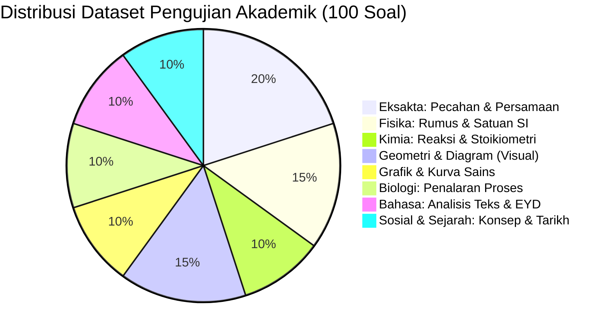

# Rencana Pengujian Fitur Foto Soal & Pembahasan
## KerjaiAja — Photo Question Solver Comprehensive Test Plan

Dokumen ini mendefinisikan rencana pengujian komprehensif untuk fitur **Foto Soal & Pembahasan**, mencakup dataset pengujian 12 rumpun mata pelajaran, variasi kondisi citra lapangan, pemisahan metrik OCR vs akurasi jawaban, serta verifikasi penghapusan berkas citra efemeral.

---

## 1. Tujuan & Ruang Lingkup Pengujian

Pengujian ini bertujuan memvalidasi bahwa:
1. **Pipeline Pemrosesan Citra Efemeral:** Kamera/galeri $\rightarrow$ crop/rotate $\rightarrow$ ML Kit OCR $\rightarrow$ review pengguna $\rightarrow$ inferensi model on-device $\rightarrow$ validasi jawaban 7 bagian berfungsi mulus tanpa memory leak atau force close.
2. **Pemisahan Pengukuran OCR vs AI:** Mengukur secara terpisah antara akurasi pembacaan karakter fisik OCR (*Character Error Rate*) dan kebenaran penalaran ilmiah AI (*Answer Correctness*).
3. **Ketahanan Validasi Deterministik:** Memastikan layer `AnswerValidator` mampu menangkap kesalahan aritmetika dan format solusi yang tidak lengkap sebelum disajikan ke siswa.
4. **Jaminan Privasi:** Memverifikasi secara teknis bahwa berkas citra sementara selalu terhapus dari disk setelah sesi selesai dan tidak ada transmisi foto ke Supabase Storage.

---

## 2. Struktur Dataset Pengujian Akademik

Dataset uji terstandardisasi mencakup 10 kategori materi akademik (total 100 soal terkurasi):



### Rincian 10 Kategori Dataset Uji:

| No | Kategori Dataset | Deskripsi Materi Uji | Fokus Pengujian & Toleransi |
| :--- | :--- | :--- | :--- |
| 1 | **Teks Biasa Deskriptif** | Soal pilihan ganda Sejarah, Sosiologi, PPKn | Ekstraksi teks cepat, akurasi penalaran teoretis |
| 2 | **Pecahan & Pangkat** | Aljabar Matematika: pecahan bersusun, $\sqrt{x}$, $x^n$ | Evaluasi akurasi OCR simbol & toolbar peninjauan |
| 3 | **Persamaan & Matriks** | Sistem persamaan linear, determinan matriks $2\times 2$ | Penataan baris teks persamaan, penurunan aljabar |
| 4 | **Fisika dengan Satuan SI** | Dinamika Newton, energi kinetik, hukum Ohm | Konsistensi konversi satuan ($cm \rightarrow m$), verifikasi rumus |
| 5 | **Kimia & Stoikiometri** | Penyetaraan reaksi kimia, konsep mol, konsentrasi | Subskrip rumus kimia ($H_2SO_4$), perhitungan mol |
| 6 | **Biologi Ilmiah** | Sitologi sel, genetika Mendel, rantai makanan | Istilah taksonomi ilmiah, hubungan kausalitas |
| 7 | **Diagram Geometri** | Segitiga siku-siku Pythagoras, sudut lingkaran | Pemahaman relasi visual (uji banding Jalur A vs Jalur B) |
| 8 | **Grafik Kurva Sains** | Grafik kecepatan $v-t$, kurva penawaran ekonomi | Pembacaan sumbu koordinat dan interpretasi tren |
| 9 | **Bahasa Indonesia & EYD** | Analisis ide pokok paragraf, perbaikan ejaan | Pemahaman teks panjang, rujukan kutipan kalimat |
| 10 | **Bahasa Inggris** | *Reading Comprehension*, analisis tenses | Grammar consistency, sinonim dan antonim kata |

---

## 3. Matriks Pengujian Ketahanan Citra OCR (8 Skenario Lapangan)

Pengujian dilakukan terhadap variasi kondisi fisik pengambilan foto dokumen:

| ID | Skenario Citra | Kondisi Fisik Uji | Ekspektasi Sistem | Kriteria Lolos |
| :--- | :--- | :--- | :--- | :--- |
| **IMG-01** | Buku Cetak Standar | Cahaya ruangan terang ($> 300\text{ lux}$), tegak | OCR langsung diproses tanpa peringatan | CER $\le 1.0\%$, NRR $\ge 99.0\%$ |
| **IMG-02** | Bayangan Ponsel/Jari | Sebagian teks tertutup bayangan lembut | Binarisasi adaptif lokal memperjelas teks | CER $\le 3.5\%$, NRR $\ge 96.0\%$ |
| **IMG-03** | Cahaya Rendah (Malam) | Ruang redup ($< 50\text{ lux}$), tanpa flash | Peningkatan kontras otomatis | CER $\le 8.0\%$, NRR $\ge 90.0\%$ |
| **IMG-04** | Kertas Fotokopi LKS | Kertas buram abu-abu bertekstur kasar | Auto-thresholding memisahkan teks & background | CER $\le 5.0\%$, NRR $\ge 94.0\%$ |
| **IMG-05** | Kemiringan Sudut ($15^\circ$)| Dokumen difoto miring dari perspektif samping | Auto-deskew bounding-box ML Kit | CER $\le 3.0\%$, NRR $\ge 97.0\%$ |
| **IMG-06** | Motion Blur Ringan | Ponsel bergerak pelan saat memotret | Deteksi varians Laplacian $< 100$, peringatan review | Menampilkan banner kuning review |
| **IMG-07** | Tulisan Tangan Rapi | Tulisan tangan pena hitam di kertas bergaris | Deteksi kata confidence rendah ditandai garis bawah | Review screen wajib terbuka |
| **IMG-08** | Pantulan Flash (Glare) | Kertas glossy dengan titik pantulan putih | Deteksi area saturasi putih $> 25\%$ | Peringatan: *"Foto silau, silakan retake"* |

---

## 4. Pemisahan Metrik: OCR Accuracy vs Answer Correctness

Protokol pengujian memisahkan secara tegas dua tahap evaluasi:

```text
[TAHAP 1: EVALUASI OCR (Google ML Kit)]
├── Character Error Rate (CER) = (S + D + I) / N * 100%
├── Word Error Rate (WER) = (Substitusi + Hapus + Sisip) / Total Kata * 100%
└── Number Retention Rate (NRR) = Angka Numerik Benar / Total Angka Asli * 100%

[TAHAP 2: EVALUASI JAWABAN AKADEMIK (Gemma + AnswerValidator)]
├── Kelengkapan Skema: 7 Bagian wajib terisi (100% kelulusan)
├── Akurasi Konsep Ilmiah: Skor evaluasi kebenaran dalil/teori (Target >= 85%)
├── Integritas Aritmetika Deterministik: Validasi ekspresi A [op] B = C (0% fatal discrepancy)
└── Konsistensi Dimensi/Satuan: Keselarasan satuan input terhadap jawaban akhir
```

---

## 5. Prosedur Verifikasi Privasi Citra Efemeral

Setiap kali skenario pengujian di atas dijalankan:
1. **Pemeriksaan Direktori Cache:**  
   Memverifikasi bahwa berkas sementara pada `context.cacheDir/temp_solver/` benar-benar terhapus setelah solusi ditampilkan ke layar:
   ```kotlin
   val tempFiles = context.cacheDir.resolve("temp_solver").listFiles()
   assertTrue(tempFiles.isNullOrEmpty(), "Direktori cache harus kosong setelah inferensi selesai")
   ```
2. **Pemeriksaan Network Traffic (Zero Upload):**  
   Memantau HTTP traffic menggunakan Network Profiler Android Studio untuk memastikan tidak ada permintaan POST/PUT ke bucket Supabase Storage selama proses foto soal berlangsung.
